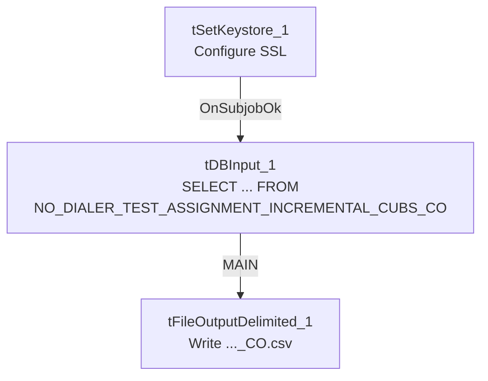

# Talend Job: Extract_No_Dialer_Test_CO

## Overview

Extracts the CO-site "no dialer test" debtor assignment (logon, debtor number, and a flag indicating the debtor is excluded from dialer campaigns as part of a test) from a Snowflake table scoped to CO, and writes it to a dated CSV file. Unlike its two siblings in this batch (`Extract_No_Dialer_Test_CHI` and `Extract_No_Dialer_Test_DC`), **this job is internally consistent** — its query and output filename both correctly reference CO.

## Detail table

| Field | Value |
|---|---|
| Job name | Extract_No_Dialer_Test_CO |
| Version | 0.1 |
| Project | EDW2SF |
| Author | jmach@harriscollect.com |
| Created | 2022-09-07T15:46:59.598-0700 |
| Last Modified | 2025-11-19T07:57:05.670-0800 |

## Step-by-step data flow

This job has no `tPrejob`/`tPostjob` and no explicit `tSnowflakeConnection`/`tSnowflakeClose` — just two steps gated by an SSL setup:

1. `tSetKeystore_1` configures SSL trust/keystore from `context.keystorePath` (passwords redacted).
2. On success (`OnSubjobOk`), `tDBInput_1` runs `SELECT LOGON, DEBTORNUMBER, TEST_NO_DIALER FROM NO_DIALER_TEST_ASSIGNMENT_INCREMENTAL_CUBS_CO;` — correctly querying the CO table.
3. `tFileOutputDelimited_1` writes the result to `context.outputDir + "NO_DIALER_TEST_ASSIGNMENT_INCREMENTAL_CUBS_" + <CCYYMMDD> + "_CO.csv"` — correctly named for CO.

## Settings tables

### Source: `tDBInput_1` (`tSnowflakeInput`)

| Setting | Value | What it means |
|---|---|---|
| Query | `SELECT LOGON, DEBTORNUMBER, TEST_NO_DIALER FROM NO_DIALER_TEST_ASSIGNMENT_INCREMENTAL_CUBS_CO;` | Correctly scoped to CO — consistent with the job name. |

### Target: `tFileOutputDelimited_1`

| Setting | Value | What it means |
|---|---|---|
| FILENAME | `context.outputDir + "NO_DIALER_TEST_ASSIGNMENT_INCREMENTAL_CUBS_"+TalendDate.getDate("CCYYMMDD")+"_CO.csv"` | Correctly suffixed `_CO`. |

### SSL setup: `tSetKeystore_1`

| Setting | Value | What it means |
|---|---|---|
| SSL_TRUSTSERVER_TRUSTSTORE | `"C:/clientTrustStore.trustStore"` | Hardcoded local path, same as the `*_Hermes_Decile` family — see Issues observed. |
| SSL_KEYSTORE | `context.keystorePath` | Client keystore path is context-driven. |
| SSL_TRUSTSERVER_PASSWORD / SSL_KEYSTORE_PASSWORD / NEED_CLIENT_AUTH | `***REDACTED***` | Preserved as redacted. |

## Dependencies & configuration

- **Triggers/depends on other jobs:** none — no `tRunJob` links found.
- **Context variables used:** `keystorePath`, `outputDir`.
- **1 hardcoded path finding:** `tSetKeystore_1.SSL_TRUSTSERVER_TRUSTSTORE` = `"C:/clientTrustStore.trustStore"`.

## Glossary

| Component type | Plain-English meaning |
|---|---|
| `tSetKeystore` | Configures SSL/TLS trust and client keystore settings for the Snowflake connection used later in the job. |
| `tSnowflakeInput` | Runs a query against Snowflake and returns its result rows. |
| `tFileOutputDelimited` | Writes rows to a delimited (CSV-style) text file. |

## Issues observed

- **This job is correctly self-consistent, unlike its two siblings in this batch.** `Extract_No_Dialer_Test_CHI` actually queries and outputs DC data, and `Extract_No_Dialer_Test_DC` actually queries and outputs CHI data — a swapped-site bug between those two jobs (see their own docs for full detail). This CO job has no such problem: its query table and output filename both correctly say `CO` throughout. This confirms the swap is specific to the CHI/DC pair, not a systemic pattern across the whole "No_Dialer_Test" family.
- **`SSL_TRUSTSERVER_TRUSTSTORE` is a hardcoded local path**, consistent with the same setting across the `*_Hermes_Decile` family.
- **No `tPrejob`/`tPostjob`, no explicit Snowflake connection-open/close component, and no error/row-count logging** — same minimal-scaffolding pattern as its siblings; a failure would only surface as a generic Talend execution error.
