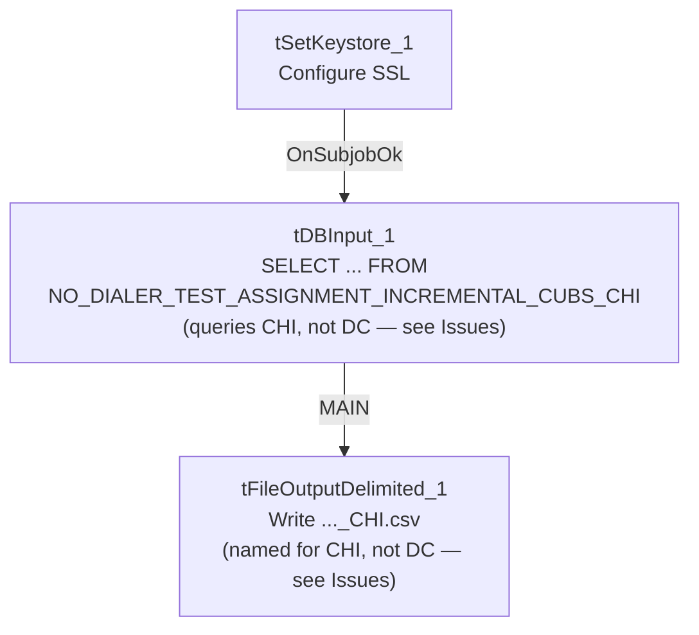

# Talend Job: Extract_No_Dialer_Test_DC

## Overview

This job is named for the DC site, but **its query and output filename both actually reference CHI, not DC** — it reads `NO_DIALER_TEST_ASSIGNMENT_INCREMENTAL_CUBS_CHI` and writes a file named `..._CHI.csv`. This is the mirror-image counterpart of `Extract_No_Dialer_Test_CHI` (which reads and outputs DC data instead), confirming a site-code swap between these two specific jobs in the batch — the third sibling, `Extract_No_Dialer_Test_CO`, is unaffected and internally consistent.

## Detail table

| Field | Value |
|---|---|
| Job name | Extract_No_Dialer_Test_DC |
| Version | 0.1 |
| Project | EDW2SF |
| Author | jmach@harriscollect.com |
| Created | 2022-09-07T15:50:35.783-0700 |
| Last Modified | 2025-11-19T07:56:44.249-0800 |

## Step-by-step data flow

This job has no `tPrejob`/`tPostjob` and no explicit `tSnowflakeConnection`/`tSnowflakeClose` — just two steps gated by an SSL setup:

1. `tSetKeystore_1` configures SSL trust/keystore from `context.keystorePath` (passwords redacted).
2. On success (`OnSubjobOk`), `tDBInput_1` runs `SELECT LOGON, DEBTORNUMBER, TEST_NO_DIALER FROM NO_DIALER_TEST_ASSIGNMENT_INCREMENTAL_CUBS_CHI;` — **querying the CHI table, not a DC one**.
3. `tFileOutputDelimited_1` writes the result to `context.outputDir + "NO_DIALER_TEST_ASSIGNMENT_INCREMENTAL_CUBS_" + <CCYYMMDD> + "_CHI.csv"` — **also named for CHI**.

## Settings tables

### Source: `tDBInput_1` (`tSnowflakeInput`)

| Setting | Value | What it means |
|---|---|---|
| Query | `SELECT LOGON, DEBTORNUMBER, TEST_NO_DIALER FROM NO_DIALER_TEST_ASSIGNMENT_INCREMENTAL_CUBS_CHI;` | This job, named `Extract_No_Dialer_Test_DC`, actually reads the **CHI**-suffixed table. |

### Target: `tFileOutputDelimited_1`

| Setting | Value | What it means |
|---|---|---|
| FILENAME | `context.outputDir + "NO_DIALER_TEST_ASSIGNMENT_INCREMENTAL_CUBS_"+TalendDate.getDate("CCYYMMDD")+"_CHI.csv"` | Also suffixed `_CHI`, matching the query's actual (CHI) scope, but not the job's own DC-suggesting name. |

### SSL setup: `tSetKeystore_1`

| Setting | Value | What it means |
|---|---|---|
| SSL_TRUSTSERVER_TRUSTSTORE | `"C:/clientTrustStore.trustStore"` | Hardcoded local path, same as the `*_Hermes_Decile` family — see Issues observed. |
| SSL_KEYSTORE | `context.keystorePath` | Client keystore path is context-driven. |
| SSL_TRUSTSERVER_PASSWORD / SSL_KEYSTORE_PASSWORD / NEED_CLIENT_AUTH | `***REDACTED***` | Preserved as redacted. |

## Dependencies & configuration

- **Triggers/depends on other jobs:** none — no `tRunJob` links found.
- **Context variables used:** `keystorePath`, `outputDir`.
- **1 hardcoded path finding:** `tSetKeystore_1.SSL_TRUSTSERVER_TRUSTSTORE` = `"C:/clientTrustStore.trustStore"`.

## Glossary

| Component type | Plain-English meaning |
|---|---|
| `tSetKeystore` | Configures SSL/TLS trust and client keystore settings for the Snowflake connection used later in the job. |
| `tSnowflakeInput` | Runs a query against Snowflake and returns its result rows. |
| `tFileOutputDelimited` | Writes rows to a delimited (CSV-style) text file. |

## Issues observed

- **This is a confirmed site-code swap bug, not a naming quibble.** `Extract_No_Dialer_Test_DC`'s query reads `NO_DIALER_TEST_ASSIGNMENT_INCREMENTAL_CUBS_CHI` and its output file is named `..._CHI.csv` — both internals point to CHI, the mirror image of `Extract_No_Dialer_Test_CHI`'s DC-pointing internals. The third sibling, `Extract_No_Dialer_Test_CO`, is internally consistent (queries and outputs `..._CO`), which rules out a systemic bug across the whole family and narrows it specifically to this CHI/DC pair. **The practical effect: whatever process runs "the DC no-dialer-test extract" today is actually extracting and delivering CHI's no-dialer-test assignment data, and vice versa.** This should be confirmed and fixed with the team — it directly affects which site's debtors are excluded from dialer campaigns based on this test assignment data. See `job_Extract_No_Dialer_Test_CHI.md` for the paired analysis.
- **`SSL_TRUSTSERVER_TRUSTSTORE` is a hardcoded local path**, consistent with the same setting across the `*_Hermes_Decile` family.
- **No `tPrejob`/`tPostjob`, no explicit Snowflake connection-open/close component, and no error/row-count logging** — same minimal-scaffolding pattern as its siblings; a failure would only surface as a generic Talend execution error.
