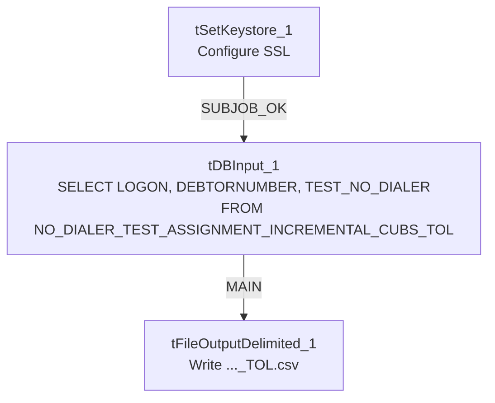

# Talend Job: Extract_No_Dialer_Test_TOL

## Overview

Extracts the "no-dialer-test" debtor assignment list for the TOL site — logon, debtor number, and a `TEST_NO_DIALER` flag — from a Snowflake table and writes it to a dated CSV file. This is one of at least five near-identical `Extract_No_Dialer_Test_<site>` jobs (CHI, CO, DC, HH, TOL) that share the same two-step shape; unlike the `CHI`/`DC` pair (documented separately, see Issues observed), this job's query and output filename are internally consistent — both point to `TOL`.

## Detail table

| Field | Value |
|---|---|
| Job name | Extract_No_Dialer_Test_TOL |
| Version | 0.1 |
| Project | EDW2SF |
| Author | jmach@harriscollect.com |
| Created | 2024-05-24T09:07:58.551-0700 |
| Last Modified | 2025-11-19T07:55:50.305-0800 |

## Step-by-step data flow

This job has no `tPrejob`/`tPostjob` and no explicit `tSnowflakeConnection`/`tSnowflakeClose` — just two steps gated by an SSL setup:

1. `tSetKeystore_1` configures SSL trust/keystore from `context.keystorePath` (passwords redacted).
2. On success (`SUBJOB_OK` / "OnSubjobOk"), `tDBInput_1` runs `SELECT LOGON, DEBTORNUMBER, TEST_NO_DIALER FROM NO_DIALER_TEST_ASSIGNMENT_INCREMENTAL_CUBS_TOL;` — querying the **TOL**-suffixed table, matching the job's own name.
3. `tFileOutputDelimited_1` (connected via `MAIN`) writes the result to `context.outputDir + "NO_DIALER_TEST_ASSIGNMENT_INCREMENTAL_CUBS_" + <CCYYMMDD> + "_TOL.csv"` — also named for TOL.

## Settings tables

### Source: `tDBInput_1` (`tSnowflakeInput`)

| Setting | Value | What it means |
|---|---|---|
| Query | `SELECT LOGON, DEBTORNUMBER, TEST_NO_DIALER FROM NO_DIALER_TEST_ASSIGNMENT_INCREMENTAL_CUBS_TOL;` | Reads the TOL-suffixed table — consistent with this job's name. |

### Target: `tFileOutputDelimited_1`

| Setting | Value | What it means |
|---|---|---|
| FILENAME | `context.outputDir + "NO_DIALER_TEST_ASSIGNMENT_INCREMENTAL_CUBS_"+TalendDate.getDate("CCYYMMDD")+"_TOL.csv"` | Dated CSV, suffixed `_TOL` — consistent with the query's scope and the job's own name. |
| FIELDSEPARATOR / INCLUDEHEADER | `,` / true | Standard comma-delimited CSV with a header row. |
| ENCODING | `ISO-8859-15` | Non-default encoding — consistent across this job family. |
| APPEND | `false` | File is overwritten each run, not appended to. |

### SSL setup: `tSetKeystore_1`

| Setting | Value | What it means |
|---|---|---|
| SSL_TRUSTSERVER_TRUSTSTORE | `"C:/clientTrustStore.trustStore"` | Hardcoded local path, same as the `*_Hermes_Decile` and sibling `Extract_No_Dialer_Test_*` jobs — see Issues observed. |
| SSL_KEYSTORE | `context.keystorePath` | Client keystore path is context-driven. |
| SSL_TRUSTSERVER_PASSWORD / SSL_KEYSTORE_PASSWORD / NEED_CLIENT_AUTH | `***REDACTED***` | Preserved as redacted. |

## Dependencies & configuration

- **Triggers/depends on other jobs:** none — `runjob_targets` is empty in this job's metadata.
- **Context variables used:** `keystorePath`, `outputDir`.
- **1 hardcoded path finding:** `tSetKeystore_1.SSL_TRUSTSERVER_TRUSTSTORE` = `"C:/clientTrustStore.trustStore"`.

## Glossary

| Component type | Plain-English meaning |
|---|---|
| `tSetKeystore` | Configures SSL/TLS trust and client keystore settings for the Snowflake connection used later in the job. |
| `tSnowflakeInput` | Runs a query against Snowflake and returns its result rows. |
| `tFileOutputDelimited` | Writes rows to a delimited (CSV-style) text file. |

## Issues observed

- **This job's site internals are consistent (no swap bug).** Two siblings in this family, `Extract_No_Dialer_Test_CHI` and `Extract_No_Dialer_Test_DC`, were found to have had their query/filename site codes swapped with each other (CHI's job reads and writes DC data, and vice versa — see `job_Extract_No_Dialer_Test_CHI.md` and `job_Extract_No_Dialer_Test_DC.md`). This job (`Extract_No_Dialer_Test_TOL`) was checked against that same pattern: its query reads `..._CUBS_TOL` and its output file is named `..._TOL.csv` — both match its own name, so it does **not** exhibit the CHI/DC swap issue.
- **`SSL_TRUSTSERVER_TRUSTSTORE` is a hardcoded local path** (`"C:/clientTrustStore.trustStore"`), consistent with the same setting across the `*_Hermes_Decile` family and the other `Extract_No_Dialer_Test_*` siblings.
- **No `tPrejob`/`tPostjob`, no explicit Snowflake connection-open/close component, and no error/row-count logging** — same minimal-scaffolding pattern as its siblings; a failure would only surface as a generic Talend execution error.
