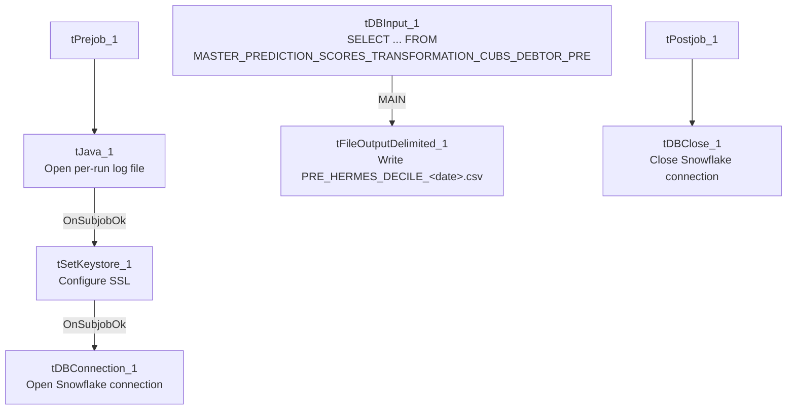

# Talend Job: Extract_PRE_Hermes_Decile

## Overview

This is a small extract job for the "PRE" site: it pulls debtor-level scoring/prediction data (logon, packet, debtor number, portfolio group, "local"/"global" model scores, an Equabli treatment group, and a dialer group) from a Snowflake table named `MASTER_PREDICTION_SCORES_TRANSFORMATION_CUBS_DEBTOR_PRE`, and writes it out as a dated CSV file for consumption by Hermes (an external scoring/decile system, based on the job and file naming). It is one of a near-identical pair with `Extract_TOL_Hermes_Decile` — see Issues observed for the one real structural quirk both share and the site-specific differences.

## Detail table

| Field | Value |
|---|---|
| Job name | Extract_PRE_Hermes_Decile |
| Version | 0.1 |
| Project | EDW2SF |
| Author | jmach@harriscollect.com |
| Created | 2023-08-13T21:09:11.416-0700 |
| Last Modified | 2025-11-05T09:31:05.134-0800 |

## Step-by-step data flow

**Setup subjob:** `tPrejob_1` → `tJava_1` opens a per-run log file at `context.logDir + jobName + "_" + <timestamp> + ".log"` → on subjob-ok, `tSetKeystore_1` configures SSL trust/keystore from `context.keystorePath` (passwords redacted) → on subjob-ok, `tDBConnection_1` opens the Snowflake connection.

**Main subjob** — note this is a *separate, unlinked* chain (see Issues observed): `tDBInput_1` runs a fixed `SELECT` against `MASTER_PREDICTION_SCORES_TRANSFORMATION_CUBS_DEBTOR_PRE`, returning `LOGON`, `PACKET`, `DEBTORNUMBER`, `PL_GROUP`, `LOCAL`, `GLOBAL`, `EQUABLI_TREATMENT_GROUP`, `DIALERGRP`. Its output flows directly (`MAIN` connector) to `tFileOutputDelimited_1`, which writes a comma-delimited CSV with header to `context.outputDir + "PRE_HERMES_DECILE_" + TalendDate.getDate("CCYYMMDD") + ".csv"`.

**Teardown:** `tPostjob_1` → `tDBClose_1` closes the Snowflake connection.

## Settings tables

### Source: `tDBInput_1` (`tSnowflakeInput`)

| Setting | Value | What it means |
|---|---|---|
| Query | `SELECT LOGON, PACKET, DEBTORNUMBER, PL_GROUP, "LOCAL", "GLOBAL", EQUABLI_TREATMENT_GROUP, DIALERGRP FROM MASTER_PREDICTION_SCORES_TRANSFORMATION_CUBS_DEBTOR_PRE;` | A fixed, non-parameterized pull of the full scoring table for the PRE site — no date filter or incremental logic. |

### Target: `tFileOutputDelimited_1`

| Setting | Value | What it means |
|---|---|---|
| FILENAME | `context.outputDir + "PRE_HERMES_DECILE_" + TalendDate.getDate("CCYYMMDD") + ".csv"` | Writes a new dated file each run; does not append. |
| FIELDSEPARATOR / INCLUDEHEADER | `,` / `true` | Standard CSV with header row. |
| ENCODING | `ISO-8859-15` | |

### Security: `tSetKeystore_1`

| Setting | Value | What it means |
|---|---|---|
| SSL_TRUSTSERVER_TRUSTSTORE | `"C:/clientTrustStore.trustStore"` (hardcoded) | A Windows-path truststore location — see Issues observed. |
| SSL_KEYSTORE | `context.keystorePath` | |
| SSL_TRUSTSERVER_PASSWORD / SSL_KEYSTORE_PASSWORD | `***REDACTED***` | Preserved as redacted; real values not available in this metadata. |

## Dependencies & configuration

- **Triggers/depends on other jobs:** none — no `tRunJob` links found.
- **Context variables used:** `keystorePath`, `logDir`, `outputDir`.
- **1 hardcoded path finding:** `tSetKeystore_1.SSL_TRUSTSERVER_TRUSTSTORE` = `"C:/clientTrustStore.trustStore"` — a Windows-specific path, consistent with the project-wide portability risk noted in `05_operational_runbook.md`.

## Glossary

| Component type | Plain-English meaning |
|---|---|
| `tSnowflakeInput` | Runs a query against Snowflake and returns its result rows. |
| `tFileOutputDelimited` | Writes rows to a delimited (CSV-style) text file. |
| `tSetKeystore` | Configures SSL/TLS trust and client certificate settings used by subsequent secure connections in the job. |
| `tSnowflakeConnection` / `tSnowflakeClose` | Open/close the Snowflake connection shared by other components in the job. |

## Issues observed

- **The main data-extraction chain (`tDBInput_1` → `tFileOutputDelimited_1`) is not wired to the setup subjob that opens the Snowflake connection.** There is no connection (`OnSubjobOk`, `OnComponentOk`, or otherwise) linking `tDBConnection_1` to `tDBInput_1` in this job's metadata. In Talend, components sharing a connection typically still run correctly as long as the connection is opened before the query fires, but the *absence* of an explicit ordering link means there's no guarantee the connection subjob finishes (or even runs) before the extract subjob starts — both are top-level, unlinked subjobs in the same job. This is very likely fine in practice (independent subjobs in Talend commonly run in parallel or in an implicit but unenforced order), but it means a race condition is structurally possible; verify actual execution order in Talend Studio if this job's output is ever intermittently empty or fails to connect.
- **The extract query has no date/incremental filter** — every run re-pulls the entire scoring table for the PRE site. Given this table's name (`MASTER_PREDICTION_SCORES_TRANSFORMATION_CUBS_DEBTOR_PRE`) suggests it's already a transformed/scored view rather than a raw growing log, a full pull each run may be entirely intentional; unable to determine from metadata alone whether this is a performance concern.
- **This job is structurally identical to `Extract_TOL_Hermes_Decile`** except for the site code embedded in the source table name (`..._PRE` vs `..._TOL`) and the output filename (`PRE_HERMES_DECILE_...` vs `TOL_HERMES_DECILE_...`). No other differences were found between the two jobs' metadata (same schema, same component wiring, same hardcoded truststore path). This is a template-per-site pattern consistent with the rest of the project (see `01_system_architecture.md`'s site-code glossary entry) — worth checking whether other sites (CHI, CO, DC, HH) have an equivalent `Extract_<Site>_Hermes_Decile` job that wasn't included in this metadata export.
