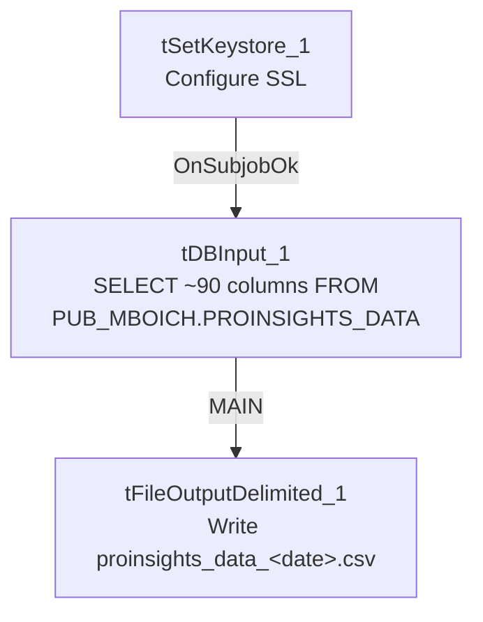

# Talend Job: Extract_ProInsights_Data

## Overview

This job extracts call-analytics/QA scoring data — one row per recorded call, with roughly 90 columns covering call metadata (agent, campaign, direction, duration, client/account identifiers) and a large set of boolean flags describing what happened on the call (hardship, dispute, bankruptcy, profanity, promise-to-pay, verification attempts, sentiment, etc.) — from a Snowflake table `PUB_MBOICH.PROINSIGHTS_DATA`, and writes it to a dated CSV file. This is a "ProInsights" call-scoring/speech-analytics export, most likely feeding an external or downstream reporting consumer given the `PUB_` (publish) schema prefix on the source table.

## Detail table

| Field | Value |
|---|---|
| Job name | Extract_ProInsights_Data |
| Version | 0.1 |
| Project | EDW2SF |
| Author | jmach@harriscollect.com |
| Created | 2024-08-22T11:14:26.521-0700 |
| Last Modified | 2025-11-16T19:09:21.386-0800 |

## Step-by-step data flow

1. `tSetKeystore_1` configures SSL trust/keystore from `context.keystorePath` (passwords redacted).
2. On subjob-ok, `tDBInput_1` runs a fixed `SELECT` of ~90 named columns from `PUB_MBOICH.PROINSIGHTS_DATA` (call ID, file/call metadata, ~70 boolean call-content flags, sentiment fields, `LOGON`, `PL_GROUP`).
3. Its output flows (`MAIN` connector) to `tFileOutputDelimited_1`, which writes a comma-delimited CSV with header to `context.outputDir + "proinsights_data_" + TalendDate.getDate("CCYYMMDD") + ".csv"`.

There is no `tPrejob`/`tPostjob`, no explicit `tSnowflakeConnection`/`tSnowflakeClose` component, and no log-file setup (`tJava`) visible anywhere in this job's extracted metadata — see Issues observed.

## Settings tables

### Source: `tDBInput_1` (`tSnowflakeInput`)

| Setting | Value | What it means |
|---|---|---|
| Query | Fixed `SELECT` of ~90 named columns (call/agent metadata plus ~70 boolean call-content flags, sentiment, `LOGON`, `PL_GROUP`) from `PUB_MBOICH.PROINSIGHTS_DATA` | No date filter or incremental logic — every run re-pulls the full published table. |

### Target: `tFileOutputDelimited_1`

| Setting | Value | What it means |
|---|---|---|
| FILENAME | `context.outputDir + "proinsights_data_" + TalendDate.getDate("CCYYMMDD") + ".csv"` | Writes a new dated file each run; does not append. |
| FIELDSEPARATOR / INCLUDEHEADER | `,` / `true` | Standard CSV with header row. |
| ENCODING | `ISO-8859-15` | |

### Security: `tSetKeystore_1`

| Setting | Value | What it means |
|---|---|---|
| SSL_TRUSTSERVER_TRUSTSTORE | `"C:/clientTrustStore.trustStore"` (hardcoded) | Same Windows-path truststore pattern used across the `Extract_*_Hermes_Decile` jobs. |
| SSL_KEYSTORE | `context.keystorePath` | |
| SSL_TRUSTSERVER_PASSWORD / SSL_KEYSTORE_PASSWORD | `***REDACTED***` | Preserved as redacted. |

## Dependencies & configuration

- **Triggers/depends on other jobs:** none — no `tRunJob` links found.
- **Context variables used:** `keystorePath`, `outputDir`.
- **1 hardcoded path finding:** `tSetKeystore_1.SSL_TRUSTSERVER_TRUSTSTORE` = `"C:/clientTrustStore.trustStore"`.

## Glossary

| Component type | Plain-English meaning |
|---|---|
| `tSnowflakeInput` | Runs a query against Snowflake and returns its result rows. |
| `tFileOutputDelimited` | Writes rows to a delimited (CSV-style) text file. |
| `tSetKeystore` | Configures SSL/TLS trust and client certificate settings used by subsequent secure connections in the job. |

## Issues observed

- **This job's extracted metadata contains only 3 components** (`tDBInput_1`, `tFileOutputDelimited_1`, `tSetKeystore_1`) — there is no `tPrejob`/`tPostjob`, no `tSnowflakeConnection`/`tSnowflakeClose`, and no log-file-opening `tJava` step, all of which are present in every other job documented in this batch. This could mean: (a) the job genuinely has a minimal 3-component design and reuses a connection opened elsewhere (e.g., a shared/default project connection not captured per-job in this extraction), or (b) the metadata extraction for this job is incomplete. Unable to determine from metadata alone which is the case — verify directly in Talend Studio before assuming this job has no explicit Snowflake connection lifecycle.
- **The query pulls the entire `PROINSIGHTS_DATA` table with no date or incremental filter** on every run — if this table grows unbounded, this extract's runtime and output file size will grow unbounded too. Unable to determine table size or growth pattern from metadata.
- **No error/row-count logging specific to this job's business outcome** (no `tWarn`/`tDie`/`tSendMail`, and no per-run log file as seen in most other jobs) — a failure here would only surface as a generic Talend execution error.
