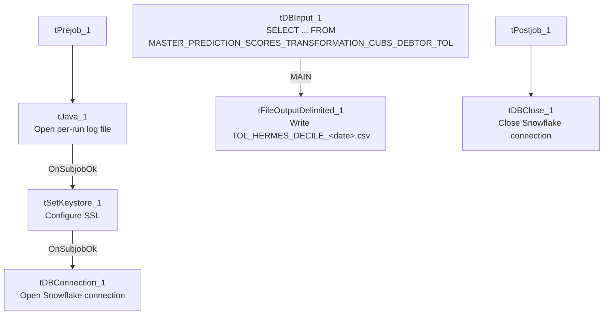

# Talend Job: Extract_TOL_Hermes_Decile

## Overview

This is the "TOL" site's counterpart to `Extract_PRE_Hermes_Decile`: it pulls the same shape of debtor-level scoring/prediction data (logon, packet, debtor number, portfolio group, "local"/"global" model scores, an Equabli treatment group, and a dialer group) from a Snowflake table named `MASTER_PREDICTION_SCORES_TRANSFORMATION_CUBS_DEBTOR_TOL`, and writes it out as a dated CSV file for the Hermes scoring/decile system. The two jobs are otherwise identical in structure — see Issues observed for what is and isn't different between them.

## Detail table

| Field | Value |
|---|---|
| Job name | Extract_TOL_Hermes_Decile |
| Version | 0.1 |
| Project | EDW2SF |
| Author | jmach@harriscollect.com |
| Created | 2024-05-21T09:35:03.511-0700 |
| Last Modified | 2025-11-05T09:38:04.097-0800 |

## Step-by-step data flow

**Setup subjob:** `tPrejob_1` → `tJava_1` opens a per-run log file at `context.logDir + jobName + "_" + <timestamp> + ".log"` → on subjob-ok, `tSetKeystore_1` configures SSL trust/keystore from `context.keystorePath` (passwords redacted) → on subjob-ok, `tDBConnection_1` opens the Snowflake connection.

**Main subjob** — again a separate, unlinked chain (see Issues observed): `tDBInput_1` runs a fixed `SELECT` against `MASTER_PREDICTION_SCORES_TRANSFORMATION_CUBS_DEBTOR_TOL`, returning `LOGON`, `PACKET`, `DEBTORNUMBER`, `PL_GROUP`, `LOCAL`, `GLOBAL`, `EQUABLI_TREATMENT_GROUP`, `DIALERGRP`. Its output flows directly (`MAIN` connector) to `tFileOutputDelimited_1`, which writes a comma-delimited CSV with header to `context.outputDir + "TOL_HERMES_DECILE_" + TalendDate.getDate("CCYYMMDD") + ".csv"`.

**Teardown:** `tPostjob_1` → `tDBClose_1` closes the Snowflake connection.

## Settings tables

### Source: `tDBInput_1` (`tSnowflakeInput`)

| Setting | Value | What it means |
|---|---|---|
| Query | `SELECT LOGON, PACKET, DEBTORNUMBER, PL_GROUP, "LOCAL", "GLOBAL", EQUABLI_TREATMENT_GROUP, DIALERGRP FROM MASTER_PREDICTION_SCORES_TRANSFORMATION_CUBS_DEBTOR_TOL;` | A fixed, non-parameterized pull of the full scoring table for the TOL site — no date filter or incremental logic. |

### Target: `tFileOutputDelimited_1`

| Setting | Value | What it means |
|---|---|---|
| FILENAME | `context.outputDir + "TOL_HERMES_DECILE_" + TalendDate.getDate("CCYYMMDD") + ".csv"` | Writes a new dated file each run; does not append. |
| FIELDSEPARATOR / INCLUDEHEADER | `,` / `true` | Standard CSV with header row. |
| ENCODING | `ISO-8859-15` | |

### Security: `tSetKeystore_1`

| Setting | Value | What it means |
|---|---|---|
| SSL_TRUSTSERVER_TRUSTSTORE | `"C:/clientTrustStore.trustStore"` (hardcoded) | A Windows-path truststore location — see Issues observed. |
| SSL_KEYSTORE | `context.keystorePath` | |
| SSL_TRUSTSERVER_PASSWORD / SSL_KEYSTORE_PASSWORD | `***REDACTED***` | Preserved as redacted; real values not available in this metadata. |

## Dependencies & configuration

- **Triggers/depends on other jobs:** none — no `tRunJob` links found.
- **Context variables used:** `keystorePath`, `logDir`, `outputDir`.
- **1 hardcoded path finding:** `tSetKeystore_1.SSL_TRUSTSERVER_TRUSTSTORE` = `"C:/clientTrustStore.trustStore"` — a Windows-specific path, consistent with the project-wide portability risk noted in `05_operational_runbook.md`.

## Glossary

| Component type | Plain-English meaning |
|---|---|
| `tSnowflakeInput` | Runs a query against Snowflake and returns its result rows. |
| `tFileOutputDelimited` | Writes rows to a delimited (CSV-style) text file. |
| `tSetKeystore` | Configures SSL/TLS trust and client certificate settings used by subsequent secure connections in the job. |
| `tSnowflakeConnection` / `tSnowflakeClose` | Open/close the Snowflake connection shared by other components in the job. |

## Issues observed

- **The main data-extraction chain (`tDBInput_1` → `tFileOutputDelimited_1`) is not wired to the setup subjob that opens the Snowflake connection** — the identical structural gap documented in `Extract_PRE_Hermes_Decile`. No connection link exists between `tDBConnection_1` and `tDBInput_1` in this job's metadata either; the two subjobs are structurally independent. Same caveat applies: likely fine in practice, but not explicitly enforced.
- **The extract query has no date/incremental filter**, same as the PRE sibling — every run re-pulls the entire TOL scoring table.
- **This job is byte-for-byte structurally identical to `Extract_PRE_Hermes_Decile`** except for the site code in the source table name (`..._TOL` vs `..._PRE`) and the output filename prefix (`TOL_HERMES_DECILE_...` vs `PRE_HERMES_DECILE_...`). Every component, parameter, and connection in both jobs' metadata matches otherwise — this is a clean per-site template, not a copy-paste job that drifted. If a third site's equivalent extract exists, it was not included in this metadata export.
