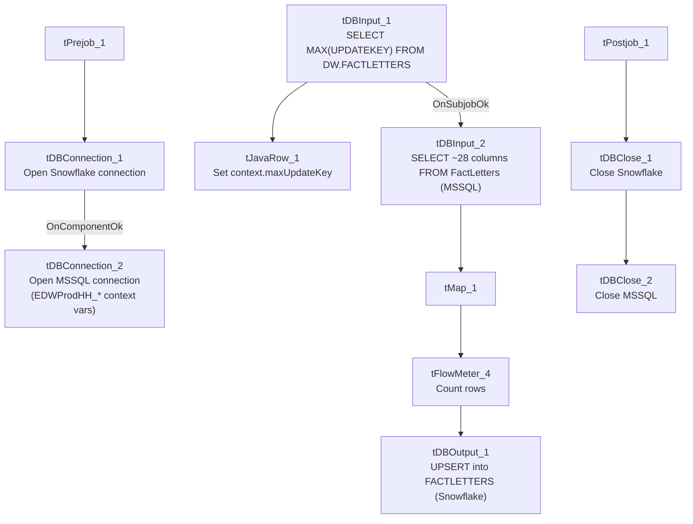

# Talend Job: FactLetter_Load

## Overview

Loads collection-letter records (letter ID, debtor, letter amount, pay-by date, print dates, notice sequence/rate, delinquency series, employee initials, and an `UpdateKey` audit column) from the legacy `EDWProdHH` MSSQL `FactLetters` table into the Snowflake `FACTLETTERS` table. Uses the same "check max key in Snowflake, then pull from source" incremental pattern as `i3_CallDetail_40_Load`, and shares that job's same unresolved question about whether the incremental filter is actually applied (see Issues observed).

## Detail table

| Field | Value |
|---|---|
| Job name | FactLetter_Load |
| Version | 0.1 |
| Project | EDW2SF |
| Author | jmach@harriscollect.com |
| Created | 2022-01-26T08:46:18.282-0800 |
| Last Modified | 2022-05-24T09:48:45.308-0700 |

## Step-by-step data flow

**Setup subjob:** `tPrejob_1` → `tDBConnection_1` opens the Snowflake connection → on component-ok, `tDBConnection_2` opens the MSSQL connection to `context.EDWProdHH_Server`/`Port`/`Schema`/`Database`/`Login` (password redacted).

**Main subjob:**

1. `tDBInput_1` runs `SELECT CAST(COALESCE(MAX(UPDATEKEY),0) AS VARCHAR(10)) AS MAX_UPDATE_KEY FROM DW.FACTLETTERS;` against Snowflake.
2. `tJavaRow_1` captures that value into `context.maxUpdateKey`.
3. On success, `tDBInput_2` runs a fixed `SELECT` against the source `FactLetters` MSSQL table (letter ID, `DimLogOn`, letter amount, pay-by/print dates, delinquency-notice fields, `UpdateKey`, etc.). **The captured query text is truncated and does not visibly reference `context.maxUpdateKey`** — see Issues observed.
4. `tMap_1` passes the ~28 source columns through to a same-shaped uppercase-named target schema.
5. `tFlowMeter_4` counts rows passing through (labeled "MyLabel", not renamed for this job).
6. `tDBOutput_1` **upserts** the rows into Snowflake table `FACTLETTERS` (`UPSERT`, no table-recreate action) — unlike `i3_CallDetail_40_Load`'s plain `INSERT`, this job's target action would at least avoid duplicating rows even if the source query isn't actually filtered.

Separately, `tStatCatcher_1` and `tFlowMeterCatcher_1` feed two `tLogRow` components that print job statistics and flow-meter counts to the log — standard Talend internal instrumentation, not part of the business data path.

**Teardown subjob:** `tPostjob_1` → `tDBClose_1` (close Snowflake) → `tDBClose_2` (close MSSQL).

## Settings tables

### Source: `tDBInput_2` (`tMSSqlInput`)

| Setting | Value | What it means |
|---|---|---|
| Connection | Shared `tDBConnection_2` | Reuses the job's single MSSQL connection. |
| Table | `FactLetters` | Source letter-tracking table. |
| Query | Fixed `SELECT` of `PKFactLetters`, `DimLogOn`, `LTR ID`, `LTR-IDX`, `DEBTOR`, `LTR_NAME`, `LTR_AMT`, `PAY_BY_DTE`, print/notice-series fields, `UpdateKey`, etc. | The visible portion of the query does not reference `context.maxUpdateKey` — see Issues observed. |

### Target: `tDBOutput_1` (`tSnowflakeOutput`)

| Setting | Value | What it means |
|---|---|---|
| Table | `FACTLETTERS` | Destination table in Snowflake. |
| Output action | `UPSERT` | Updates matching rows and inserts new ones — safer against duplication than a plain `INSERT` if the source query re-reads already-loaded rows. |

## Dependencies & configuration

- **Triggers/depends on other jobs:** none — no `tRunJob` links found.
- **Context variables used:** `EDWProdHH_Server`, `EDWProdHH_Port`, `EDWProdHH_Schema`, `EDWProdHH_Database`, `EDWProdHH_Login` (MSSQL connection details), `maxUpdateKey` (computed internally from the Snowflake max-key query).
- No hardcoded developer-workstation paths found in this job.

## Glossary

| Component type | Plain-English meaning |
|---|---|
| `tSnowflakeConnection` / `tSnowflakeClose` | Open/close a Snowflake database connection shared by other components in the job. |
| `tMSSqlConnection` / `tMSSqlInput` / `tMSSqlClose` | Open a Microsoft SQL Server connection, run a query against it, and close it. |
| `tSnowflakeInput` | Runs a query against Snowflake and returns its result rows (here, used just once for a single aggregate value). |
| `tJavaRow` | Runs custom Java code once per input row — here used to unpack a single query result into a context variable. |
| `tMap` | Maps/transforms columns from one schema to another. |
| `tFlowMeter` | Counts rows passing a point in the flow for logging/monitoring. |
| `tStatCatcher` / `tFlowMeterCatcher` / `tLogRow` | Talend's built-in job-statistics and flow-meter capture components, which print execution stats to the log; not part of the business data flow. |

## Issues observed

- **The incremental-load logic may not actually be applied**, the same open question documented for `i3_CallDetail_40_Load`: the job computes `context.maxUpdateKey` from Snowflake before reading the MSSQL source, but the captured `tDBInput_2.QUERY` text is truncated and does not show a `WHERE UpdateKey > ...` clause referencing `context.maxUpdateKey` in the visible portion. Unlike `i3_CallDetail_40_Load`, this job's target uses `UPSERT` rather than plain `INSERT`, which would at least prevent duplicate rows even if the source query pulls the full table every run — but it would still mean unnecessary full-table reads/transfers each run if the filter isn't applied. Verify the full query text directly in Talend Studio.
- **No error/row-count logging specific to this job's business outcome** (no `tWarn`/`tDie`/`tSendMail`) — a load failure here would only surface as a generic Talend execution error, with no job-specific message to distinguish it in a shared log. This differs from the `tDie`-on-merge-failure pattern used by file-load jobs like `ADP_Payroll_Load`, though this job doesn't have a separate merge step to fail on in the first place — it upserts directly.
