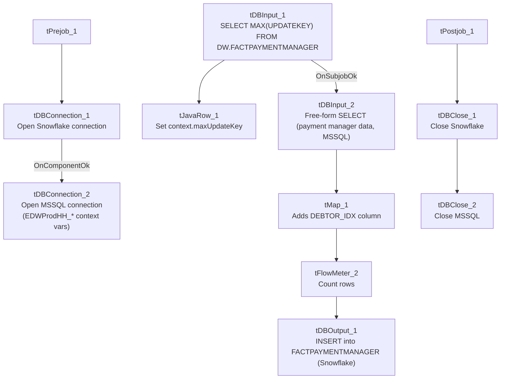

# Talend Job: FactPaymentManager_Load

## Overview

Loads payment-manager transaction records (payment ID, debtor number, logon parsed out of a `LoadID` field, initials, desk, pay amount, commission rate/amount, client number, payment/transaction/load dates, packet number, and an `UpdateKey` audit column) from the legacy `EDWProdHH` MSSQL database into the Snowflake `FACTPAYMENTMANAGER` table. Uses the same "check max key in Snowflake, then pull from source" incremental pattern seen in `i3_CallDetail_40_Load` and `FactLetter_Load`, with the same open question about whether the filter is actually applied.

## Detail table

| Field | Value |
|---|---|
| Job name | FactPaymentManager_Load |
| Version | 0.1 |
| Project | EDW2SF |
| Author | jmach@harriscollect.com |
| Created | 2022-05-09T09:31:33.933-0700 |
| Last Modified | 2025-09-24T10:59:11.228-0700 |

## Step-by-step data flow

**Setup subjob:** `tPrejob_1` → `tDBConnection_1` opens the Snowflake connection → on component-ok, `tDBConnection_2` opens the MSSQL connection to `context.EDWProdHH_Server`/`Port`/`Schema`/`Database`/`Login` (password redacted).

**Main subjob:**

1. `tDBInput_1` runs `SELECT CAST(COALESCE(MAX(UPDATEKEY),0) AS VARCHAR(10)) AS MAX_UPDATE_KEY FROM DW.FACTPAYMENTMANAGER;` against Snowflake.
2. `tJavaRow_1` captures that value into `context.maxUpdateKey`.
3. On success, `tDBInput_2` runs a fixed `SELECT` against the source MSSQL data — no table name is set on the component itself (`TABLE` param is blank; it's a free-form query), pulling `[ID]`, a `COALESCE([Debtor],'')` as `DebtorNumber`, a `Logon` value parsed via `SUBSTRING(LoadID,1,CHARINDEX('-',LoadID,1)-1)`, initials, desk, pay amount, commission rate/amount, client number, payment/transaction/load dates, packet number, and `UpdateKey`. **The captured query text is truncated and does not visibly reference `context.maxUpdateKey`** — see Issues observed.
4. `tMap_1` passes the source columns through to a target schema that adds a `DEBTOR_IDX` column not present in the source query's visible output — see Issues observed.
5. `tFlowMeter_2` counts rows passing through (labeled "MyLabel").
6. `tDBOutput_1` inserts the rows into Snowflake table `FACTPAYMENTMANAGER` (`INSERT`, no table-recreate action, no merge step afterward).

## Settings tables

### Source: `tDBInput_2` (`tMSSqlInput`)

| Setting | Value | What it means |
|---|---|---|
| Connection | Shared `tDBConnection_2` | Reuses the job's single MSSQL connection. |
| Table | *(blank — free-form query, no table set on the component)* | The query itself references the source table inline (not visible in the truncated captured text). |
| Query | `SELECT [ID], COALESCE([Debtor],'') AS DebtorNumber, COALESCE(SUBSTRING(LoadID,1,CHARINDEX('-',LoadID,1)-1),'') AS Logon, [Initials], [Desk], CAST([PayAmt] AS numeric(16,4)), [CommRate], [ClientNum] ...` (truncated) | Derives `Logon` by parsing the prefix of a `LoadID` field rather than reading it as a stored column — an inline transformation embedded in SQL rather than in `tMap`. |

### Target: `tDBOutput_1` (`tSnowflakeOutput`)

| Setting | Value | What it means |
|---|---|---|
| Table | `FACTPAYMENTMANAGER` | Destination table in Snowflake. |
| Output action | `INSERT` | Appends rows — there is no `TRUNCATE`/staging step and no merge call, consistent with an incremental-append design, contingent on the max-key filter actually working. |

## Dependencies & configuration

- **Triggers/depends on other jobs:** none — no `tRunJob` links found.
- **Context variables used:** `EDWProdHH_Server`, `EDWProdHH_Port`, `EDWProdHH_Schema`, `EDWProdHH_Database`, `EDWProdHH_Login`, `maxUpdateKey` (computed internally).
- No hardcoded developer-workstation paths found in this job.

## Glossary

| Component type | Plain-English meaning |
|---|---|
| `tSnowflakeConnection` / `tSnowflakeClose` | Open/close a Snowflake database connection shared by other components in the job. |
| `tMSSqlConnection` / `tMSSqlInput` / `tMSSqlClose` | Open a Microsoft SQL Server connection, run a query against it, and close it. |
| `tSnowflakeInput` | Runs a query against Snowflake and returns its result rows (here, used just once for a single aggregate value). |
| `tJavaRow` | Runs custom Java code once per input row — here used to unpack a single query result into a context variable. |
| `tMap` | Maps/transforms columns from one schema to another. |
| `tFlowMeter` | Counts rows passing a point in the flow for logging/monitoring. |

## Issues observed

- **The incremental-load logic may not actually be applied** — same open question as `i3_CallDetail_40_Load` and `FactLetter_Load`: `context.maxUpdateKey` is computed but the captured `tDBInput_2.QUERY` text is truncated and does not show a `WHERE UpdateKey > ...` filter in the visible portion. Combined with a plain `INSERT` (not `UPSERT` or `TRUNCATE`-then-load), if the filter is not actually applied, every run would re-insert the entire source table's history into `FACTPAYMENTMANAGER`, duplicating all previously loaded rows. This should be verified directly in Talend Studio before assuming the incremental design works.
- **`tMap_1`'s target schema includes a `DEBTOR_IDX` column that does not appear anywhere in the source query's visible schema** (`tDBInput_2`'s columns are `ID`, `DEBTORNUMBER`, `LOGON`, `INITIALS`, `DESK`, `PAYAMT`, `COMMRATE`, `CLIENTNUM`, `COMMAMT`, `PAYMENTDATE`, `CREDITMONTH`, `CREDITYEAR`, `LOADID`, `TRANSDATE`, `PACKETNUM`, `LOADDATE`, `UPDATEKEY` — no `DEBTOR_IDX`). Either `tMap_1` derives `DEBTOR_IDX` via an internal expression/lookup not captured in this metadata, or it passes through blank/null for that column. Unable to determine from metadata; verify the actual `tMap_1` mapping expressions in Talend Studio.
- **No error/row-count logging specific to this job's business outcome** (no `tWarn`/`tDie`/`tSendMail`, and no merge/stored-procedure step) — a load failure here would only surface as a generic Talend execution error.
