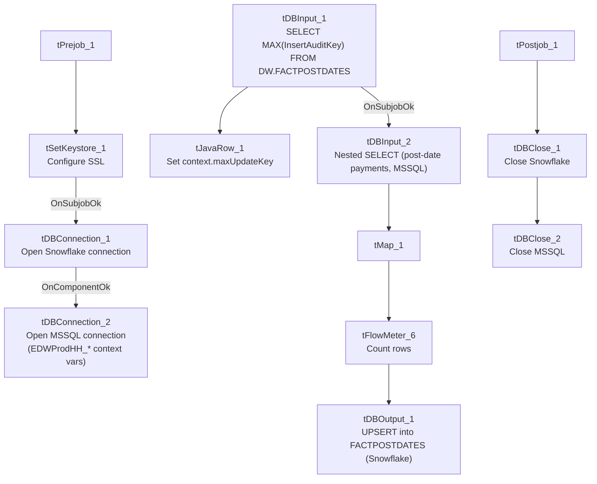

# Talend Job: FactPostDates_Load

## Overview

Loads scheduled/post-dated payment records (payment type, payment date/amount, employee payroll ID, source system, and an audit key) from the legacy `EDWProdHH` MSSQL database into the Snowflake `FACTPOSTDATES` table. Uses the same "check max audit key in Snowflake, then pull from source" incremental pattern as the other `Fact*_Load` jobs in this batch, and upserts (rather than plain-inserts) into the target, which limits the damage if the incremental filter isn't actually working.

## Detail table

| Field | Value |
|---|---|
| Job name | FactPostDates_Load |
| Version | 0.1 |
| Project | EDW2SF |
| Author | jmach@harriscollect.com |
| Created | 2023-03-07T21:03:13.699-0800 |
| Last Modified | 2025-11-04T11:08:12.449-0800 |

## Step-by-step data flow

**Setup subjob:** `tPrejob_1` → `tSetKeystore_1` configures SSL trust/keystore from `context.keystorePath` → on subjob-ok, `tDBConnection_1` opens the Snowflake connection → on component-ok, `tDBConnection_2` opens the MSSQL connection to `context.EDWProdHH_Server`/`Port`/`Schema`/`Database`/`Login`.

**Main subjob:**

1. `tDBInput_1` runs `SELECT CAST(COALESCE(MAX(InsertAuditKey),0) AS VARCHAR(10)) AS MAX_UPDATE_KEY FROM DW.FACTPOSTDATES;` against Snowflake.
2. `tJavaRow_1` captures that value into `context.maxUpdateKey`.
3. On success, `tDBInput_2` runs a nested `SELECT` against MSSQL — an outer query selecting `FactPostdateKey`, `PostdateID`, `HHLOGON`, `ACCOUNTNUMBER`, `DEBTOR_IDX`, `PAYMENTTYPE`, `PAYMENTDATE`, `PAYMENTAMOUNT`, `PostdateKEY`, `EMPLOYEEPAYROLLID`, `[SOURCE]`, `InsertAuditKey` from an inner subquery (the inner query's own filter logic isn't visible in this metadata — truncated).
4. `tMap_1` passes the columns through to a same-shaped uppercase-named target schema.
5. `tFlowMeter_6` counts rows passing through (labeled "MyLabel").
6. `tDBOutput_1` **upserts** the rows into Snowflake table `FACTPOSTDATES`.

Separately, `tStatCatcher_1` and `tFlowMeterCatcher_1` feed two `tLogRow` components that print job statistics to the log — standard Talend instrumentation, not part of the business data path.

**Teardown subjob:** `tPostjob_1` → `tDBClose_1` (close Snowflake) → `tDBClose_2` (close MSSQL).

## Settings tables

### Source: `tDBInput_2` (`tMSSqlInput`)

| Setting | Value | What it means |
|---|---|---|
| Connection | Shared `tDBConnection_2` | Reuses the job's single MSSQL connection. |
| Query | `SELECT FactPostdateKey, PostdateID, HHLOGON, ACCOUNTNUMBER, DEBTOR_IDX, PAYMENTTYPE, PAYMENTDATE, PAYMENTAMOUNT, PostdateKEY, EMPLOYEEPAYROLLID, [SOURCE], InsertAuditKey FROM (SELECT CAST([FactPostdateKey] AS numeri...` (truncated) | Wraps an inner subquery — the actual filtering/casting logic inside that subquery is not visible in this metadata. |

### Target: `tDBOutput_1` (`tSnowflakeOutput`)

| Setting | Value | What it means |
|---|---|---|
| Table | `FACTPOSTDATES` | Destination table in Snowflake. |
| Output action | `UPSERT` | Updates matching rows and inserts new ones — protects against duplication if the incremental filter isn't fully effective. |

### Security: `tSetKeystore_1`

| Setting | Value | What it means |
|---|---|---|
| SSL_TRUSTSERVER_TRUSTSTORE | `"C:/clientTrustStore.trustStore"` (hardcoded) | Same Windows-path truststore pattern used across several jobs in this batch. |
| SSL_KEYSTORE | `context.keystorePath` | |
| Passwords | `***REDACTED***` | Preserved as redacted. |

## Dependencies & configuration

- **Triggers/depends on other jobs:** none — no `tRunJob` links found.
- **Context variables used:** `EDWProdHH_Server`, `EDWProdHH_Port`, `EDWProdHH_Schema`, `EDWProdHH_Database`, `EDWProdHH_Login`, `keystorePath`, `maxUpdateKey` (computed internally from the Snowflake max-key query, despite tracking `InsertAuditKey` rather than `UpdateKey`).
- **1 hardcoded path finding:** `tSetKeystore_1.SSL_TRUSTSERVER_TRUSTSTORE` = `"C:/clientTrustStore.trustStore"`.

## Glossary

| Component type | Plain-English meaning |
|---|---|
| `tSnowflakeConnection` / `tSnowflakeClose` | Open/close a Snowflake database connection shared by other components in the job. |
| `tMSSqlConnection` / `tMSSqlInput` / `tMSSqlClose` | Open a Microsoft SQL Server connection, run a query against it, and close it. |
| `tSnowflakeInput` | Runs a query against Snowflake and returns its result rows (here, used just once for a single aggregate value). |
| `tJavaRow` | Runs custom Java code once per input row — here used to unpack a single query result into a context variable. |
| `tMap` | Maps/transforms columns from one schema to another. |
| `tFlowMeter` | Counts rows passing a point in the flow for logging/monitoring. |
| `tSetKeystore` | Configures SSL/TLS trust and client certificate settings used by subsequent secure connections in the job. |
| `tStatCatcher` / `tFlowMeterCatcher` / `tLogRow` | Talend's built-in job-statistics and flow-meter capture components; not part of the business data flow. |

## Issues observed

- **The context variable name (`maxUpdateKey`) doesn't match the column it's actually derived from (`InsertAuditKey`, not `UpdateKey`)** — a naming inconsistency inherited from the shared pattern used across `i3_CallDetail_40_Load`, `FactLetter_Load`, `FactTrans_Load`, and this job. Functionally harmless (it's just a variable name), but could confuse anyone reading this job's logic expecting `maxUpdateKey` to always track an `UpdateKey` column.
- **The source query wraps an inner subquery whose own filtering/casting logic is not visible in this metadata** (truncated after the outer `SELECT` list) — unable to confirm from metadata whether `context.maxUpdateKey` is actually referenced inside that subquery to filter the pull. Same incremental-load verification caveat as the other `Fact*_Load` jobs in this batch, though the `UPSERT` target action here reduces the risk of duplicate rows even if the filter isn't applied.
- **This is the only `Fact*_Load` job in this batch with its own `tSetKeystore_1` component** (`FactLetter_Load`, `FactPaymentManager_Load`, and `FactTrans_Load` all lack one). Since SSL/keystore configuration is typically needed for the Snowflake connection, it's unclear why this job needs it and its siblings don't — unable to determine from metadata whether the siblings rely on a JVM-wide keystore setting instead; worth confirming this isn't a silent connection-security gap in the other three jobs.
