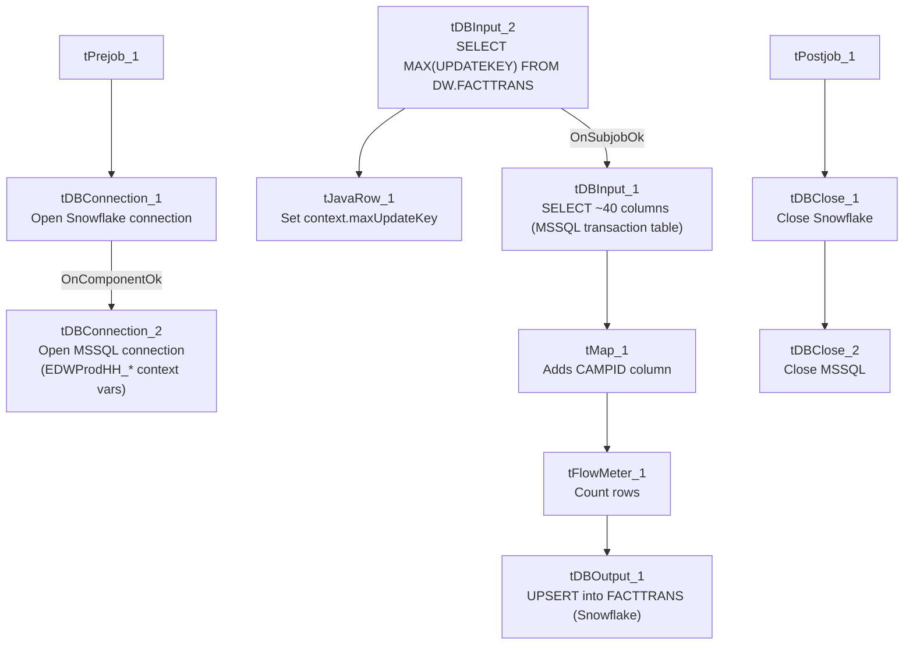

# Talend Job: FactTrans_Load

## Overview

Loads the core transaction fact table — one row per collection transaction, with amounts broken out by category (principal, interest, agency, forwarding, direct payments and their NSF/reversal counterparts), transaction code, dates, desk, client, and a `TCODE_COLLECTOR` description column — from the legacy `EDWProdHH` MSSQL database into the Snowflake `FACTTRANS` table. This is almost certainly the project's central transaction fact load (the name `FACTTRANS` and its ~40-column business schema strongly suggest this), using the same "check max key in Snowflake, then pull from source" incremental pattern as the other `Fact*_Load` jobs, and upserting into the target.

## Detail table

| Field | Value |
|---|---|
| Job name | FactTrans_Load |
| Version | 0.1 |
| Project | EDW2SF |
| Author | jmach@harriscollect.com |
| Created | 2022-01-13T08:03:16.563-0800 |
| Last Modified | 2022-05-24T09:48:46.946-0700 |

## Step-by-step data flow

**Setup subjob:** `tPrejob_1` → `tDBConnection_1` opens the Snowflake connection → on component-ok, `tDBConnection_2` opens the MSSQL connection to `context.EDWProdHH_Server`/`Port`/`Schema`/`Database`/`Login`.

**Main subjob:**

1. `tDBInput_2` runs `SELECT CAST(COALESCE(MAX(UPDATEKEY),0) AS VARCHAR(10)) AS MAX_UPDATE_KEY FROM DW.FACTTRANS;` against Snowflake.
2. `tJavaRow_1` captures that value into `context.maxUpdateKey`.
3. On success, `tDBInput_1` runs a fixed `SELECT` against MSSQL: `TRANS-IDX`, `DimLogon`, `TRANS_ID`, `DEBTOR_NUMBER`, `TCODE`, `COMM_RATE`, and ~30 more transaction-amount and status columns (truncated after the initial column list — **the query does not visibly reference `context.maxUpdateKey`**, see Issues observed). Note the source query's schema already includes a `TCODE_COLLECTOR` column.
4. `tMap_1` passes the source columns through to a same-shaped uppercase-named target schema, adding a `CAMPID` column not present in the source query's captured schema.
5. `tFlowMeter_1` counts rows passing through (labeled "MyLabel"; `TSTATCATCHER_STATS` enabled).
6. `tDBOutput_1` **upserts** the rows into Snowflake table `FACTTRANS`.

**Teardown subjob:** `tPostjob_1` → `tDBClose_1` (close Snowflake) → `tDBClose_2` (close MSSQL).

## Settings tables

### Source: `tDBInput_1` (`tMSSqlInput`)

| Setting | Value | What it means |
|---|---|---|
| Connection | Shared `tDBConnection_2` | Reuses the job's single MSSQL connection. |
| Query | `SELECT [TRANS-IDX] AS TRANS_IDX, CAST([DimLogon] AS numeric(38,0)) AS DIMLOGON, [TRANS_ID], [DEBTOR_NUMBER], CAST([TCODE] AS numeric(38,0)) AS TCODE, CAST([COMM_RATE] AS numeric(16,4)) AS COMM_RATE, CAST([T...` (truncated) | Pulls ~40 transaction-detail columns including a pre-populated `TCODE_COLLECTOR` field — see Dependencies & configuration for its likely relationship to `FactTrans_TCODE_COLLECTOR_Load`. |

### Target: `tDBOutput_1` (`tSnowflakeOutput`)

| Setting | Value | What it means |
|---|---|---|
| Table | `FACTTRANS` | Destination table in Snowflake — the project's core transaction fact table. |
| Output action | `UPSERT` | Updates matching rows and inserts new ones. |

## Dependencies & configuration

- **Triggers/depends on other jobs:** none — no `tRunJob` links found. However, the source query's `TCODE_COLLECTOR` column and the small standalone job `FactTrans_TCODE_COLLECTOR_Load` (which reads `TCODE_DESC1 AS TCODE_COLLECTOR` from `dbo.FACTTRANS` and writes it to a Snowflake lookup table `TRANS_TCODE_COLLECTOR`) strongly suggest a data lineage relationship between the two jobs, even though neither calls the other via `tRunJob`. Unable to confirm the exact join/enrichment mechanism from metadata alone — see that job's own doc.
- **Context variables used:** `EDWProdHH_Server`, `EDWProdHH_Port`, `EDWProdHH_Schema`, `EDWProdHH_Database`, `EDWProdHH_Login`, `maxUpdateKey` (computed internally).
- No hardcoded developer-workstation paths found in this job.

## Glossary

| Component type | Plain-English meaning |
|---|---|
| `tSnowflakeConnection` / `tSnowflakeClose` | Open/close a Snowflake database connection shared by other components in the job. |
| `tMSSqlConnection` / `tMSSqlInput` / `tMSSqlClose` | Open a Microsoft SQL Server connection, run a query against it, and close it. |
| `tSnowflakeInput` | Runs a query against Snowflake and returns its result rows (here, used just once for a single aggregate value). |
| `tJavaRow` | Runs custom Java code once per input row — here used to unpack a single query result into a context variable. |
| `tMap` | Maps/transforms columns from one schema to another. |
| `tFlowMeter` | Counts rows passing a point in the flow for logging/monitoring. |

## Issues observed

- **The incremental-load logic may not actually be applied** — the same open question as `i3_CallDetail_40_Load`, `FactLetter_Load`, `FactPaymentManager_Load`, and `FactPostDates_Load`: `context.maxUpdateKey` is computed from Snowflake before reading MSSQL, but the captured `tDBInput_1.QUERY` text is truncated after the initial column list and does not show a `WHERE ... > context.maxUpdateKey` clause. Since this is (likely) the project's central transaction fact table, an unfiltered full-table pull each run — even with `UPSERT` protecting against duplication — could mean a substantial, unnecessary daily data-transfer cost if the source table is large. Verify the full query text directly in Talend Studio.
- **`tMap_1`'s target schema includes a `CAMPID` column not present in the source query's captured schema** (`tDBInput_1`'s schema list does not include `CAMPID`). Either `tMap_1` derives it via an internal expression/lookup not captured here, or it passes through blank/null. Unable to determine from metadata; verify the `tMap_1` mapping expressions directly.
- **No error/row-count logging specific to this job's business outcome** (no `tWarn`/`tDie`/`tSendMail`) — given this table's apparent importance, a silent failure here would only show up as a generic Talend execution error unless caught by external monitoring.
