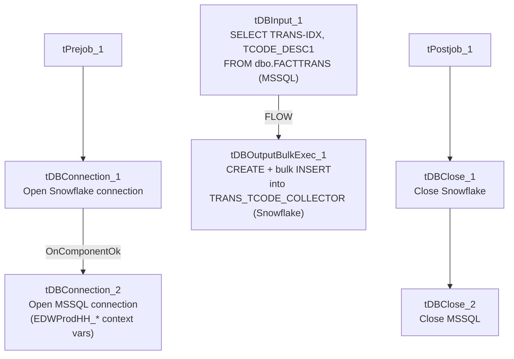

# Talend Job: FactTrans_TCODE_COLLECTOR_Load

## Overview

A small, single-purpose lookup-table load: it reads a transaction-code description column (`TCODE_DESC1`, aliased as `TCODE_COLLECTOR`) alongside the transaction index (`TRANS-IDX`) from the legacy `EDWProdHH` MSSQL `dbo.FACTTRANS` table, and bulk-loads it into a new/recreated Snowflake table `TRANS_TCODE_COLLECTOR`. This table's shape (`TRANS_IDX` + `TCODE_COLLECTOR`) matches a column that also appears directly in `FactTrans_Load`'s own source query, suggesting this job either populates a lookup table `FactTrans_Load` (or something downstream of it) joins against, or is a redundant/legacy extraction of a column `FactTrans_Load` already pulls itself — see Issues observed.

## Detail table

| Field | Value |
|---|---|
| Job name | FactTrans_TCODE_COLLECTOR_Load |
| Version | 0.1 |
| Project | EDW2SF |
| Author | jmach@harriscollect.com |
| Created | 2022-02-28T14:16:07.725-0800 |
| Last Modified | 2025-09-24T11:01:15.598-0700 |

## Step-by-step data flow

**Setup subjob:** `tPrejob_1` → `tDBConnection_1` opens the Snowflake connection → on component-ok, `tDBConnection_2` opens the MSSQL connection to `context.EDWProdHH_Server`/`Port`/`Schema`/`Database`/`Login`.

**Main subjob:** `tDBInput_1` runs `SELECT [TRANS-IDX] AS TRANS_IDX, TCODE_DESC1 AS TCODE_COLLECTOR FROM dbo.FACTTRANS;` against MSSQL, and its output flows (`FLOW` connector) directly into `tDBOutputBulkExec_1`, which bulk-loads the two columns into Snowflake table `TRANS_TCODE_COLLECTOR` with `outputAction=INSERT` and `tableAction=CREATE` — i.e., the table is (re)created fresh each run. There is no `tMap`, no row-count logging, and no merge step.

**Teardown subjob:** `tPostjob_1` → `tDBClose_1` (close Snowflake) → `tDBClose_2` (close MSSQL).

## Settings tables

### Source: `tDBInput_1` (`tMSSqlInput`)

| Setting | Value | What it means |
|---|---|---|
| Query | `SELECT [TRANS-IDX] AS TRANS_IDX, TCODE_DESC1 AS TCODE_COLLECTOR FROM dbo.FACTTRANS;` | A simple two-column pull with no filter — reads the entire `FACTTRANS` MSSQL table every run. |

### Target: `tDBOutputBulkExec_1` (`tSnowflakeOutputBulkExec`)

| Setting | Value | What it means |
|---|---|---|
| Table | `TRANS_TCODE_COLLECTOR` | Destination lookup table in Snowflake. |
| Output action | `INSERT` | Appends rows into the (freshly created) table. |
| Table action | `CREATE` | The table is dropped and recreated from scratch every run — this is a full-replace load, not an incremental one. |

## Dependencies & configuration

- **Triggers/depends on other jobs:** none — no `tRunJob` links found. However, see Overview and Issues observed regarding its likely data-lineage relationship with `FactTrans_Load`, which independently reads a `TCODE_COLLECTOR` column directly from its own MSSQL source query.
- **Context variables used:** `EDWProdHH_Database`, `EDWProdHH_Login`, `EDWProdHH_Port`, `EDWProdHH_Schema`, `EDWProdHH_Server`.
- No hardcoded developer-workstation paths found in this job.

## Glossary

| Component type | Plain-English meaning |
|---|---|
| `tSnowflakeConnection` / `tSnowflakeClose` | Open/close a Snowflake database connection shared by other components in the job. |
| `tMSSqlConnection` / `tMSSqlInput` / `tMSSqlClose` | Open a Microsoft SQL Server connection, run a query against it, and close it. |
| `tSnowflakeOutputBulkExec` | Bulk-loads rows into a Snowflake table, typically faster than row-by-row insert for large volumes; here also configured to recreate the table each run. |

## Issues observed

- **`tableAction=CREATE` means this table is dropped and rebuilt from scratch every run**, with no incremental logic and no filter on the source query — every run re-reads the entire `dbo.FACTTRANS` MSSQL table just to extract two columns. For a table the size implied by `FactTrans_Load`'s own ~40-column, presumably large fact table, this could be an expensive way to maintain what is effectively a 2-column lookup/mapping table.
- **This job's output table (`TRANS_TCODE_COLLECTOR`, columns `TRANS_IDX` + `TCODE_COLLECTOR`) closely mirrors a column that `FactTrans_Load` already pulls directly in its own source query** (`FactTrans_Load`'s MSSQL query schema includes a `TCODE_COLLECTOR` column). This raises a real question this metadata cannot answer: is `TRANS_TCODE_COLLECTOR` an actively-used lookup table that some other job or downstream consumer joins against (in which case this job is essential and not redundant), or is it a leftover/legacy extraction now duplicated by `FactTrans_Load`'s own direct pull? No `tRunJob` link or SQL reference elsewhere in this batch's metadata resolves this — verify with the team whether `TRANS_TCODE_COLLECTOR` still has active downstream consumers before considering this job for retirement.
- **No error/row-count logging** (no `tWarn`/`tDie`, no `tFlowMeter`) — a failure here would only surface as a generic Talend execution error.
