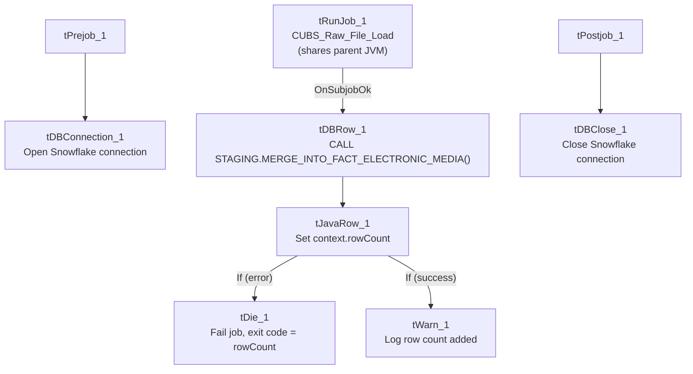

# Talend Job: Fact_Electronic_Media_Load

## Overview

A thin orchestrator/merge job: it doesn't read or write business data columns directly. It calls `CUBS_Raw_File_Load` to do the actual file loading, then runs a stored procedure to merge the newly staged rows into the `FACT_ELECTRONIC_MEDIA` warehouse table, and branches to a warning or a job failure depending on the merge's return code. This is the same "call a loader job, then merge, then check the result" shape used by `ADP_Payroll_Load`, but with the merge outcome only ever producing a `tWarn` on the success path and a `tDie` on the failure path (see Issues observed for what "success" actually means here).

## Detail table

| Field | Value |
|---|---|
| Job name | Fact_Electronic_Media_Load |
| Version | 0.1 |
| Project | EDW2SF |
| Author | jmach@harriscollect.com |
| Created | 2022-05-23T15:54:12.268-0700 |
| Last Modified | 2022-05-24T09:49:20.346-0700 |

## Step-by-step data flow

**Setup subjob:** `tPrejob_1` → `tDBConnection_1` opens the Snowflake connection.

**Main subjob:**

1. `tRunJob_1` calls **`CUBS_Raw_File_Load`** (`USE_INDEPENDENT_PROCESS=false` — runs inside this job's own JVM rather than as a separate process, `DIE_ON_CHILD_ERROR=true`, `TRANSMIT_ORIGINAL_CONTEXT=true`).
2. On subjob-ok, `tDBRow_1` runs `CALL STAGING.MERGE_INTO_FACT_ELECTRONIC_MEDIA();` against Snowflake.
3. `tJavaRow_1` captures the procedure's `RETVALUE` into `context.rowCount`.
4. The flow branches on two ordered `RUN_IF` conditions off `tJavaRow_1` (the branch conditions themselves aren't captured in this metadata, but component wiring and message content make the intent clear):
   - One branch: `tDie_1` fails the job with message `context.rowCount.toString() + ": an error occurred during MERGE"`, exit code = `context.rowCount.intValue()`.
   - The other branch: `tWarn_1` logs `context.rowCount.toString() + " rows added to FACT_ELECTRONIC_MEDIA"` (severity 42) — a warning, not a success confirmation via any other channel.

**Teardown subjob:** `tPostjob_1` → `tDBClose_1` closes the Snowflake connection.

## Settings tables

### Orchestration: `tRunJob_1`

| Setting | Value | What it means |
|---|---|---|
| PROCESS | `CUBS_Raw_File_Load` | The sub-job that actually performs the raw file load this job's merge depends on. |
| USE_INDEPENDENT_PROCESS | `false` | Runs inside this job's own JVM rather than as a separate process — the same non-default setting flagged as notable for `DimFiscal_CO_Load` in `CO_Master_Load`'s doc. |
| DIE_ON_CHILD_ERROR | `true` | If `CUBS_Raw_File_Load` fails, this job fails too. |
| TRANSMIT_ORIGINAL_CONTEXT | `true` | The sub-job receives this job's context values. |

### Merge step: `tDBRow_1` (`tSnowflakeRow`)

| Setting | Value | What it means |
|---|---|---|
| Query | `CALL STAGING.MERGE_INTO_FACT_ELECTRONIC_MEDIA();` | Merges the rows `CUBS_Raw_File_Load` staged into the `FACT_ELECTRONIC_MEDIA` warehouse table. |
| Result handling | `RETVALUE` → `context.rowCount` → branch to `tDie`/`tWarn` | A non-zero (or otherwise "bad") return code fails the job with that code as the exit code; otherwise, only a warning-level log entry records the row count. |

## Dependencies & configuration

- **This job calls 1 other job via `tRunJob`:** `CUBS_Raw_File_Load` — see `06_dependency_matrix.md`, which also lists `DimDeskInfo_Load`, `DimEmployeeInfo_Load`, and `PaymentPlan_Load` as other callers of the same sub-job.
- **Context variables used:** `rowCount` (set internally from the merge result).
- No hardcoded developer-workstation paths found in this job's own components.

## Glossary

| Component type | Plain-English meaning |
|---|---|
| `tRunJob` | Runs another Talend job as a sub-process (or, if configured not to use an independent process, inline in the same JVM), optionally waiting for it to finish before continuing. |
| `tSnowflakeRow` | Runs an arbitrary SQL statement or stored-procedure call against Snowflake. |
| `tJavaRow` | Runs custom Java code once per input row — here used to unpack a stored procedure's single return value. |
| `tDie` / `tWarn` | `tDie` ends the job with a specific failure message and exit code; `tWarn` logs a warning without failing the job. |

## Issues observed

- **A successful merge is only ever recorded as a `tWarn` (severity 42), never as a plain informational log or explicit success signal** — this project-wide pattern (also seen in `CO_Master_Load`'s `FACTTRANS` merge branch) means the "happy path" outcome of this job's core business action shows up in logs at the same severity level typically reserved for problems, which could make log-scanning or alerting rules that trigger on `tWarn` produce false positives on every successful run. This is flagged as a known project-wide pattern in `05_operational_runbook.md`; this job is one instance of it, and it uses `tDie` (not just `tWarn`) on the actual failure branch, which is more protective than `CO_Master_Load`'s equivalent `FACTTRANS` branch (that one only warns even on failure).
- **`USE_INDEPENDENT_PROCESS=false` on the only `tRunJob` in this job** means `CUBS_Raw_File_Load` runs inside this job's own JVM. If `CUBS_Raw_File_Load` is resource-intensive, this could affect `Fact_Electronic_Media_Load`'s own memory footprint or error isolation — the same consideration flagged for `DimFiscal_CO_Load` in `CO_Master_Load`. Unable to determine intent from metadata; worth confirming with the team, especially since `CUBS_Raw_File_Load` is called by at least 3 other jobs per `06_dependency_matrix.md` and this may be the only caller that runs it in-process.
