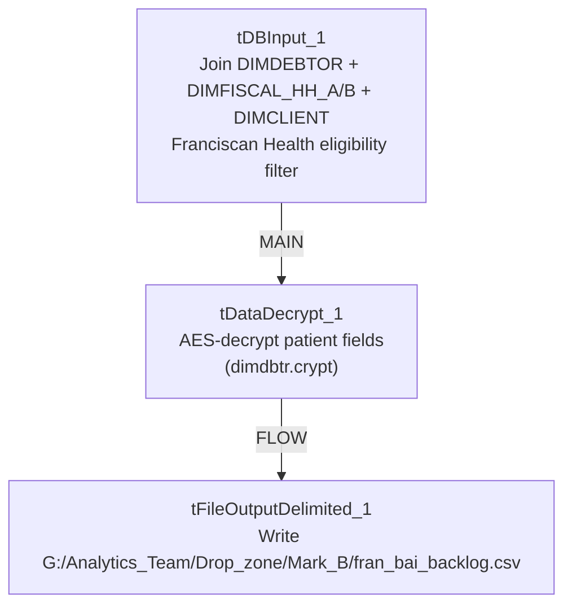

# Talend Job: Fran_Bai_Backlog

## Overview

This job builds a targeted extract of Franciscan Health patient/debtor accounts eligible for an external insurance-discovery service (Experian Health), for accounts that were assigned 2–60 days ago, haven't already been sent, and meet client-specific balance and account-status criteria. It joins Snowflake's `DIMDEBTOR`, `DIMFISCAL_HH_A`/`DIMFISCAL_HH_B`, and `DIMCLIENT` tables, decrypts the resulting patient-identifying fields via a dedicated decryption component, and writes the result to a fixed shared-drive CSV drop location for a named analyst ("Mark_B"). The query itself is heavily commented with an audit trail of which client balance thresholds were added, changed, or disabled over time (Broward, IU Health, Weill, Franciscan, Carle, UHS, NW Comm Hospital, NorthShore), making this one of the more self-documenting queries in the project.

## Detail table

| Field | Value |
|---|---|
| Job name | Fran_Bai_Backlog |
| Version | 0.1 |
| Project | EDW2SF |
| Author | jmach@harriscollect.com |
| Created | 2024-08-23T09:27:08.639-0700 |
| Last Modified | 2025-09-24T11:01:09.448-0700 |

## Step-by-step data flow

1. `tDBInput_1` runs a large Snowflake query joining `DW.DIMDEBTOR` (aliased `DD`) to `DW.DIMFISCAL_HH_A`/`DW.DIMFISCAL_HH_B` (patient DOB, sex, admit date) and `DW.DIMCLIENT` (portfolio group name), building a reference ID, parsed patient name parts, DOB/dates-of-service, claim amount, address fields, notes, an account/visit number, and an NPI code looked up via a `CASE` statement keyed on the client's `PL_GROUP` name (only the `FRANCISCAN HEALTH - 3P` branch is currently active — see Settings table). The `WHERE` clause filters to accounts assigned 2–60 days ago, with an admit date within the last 325 days, excludes accounts already present in `EDWPRODHH.DW.INSURANCE_DISCOVERY`, excludes a long list of closed/cancelled/settled status codes, and requires valid name/address/city/state/DOB values (rejecting test accounts and obviously bad data).
2. `tDataDecrypt_1` decrypts the row (`AES`, algorithm version 2) using a key file at `context.cryptoPath + "dimdbtr.crypt"` (secret type, key, and password all redacted); `DIE_ON_ERROR=true`, so a decryption failure stops the job.
3. `tFileOutputDelimited_1` writes the decrypted rows to a fixed, hardcoded path: `G:/Analytics_Team/Drop_zone/Mark_B/fran_bai_backlog.csv` (comma-delimited, header row, overwrite not append).

There is no `tPrejob`/`tPostjob`, no explicit Snowflake connection-open/close component, and no log-file setup visible in this job's extracted metadata.

## Settings tables

### Source: `tDBInput_1` (`tSnowflakeInput`)

| Setting | Value | What it means |
|---|---|---|
| Core join | `DW.DIMDEBTOR` ⟕ `DW.DIMFISCAL_HH_A`/`DW.DIMFISCAL_HH_B` on `DEBTOR_IDX`, ⟕ `DW.DIMCLIENT` on `LOGON‖'-'‖CLIENT = CLIENT_IDX` | Standard star-schema join pattern against the debtor dimension and fiscal/client detail tables. |
| Active client filter | Only `DC.PL_GROUP ILIKE '%FRANCISCAN HEALTH - 3P%' AND DD.ASGN_AMT >= 1000` is uncommented | The query's balance-threshold `WHERE` clause has 7 other client conditions (Broward, IU Health, Weill, UHS, Carle, NW Comm Hospital, NorthShore) present as SQL comments — see Issues observed. |
| Exclusion logic | `REF NOT IN (SELECT DISTINCT INP_REF FROM EDWPRODHH.DW.INSURANCE_DISCOVERY)` | Prevents re-sending accounts already loaded into the insurance-discovery result table. |
| Date window | `DT_ASSIGNED` between 2 and 60 days ago; `ADMIT_DATE >= CURRENT_DATE()-325` | Targets recently assigned accounts within a timely-filing-safe admit window. |
| NPI lookup | `CASE` on `DC.PL_GROUP` mapping to one of 7 hardcoded NPI numbers (only the Franciscan branch active) | Maps the client's portfolio group to the billing provider's National Provider Identifier required by the insurance-discovery vendor. |
| Data-quality filters | Excludes test accounts (`PFN`/`PLN` `ILIKE '%TEST%'`), requires non-blank name/address/city/state, valid DOB range | Protects the vendor extract from obviously bad or placeholder data. |

### Security: `tDataDecrypt_1`

| Setting | Value | What it means |
|---|---|---|
| CRYPTO_METHOD / ALGO_VERSION | `AES` / `2` | Symmetric decryption of the patient-identifying fields pulled from `DIMDEBTOR`. |
| CRYPTO_FILE_PATH | `context.cryptoPath + "dimdbtr.crypt"` | Points at a job-external key file; actual path root not resolvable from this metadata (`cryptoPath` value not present in `_shared_context.json`). |
| SECRET_TYPE / SECRET_KEY / PASSWORD_M1 | `***REDACTED***` | Preserved as redacted — never guessed. |
| DIE_ON_ERROR | `true` | A decryption failure stops the job rather than emitting garbled/undecrypted data. |

### Target: `tFileOutputDelimited_1`

| Setting | Value | What it means |
|---|---|---|
| FILENAME | `"G:/Analytics_Team/Drop_zone/Mark_B/fran_bai_backlog.csv"` (hardcoded, no context variable, no date stamp) | A fixed shared-drive path named for an individual analyst ("Mark_B") — see Issues observed. |
| APPEND | `false` | Each run overwrites the previous file rather than appending or dating it. |

## Dependencies & configuration

- **Triggers/depends on other jobs:** none — no `tRunJob` links found.
- **Context variables used:** `cryptoPath`.
- **No entries in `hardcoded_path_findings`** for this job's own metadata field, but the output filename itself (`G:/Analytics_Team/Drop_zone/Mark_B/fran_bai_backlog.csv`) is a hardcoded, non-context-driven, individually-named path — see Issues observed.

## Glossary

| Component type | Plain-English meaning |
|---|---|
| `tSnowflakeInput` | Runs a query against Snowflake and returns its result rows. |
| `tDataDecrypt` | Decrypts previously-encrypted field values using a key file and algorithm configured on the component — used here to restore plaintext patient-identifying data before export. |
| `tFileOutputDelimited` | Writes rows to a delimited (CSV-style) text file. |

## Issues observed

- **The output path is hardcoded to a personal/individual drop-zone folder** (`G:/Analytics_Team/Drop_zone/Mark_B/`), not a context variable and not a shared/standard export location. If "Mark_B" changes roles, loses drive access, or the shared drive's mapping changes, this job silently fails to deliver its output to anyone with no error surfaced elsewhere in the job (no `tWarn`/`tDie`/`tSendMail` present at all). Combined with the file being overwritten (not dated) each run, there's also no historical record of past extracts.
- **The client-eligibility filter in the query's `WHERE` clause has 7 of 8 client conditions commented out**, leaving only Franciscan Health active; the query's own inline comments document that Broward, IU Health, and Weill were "commented out... in favor of Franciscan and UHS," and that Columbia Doctors was "removed from process due to sub-$1.00 ROI" — but UHS, Carle, NW Comm Hospital, and NorthShore are also currently commented out despite each having an active NPI mapping still present in the `CASE` statement below. This means the query is currently narrower than its own supporting logic (NPI lookups) suggests it's designed for — worth confirming with the business owner whether those clients are meant to be re-enabled or the dead NPI branches should be cleaned up.
- **No error/row-count logging** — a failure in the join, decryption, or file write would only surface as a generic Talend execution error, and a silently-empty result set (e.g., if the date window or exclusion logic filters out everything) would produce a valid-looking empty CSV with no alert to anyone that no new backlog accounts were found.
