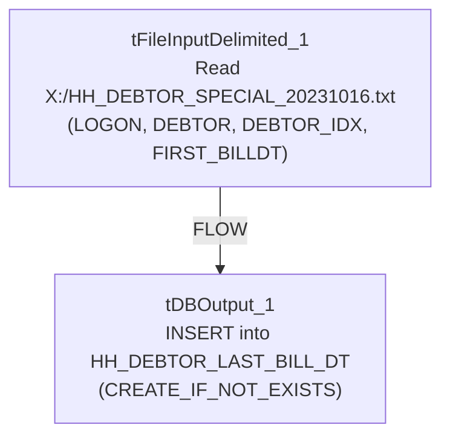

# Talend Job: HH_DEBTOR_SPECIAL_20231016_LOAD

## Overview

A one-off, dated special-load job: it reads a fixed local file `X:/HH_DEBTOR_SPECIAL_20231016.txt` (logon, debtor number, debtor index, and a "first bill date") and inserts it into a Snowflake table `HH_DEBTOR_LAST_BILL_DT`, creating the table if it doesn't already exist. The job's name embeds the date it was built for (October 16, 2023), marking it as a targeted, single-use data correction or backfill rather than a recurring scheduled load.

## Detail table

| Field | Value |
|---|---|
| Job name | HH_DEBTOR_SPECIAL_20231016_LOAD |
| Version | 0.1 |
| Project | EDW2SF |
| Author | jmach@harriscollect.com |
| Created | 2023-10-16T13:32:35.775-0700 |
| Last Modified | 2025-09-24T11:07:35.459-0700 |

## Step-by-step data flow

The entire job is a single flow: `tFileInputDelimited_1` reads `X:/HH_DEBTOR_SPECIAL_20231016.txt` (tab-delimited, header row present, using a repository schema, `DIE_ON_ERROR=false`) and passes its rows (`FLOW` connector) directly into `tDBOutput_1`, which inserts them into Snowflake table `HH_DEBTOR_LAST_BILL_DT` (creating it if it doesn't exist). There is no `tPrejob`/`tPostjob`, no explicit connection-open/close component, no `tMap`, and no logging visible in this job's extracted metadata — see Issues observed.

## Settings tables

### Source: `tFileInputDelimited_1`

| Setting | Value | What it means |
|---|---|---|
| FILENAME | `"X:/HH_DEBTOR_SPECIAL_20231016.txt"` (hardcoded) | A fixed, dated, one-time source file — not driven by any context variable or file-listing loop. |
| FIELDSEPARATOR / HEADER | tab / 1 header row | Standard delimited file with header skipped. |
| SCHEMA / SCHEMA_REJECT | Both point to the same repository schema (`_1eU_8GxiEe6inagxeNgb3w - metadata`) | The main and reject schemas are identical — see Issues observed. |
| DIE_ON_ERROR | `false` | Malformed rows don't fail the job, but no reject flow is wired to capture them either. |
| TEMP_DIR | `"C:/Talend-Studio-20211109_1610-V8.0.1/workspace"` (hardcoded) | Same project-wide developer-workstation path risk documented in `05_operational_runbook.md`. |

### Target: `tDBOutput_1` (`tSnowflakeOutput`)

| Setting | Value | What it means |
|---|---|---|
| Table | `HH_DEBTOR_LAST_BILL_DT` | Destination table — name suggests it tracks each debtor's most recent bill date. |
| Output action | `INSERT` | Appends rows — running this job more than once would duplicate rows since there is no truncate or upsert. |
| Table action | `CREATE_IF_NOT_EXISTS` | Creates the table only if missing; does not recreate or truncate an existing table. |

## Dependencies & configuration

- **Triggers/depends on other jobs:** none — no `tRunJob` links found.
- **Context variables used:** none — this job uses no context variables at all, consistent with its one-off, hardcoded-path design.
- **1 hardcoded path finding:** `tFileInputDelimited_1.TEMP_DIR` = `"C:/Talend-Studio-20211109_1610-V8.0.1/workspace"`. The source file path itself (`X:/HH_DEBTOR_SPECIAL_20231016.txt`) is also hardcoded but was not flagged in the extracted `hardcoded_path_findings` field — noted here for completeness since it's central to the job's one-time-use design.

## Glossary

| Component type | Plain-English meaning |
|---|---|
| `tFileInputDelimited` | Reads a delimited (tab/CSV-style) text file according to a schema. |
| `tSnowflakeOutput` | Writes rows to a Snowflake table. |

## Issues observed

- **This job has no visible connection-open/close, prejob/postjob, or logging components at all** — unlike nearly every other job in this batch, there is no `tSnowflakeConnection`/`tSnowflakeClose` pair and no per-run log file setup captured in this metadata. This may reflect the job's minimal, ad-hoc nature (built for a single manual run rather than scheduled production use), or it may indicate the metadata extraction captured only part of the job. Unable to determine from metadata alone; if this job is still runnable/scheduled, verify its actual connection handling directly in Talend Studio.
- **`SCHEMA` and `SCHEMA_REJECT` on `tFileInputDelimited_1` point to the identical repository schema entry.** Normally a reject schema differs from the main schema (it typically adds `errorCode`/`errorMessage` columns for malformed rows). Having them be exactly the same repository reference suggests this reject schema was never properly configured — combined with `DIE_ON_ERROR=false` and no reject-flow connection wired anywhere in this job, any malformed row is silently dropped with no record of it.
- **`INSERT` with no truncate/upsert and no incremental key** means re-running this job (even accidentally) would duplicate every row already loaded. Given the job's one-off, dated nature, this is a real risk if it's ever run more than once — there is nothing in this job's own logic to prevent it.
- **Given this is a dated, one-time special load, it should likely be retired or archived once its data has been confirmed loaded**, rather than left active alongside recurring production jobs — worth confirming with the team whether it's still needed in the active job set.
