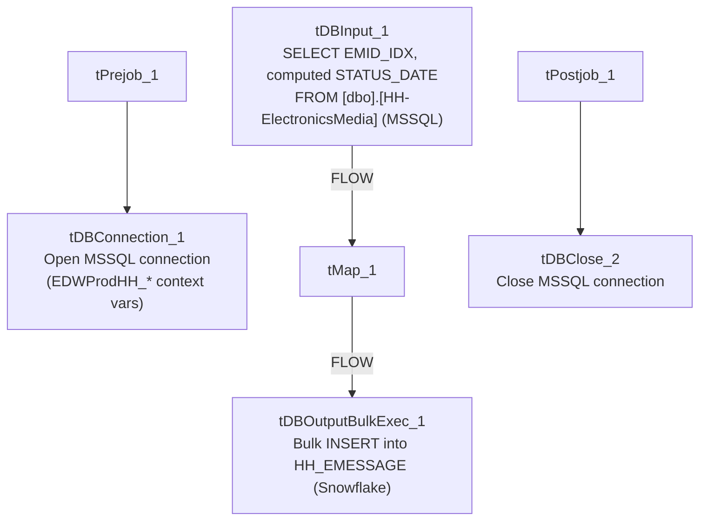

# Talend Job: HH_EMedia_Load

## Overview

A small, simple electronic-media status load: it reads two columns — a message identifier (`EMID_IDX`) and a computed status date (`DATEADD(DAY, STATUS_DATE, '1967-12-31')`, a legacy epoch-offset date format) — from the `[dbo].[HH-ElectronicsMedia]` table in the legacy `EDWProdHH` MSSQL database, and bulk-inserts them into a Snowflake table `HH_EMESSAGE`. This job should not be confused with the much larger, structurally different `HH_E_Media_Load` (note the extra underscore) — see Issues observed for a detailed comparison, including a significant table-name discrepancy found in that sibling job.

## Detail table

| Field | Value |
|---|---|
| Job name | HH_EMedia_Load |
| Version | 0.1 |
| Project | EDW2SF |
| Author | jmach@harriscollect.com |
| Created | 2022-04-27T12:55:24.320-0700 |
| Last Modified | 2025-08-28T08:57:23.583-0700 |

## Step-by-step data flow

**Setup subjob:** `tPrejob_1` → `tDBConnection_1` opens the MSSQL connection to `context.EDWProdHH_Server`/`Port`/`Schema`/`Database`/`Login` (password redacted).

**Main subjob:** `tDBInput_1` runs `SELECT CAST(EMID_IDX AS VARCHAR(105)), DATEADD(DAY, STATUS_DATE,'1967-12-31') FROM [dbo].[HH-ElectronicsMedia];` → `tMap_1` passes the two columns through unchanged (`DIE_ON_ERROR=true`) → `tDBOutputBulkExec_1` bulk-inserts the rows into Snowflake table `HH_EMESSAGE` (`INSERT`, `tableAction=NONE`).

**Teardown subjob:** `tPostjob_1` → `tDBClose_2` closes the MSSQL connection. Note there is no `tDBClose` for a Snowflake connection captured in this job's metadata, even though `tDBOutputBulkExec_1` writes to Snowflake — see Issues observed.

## Settings tables

### Source: `tDBInput_1` (`tMSSqlInput`)

| Setting | Value | What it means |
|---|---|---|
| Query | `SELECT CAST(EMID_IDX AS VARCHAR(105)), DATEADD(DAY, STATUS_DATE,'1967-12-31') FROM [dbo].[HH-ElectronicsMedia];` | Only 2 columns pulled, no filter — every run re-reads the entire source table. The `DATEADD(DAY, STATUS_DATE, '1967-12-31')` expression converts a legacy integer day-offset into a real date. |
| TRIM_ALL_COLUMN | `true` | Trims whitespace from all string fields. |

### Target: `tDBOutputBulkExec_1` (`tSnowflakeOutputBulkExec`)

| Setting | Value | What it means |
|---|---|---|
| Table | `HH_EMESSAGE` | Destination table in Snowflake. |
| Output action | `INSERT` | Appends rows — no truncate/upsert, no incremental filter on the source query. |
| Table action | `NONE` | Table is not created/recreated by this job. |

## Dependencies & configuration

- **Triggers/depends on other jobs:** none — no `tRunJob` links found.
- **Context variables used:** `EDWProdHH_Database`, `EDWProdHH_Login`, `EDWProdHH_Port`, `EDWProdHH_Schema`, `EDWProdHH_Server`.
- No hardcoded developer-workstation paths found in this job.

## Glossary

| Component type | Plain-English meaning |
|---|---|
| `tMSSqlConnection` / `tMSSqlInput` / `tMSSqlClose` | Open a Microsoft SQL Server connection, run a query against it, and close it. |
| `tMap` | Maps/transforms columns from one schema to another. |
| `tSnowflakeOutputBulkExec` | Bulk-loads rows into a Snowflake table, typically faster than row-by-row insert for large volumes. |

## Issues observed

- **No `TRUNCATE`, `UPSERT`, or incremental filter** — every run re-reads the entire `[dbo].[HH-ElectronicsMedia]` MSSQL table and appends it to `HH_EMESSAGE` with a plain `INSERT`. If run more than once (or on any regular schedule), this would duplicate all previously loaded rows indefinitely, since there is no key comparison or truncate step anywhere in this job.
- **No Snowflake connection-close component captured** — `tDBOutputBulkExec_1` writes to Snowflake, but the only `tDBClose` component in this job's metadata (`tDBClose_2`) closes the MSSQL connection (`tDBConnection_1`). There is no visible Snowflake connection-open component either, suggesting this job may rely on an implicit/default Snowflake connection not captured in this extraction, or the Snowflake connection lifecycle simply wasn't captured. Unable to determine from metadata; verify directly in Talend Studio.
- **Do not confuse this job with `HH_E_Media_Load`** (note the additional underscore between "E" and "Media"). Despite the similar name, that job is structurally much larger: it uses an incremental `maxUpdateKey` pattern, truncates and reloads a staging table, then runs an explicit `MERGE` into `DW.HH_ELECTRONICSMEDIA`, and — critically — its source table is configured as `"DC-ElectronicsMedia"`, not an HH-prefixed table. See that job's own doc for details; the two jobs' outputs (`HH_EMESSAGE` here vs. `HH_ELECTRONICSMEDIA` there) are also different tables, so they are not simply duplicate implementations of the same load.
