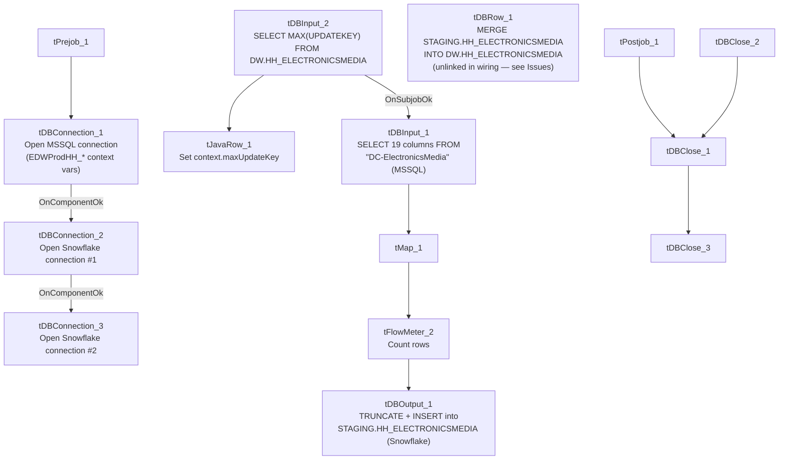

# Talend Job: HH_E_Media_Load

## Overview

Loads electronic-media/letter-status tracking records (logon, message ID, letter name, status date/time/text, waterfall sequencing, series tracking, source system) from the legacy `EDWProdHH` MSSQL database into the Snowflake `HH_ELECTRONICSMEDIA` table, using an incremental `maxUpdateKey` check, a truncate-and-reload staging step, and an explicit `MERGE` into the final warehouse table. This job is dramatically larger and more fully-built than the similarly-named `HH_EMedia_Load` (no second underscore) — but its source table is configured as `"DC-ElectronicsMedia"`, not an HH-prefixed table, which is a significant naming discrepancy given the job's own name. See Issues observed.

## Detail table

| Field | Value |
|---|---|
| Job name | HH_E_Media_Load |
| Version | 0.1 |
| Project | EDW2SF |
| Author | jmach@harriscollect.com |
| Created | 2022-05-17T09:01:11.409-0700 |
| Last Modified | 2025-09-24T11:07:38.744-0700 |

## Step-by-step data flow

**Setup subjob:** `tPrejob_1` → `tDBConnection_1` opens the MSSQL connection to `context.EDWProdHH_Server`/`Port`/`Schema`/`Database`/`Login` → on subjob-ok, `tDBConnection_2` opens the first Snowflake connection → on subjob-ok, `tDBConnection_3` opens a **second, separate** Snowflake connection (see Issues observed).

**Main subjob:**

1. `tDBInput_2` runs `SELECT CAST(COALESCE(MAX(UPDATEKEY),0) AS VARCHAR(10)) AS MAXUPDATEKEY FROM DW.HH_ELECTRONICSMEDIA;` against Snowflake.
2. `tJavaRow_1` captures the value into `context.maxUpdateKey`.
3. On success, `tDBInput_1` runs a fixed `SELECT` against MSSQL table **`"DC-ElectronicsMedia"`** (per the component's `TABLE` parameter), pulling `LOGON`, `EMID`, `EMID_IDX`, `LETTER_NAME`, `STATUS_DATE`, `STATUS_TIME`, `STATUS`, `STATUS_TEXT`, `STATUS_TYPE`, `WATERFALL`, `UPDATE_DT`, `UPDATE_TIME`, `CURR_SERIES`, `NEW_SERIES`, `CONTENT`, `ORIG_STATUS`, `SOURCE`, `SRC_NAME`, `UpdateKey` (19 columns; query text truncated after these, and does not visibly reference `context.maxUpdateKey`).
4. `tMap_1` passes the columns through (`DIE_ON_ERROR=true`) to a same-shaped uppercase target schema.
5. `tFlowMeter_2` counts rows passing through (labeled "MyLabel").
6. `tDBOutput_1` writes to Snowflake table `HH_ELECTRONICSMEDIA` with `outputAction=INSERT` and **`tableAction=TRUNCATE`** — the staging table is cleared before this load's rows are inserted.
7. `tDBRow_1` (a separate, unlinked component per the connections list — it is not wired downstream of the truncate/insert step) runs a `MERGE INTO DW.HH_ELECTRONICSMEDIA` statement, sourcing from `STAGING.HH_ELECTRONICSMEDIA` and matching on `EMID_IDX`, updating matched rows and inserting new ones.

**Teardown subjob:** teardown components (`tDBClose_1`, `tDBClose_2`, `tDBClose_3`) close the two Snowflake connections and the MSSQL connection, chained together.

## Settings tables

### Source: `tDBInput_1` (`tMSSqlInput`)

| Setting | Value | What it means |
|---|---|---|
| TABLE | `"DC-ElectronicsMedia"` | The source table is explicitly named for the **DC** site, not HH — see Issues observed. |
| Query | `SELECT [LOGON], [EMID], [EMID_IDX], [LETTER_NAME], [STATUS_DATE], [STATUS_TIME], [STATUS], [STATUS_TEXT], [STATUS_TYPE], [WATERFALL], [UPDATE_DT], [UPDATE_TIME], [...` (truncated) | Pulls 19 columns describing electronic-media letter/notice status tracking. |

### Staging load: `tDBOutput_1` (`tSnowflakeOutput`)

| Setting | Value | What it means |
|---|---|---|
| Table | `HH_ELECTRONICSMEDIA` | Written with `TRUNCATE` + `INSERT` — functions as a staging table cleared and reloaded each run. |

### Merge step: `tDBRow_1` (`tSnowflakeRow`)

| Setting | Value | What it means |
|---|---|---|
| Query | `MERGE INTO DW.HH_ELECTRONICSMEDIA AS tgt USING (SELECT LEFT(LOGON,50) AS LOGON, ... FROM STAGING.HH_ELECTRONICSMEDIA) AS src ON (tgt.EMID_IDX = src.EMID_IDX) WHEN MATCHED THEN UPDATE ... WHEN NOT MATCHED THEN INSERT ...` | Standard upsert-via-merge from the staging table into the final `DW.HH_ELECTRONICSMEDIA` warehouse table, truncating string fields to fixed lengths on the way in. |
| Schema reference | `table.main.schema:REPOSITORY_SCHEMA_TYPE` = `"_m9AtkGRHEeyH09yzpUroLA - LEGACY_DIMDEBTOR"` | **This component's configured repository schema is `LEGACY_DIMDEBTOR`** — a debtor-dimension schema, not an electronic-media schema. Its actual `schema_columns` metadata (captured separately) lists `FILEDATE`, `LOGON`, `DEBTOR`, `CLIENT`, `NAME1`, `NAME2`, `ADD1`, `TOTAL_BAL`, and dozens of other `DIMDEBTOR`-style columns that have nothing to do with electronic media — see Issues observed. |

## Dependencies & configuration

- **Triggers/depends on other jobs:** none — no `tRunJob` links found.
- **Context variables used:** `EDWProdHH_Database`, `EDWProdHH_Login`, `EDWProdHH_Port`, `EDWProdHH_Schema`, `EDWProdHH_Server`, `maxUpdateKey`.
- No hardcoded developer-workstation paths found in this job.

## Glossary

| Component type | Plain-English meaning |
|---|---|
| `tMSSqlConnection` / `tMSSqlInput` / `tMSSqlClose` | Open a Microsoft SQL Server connection, run a query against it, and close it. |
| `tSnowflakeConnection` / `tSnowflakeInput` / `tSnowflakeOutput` / `tSnowflakeRow` / `tSnowflakeClose` | Open a Snowflake connection, query it, write rows to a table, run an arbitrary SQL statement, and close the connection. |
| `tMap` | Maps/transforms columns from one schema to another. |
| `tFlowMeter` | Counts rows passing a point in the flow for logging/monitoring. |
| `tJavaRow` | Runs custom Java code once per input row — here used to unpack a single query result into a context variable. |

## Issues observed

- **The source table is explicitly configured as `"DC-ElectronicsMedia"`, not an HH-prefixed table, despite this job being named `HH_E_Media_Load`.** This is either a real, significant bug (this job is silently loading DC site data into what's presumed to be the HH electronic-media table), or the `TABLE` parameter is a leftover from copying a `DC_E_Media_Load` template that was never updated even though the rest of the job (target tables `HH_ELECTRONICSMEDIA`, context variables `EDWProdHH_*`) is consistently HH-branded. This should be verified urgently with the team — if the table name is wrong, `HH_ELECTRONICSMEDIA` in the warehouse may currently contain DC site data instead of (or mixed with) HH site data, or the query may simply fail at runtime if `"DC-ElectronicsMedia"` doesn't exist on the `EDWProdHH` server.
- **`tDBRow_1` (the merge step) is configured with a `LEGACY_DIMDEBTOR` repository schema**, and its own captured `schema_columns` list is a debtor-dimension schema (`LOGON`, `DEBTOR`, `CLIENT`, `NAME1`, `ADD1`, `TOTAL_BAL`, dozens more) that bears no resemblance to the actual `MERGE` query's electronic-media columns (`EMID`, `LETTER_NAME`, `STATUS`, `WATERFALL`, etc.). This is a clear copy-paste artifact — the component's schema metadata was never updated after being copied from a debtor-load job — though because `tSnowflakeRow` runs arbitrary SQL rather than relying on its declared schema for execution, this is very likely a cosmetic/metadata-only issue rather than a runtime failure. Still, it makes this component's own displayed schema actively misleading to anyone inspecting the job in Talend Studio.
- **`tDBRow_1` (the merge) does not appear to be connected in this job's sequence** — the captured `connections` list shows no link from `tDBOutput_1` (the truncate+insert step) to `tDBRow_1`, meaning the merge may run as an independent, unlinked subjob rather than strictly after the staging load completes. If Talend executes unlinked subjobs concurrently, the merge could theoretically run against a partially-loaded or stale staging table. Verify actual subjob ordering directly in Talend Studio.
- **Two separate Snowflake connections are opened** (`tDBConnection_2` and `tDBConnection_3`) rather than one shared connection reused across components — unlike most other jobs in this project. Unable to determine why a second connection is needed from this metadata; it may be intentional (e.g., isolating the merge's transaction from the staging load's), or a copy-paste leftover.
- **No error/row-count logging specific to this job's business outcome** (no `tWarn`/`tDie`/`tSendMail`) beyond the standard row-count `tFlowMeter`.
