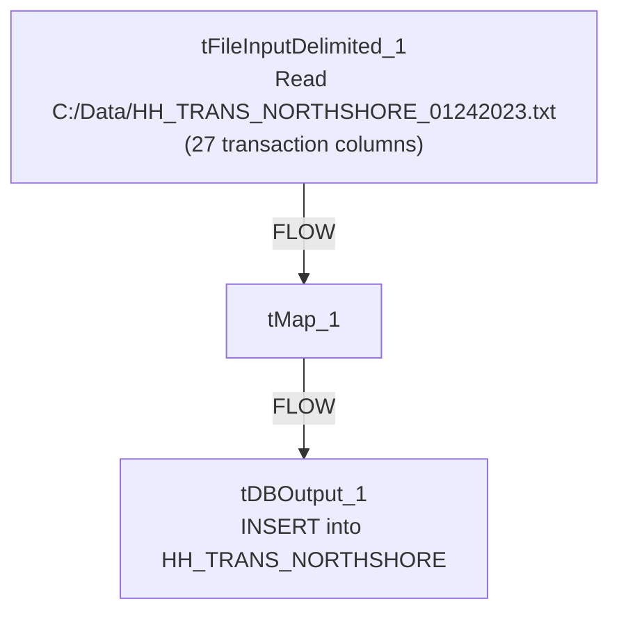

# Talend Job: HH_TRANS_NORTHSHORE_LOAD

## Overview

A one-off, dated file load for the NorthShore client: it reads a fixed local file `C:/Data/HH_TRANS_NORTHSHORE_01242023.txt` — 27 columns covering debtor number, assignment/CDN identifiers, transaction code and description, transaction amount/date, client identifiers, comments, NSF flag, commission fields, and forwarding fees — and inserts it directly into a Snowflake table `HH_TRANS_NORTHSHORE`. The job's name and hardcoded, dated input filename mark it as a targeted one-time transaction backfill rather than a recurring scheduled load, similar in shape and purpose to `HH_DEBTOR_SPECIAL_20231016_LOAD`.

## Detail table

| Field | Value |
|---|---|
| Job name | HH_TRANS_NORTHSHORE_LOAD |
| Version | 0.1 |
| Project | EDW2SF |
| Author | jmach@harriscollect.com |
| Created | 2023-01-24T14:21:52.597-0800 |
| Last Modified | 2025-09-24T11:07:44.153-0700 |

## Step-by-step data flow

The entire job is a single flow: `tFileInputDelimited_1` reads `C:/Data/HH_TRANS_NORTHSHORE_01242023.txt` (tab-delimited, header row present, using a repository schema, `DIE_ON_ERROR=false`) → `tMap_1` passes the 27 columns through unchanged to a same-shaped target schema (`DIE_ON_ERROR=true`) → `tDBOutput_1` inserts the rows into Snowflake table `HH_TRANS_NORTHSHORE`. There is no `tPrejob`/`tPostjob`, no explicit connection-open/close component, and no logging visible in this job's extracted metadata.

## Settings tables

### Source: `tFileInputDelimited_1`

| Setting | Value | What it means |
|---|---|---|
| FILENAME | `"C:/Data/HH_TRANS_NORTHSHORE_01242023.txt"` (hardcoded) | A fixed, dated, one-time source file tied to a specific client (NorthShore) and date (Jan 24, 2023). |
| FIELDSEPARATOR / HEADER | tab / 1 header row | Standard delimited file with header skipped. |
| DIE_ON_ERROR | `false` | Malformed rows don't fail the job — no reject flow is wired to capture them either. |
| TEMP_DIR | `"C:/Talend-Studio-20211109_1610-V8.0.1/workspace"` (hardcoded) | Same project-wide developer-workstation path risk documented in `05_operational_runbook.md`. |

### Target: `tDBOutput_1` (`tSnowflakeOutput`)

| Setting | Value | What it means |
|---|---|---|
| Table | `HH_TRANS_NORTHSHORE` | A client-specific transaction table — not the shared `FACTTRANS`/`HOPE_TRANSACTION` fact tables used elsewhere in the project. |
| Output action | `INSERT` | Appends rows — running this job more than once would duplicate rows since there is no truncate or upsert. |
| Table action | `NONE` | The table is not created/recreated by this job; it must already exist. |

## Dependencies & configuration

- **Triggers/depends on other jobs:** none — no `tRunJob` links found.
- **Context variables used:** none.
- **1 hardcoded path finding:** `tFileInputDelimited_1.TEMP_DIR` = `"C:/Talend-Studio-20211109_1610-V8.0.1/workspace"`. The source file path itself (`C:/Data/HH_TRANS_NORTHSHORE_01242023.txt`) is also hardcoded and dated but was not separately flagged in the extracted `hardcoded_path_findings` field.

## Glossary

| Component type | Plain-English meaning |
|---|---|
| `tFileInputDelimited` | Reads a delimited (tab/CSV-style) text file according to a schema. |
| `tMap` | Maps/transforms columns from one schema to another (here, a straight pass-through). |
| `tSnowflakeOutput` | Writes rows to a Snowflake table. |

## Issues observed

- **This job has no visible connection-open/close, prejob/postjob, or logging components** — same pattern as `HH_DEBTOR_SPECIAL_20231016_LOAD` and `HH_VAL_LTR_DATE_Backfill`, all of which appear to be minimal, ad-hoc, one-time-use jobs rather than fully-instrumented recurring production loads. Unable to confirm connection handling from this metadata; verify directly in Talend Studio if this job might ever be re-run.
- **`INSERT` with `tableAction=NONE` and no incremental key or truncate step** means re-running this job (even accidentally) would duplicate every row already loaded into `HH_TRANS_NORTHSHORE`. Given the job's one-off, client- and date-specific nature, this is a real risk if run more than once.
- **`tMap_1` has `DIE_ON_ERROR=true` while the upstream file read has `DIE_ON_ERROR=false`** — a malformed source row would pass through the file read silently (no reject flow captured it) but could then fail the whole job at the map step if it doesn't fit the target schema. This inconsistency means the job's actual error behavior on bad data depends on exactly where in the row the malformation occurs, which is hard to predict from metadata alone.
- **Given this is a dated, client-specific one-time load, it should likely be retired or archived once confirmed loaded**, rather than left active alongside recurring production jobs — worth confirming with the team.
