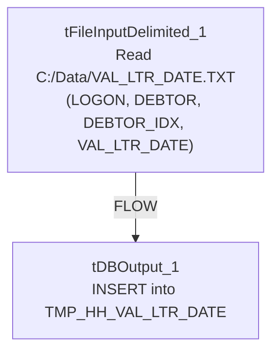

# Talend Job: HH_VAL_LTR_DATE_Backfill

## Overview

A one-off backfill job: it reads a fixed local file `C:/Data/VAL_LTR_DATE.TXT` (logon, debtor number, debtor index, and a "validation letter date") and inserts it into a temporary Snowflake staging table `TMP_HH_VAL_LTR_DATE`. Unlike the other one-off loads in this batch (`HH_DEBTOR_SPECIAL_20231016_LOAD`, `HH_TRANS_NORTHSHORE_LOAD`), this job's target table name is explicitly prefixed `TMP_`, signaling it's meant as a staging landing spot for a manual or separate downstream process (e.g., a SQL script or another job) to pick up and merge — not a final destination table itself.

## Detail table

| Field | Value |
|---|---|
| Job name | HH_VAL_LTR_DATE_Backfill |
| Version | 0.1 |
| Project | EDW2SF |
| Author | jmach@harriscollect.com |
| Created | 2025-06-23T11:12:49.271-0700 |
| Last Modified | 2025-09-24T11:00:10.011-0700 |

## Step-by-step data flow

The entire job is a single flow: `tFileInputDelimited_1` reads `C:/Data/VAL_LTR_DATE.TXT` (tab-delimited, header row present, `TRIMALL=true`, `REMOVE_EMPTY_ROW=true`, `DIE_ON_ERROR=false`) and passes its rows (`FLOW` connector) directly into `tDBOutput_1`, which inserts them into Snowflake table `TMP_HH_VAL_LTR_DATE`. There is no `tPrejob`/`tPostjob`, no explicit connection-open/close component, no `tMap`, and no logging visible in this job's extracted metadata.

## Settings tables

### Source: `tFileInputDelimited_1`

| Setting | Value | What it means |
|---|---|---|
| FILENAME | `"C:/Data/VAL_LTR_DATE.TXT"` (hardcoded) | A fixed, one-time source file — not driven by any context variable. |
| FIELDSEPARATOR / HEADER | tab / 1 header row | Standard delimited file with header skipped. |
| TRIMALL | `true` | Trims whitespace from all fields — a data-cleanliness step not seen in the other one-off loads in this batch. |
| REMOVE_EMPTY_ROW | `true` | Blank lines in the source file are dropped rather than loaded as empty rows. |
| DIE_ON_ERROR | `false` | Malformed rows don't fail the job — no reject flow is wired to capture them either. |
| TEMP_DIR | `"C:/Talend-Studio-20211109_1610-V8.0.1/workspace"` (hardcoded) | Same project-wide developer-workstation path risk documented in `05_operational_runbook.md`. |

### Target: `tDBOutput_1` (`tSnowflakeOutput`)

| Setting | Value | What it means |
|---|---|---|
| Table | `TMP_HH_VAL_LTR_DATE` | A `TMP_`-prefixed staging table — the name signals this is not the final destination for this data. |
| Output action | `INSERT` | Appends rows — running this job more than once would duplicate rows since there is no truncate or upsert. |
| Table action | `NONE` | The table is not created/recreated by this job; it must already exist. |

## Dependencies & configuration

- **Triggers/depends on other jobs:** none — no `tRunJob` links found. There is also no visible merge step or downstream job in this batch's metadata that reads from `TMP_HH_VAL_LTR_DATE`, so what consumes this staging table cannot be confirmed from metadata alone.
- **Context variables used:** none.
- **1 hardcoded path finding:** `tFileInputDelimited_1.TEMP_DIR` = `"C:/Talend-Studio-20211109_1610-V8.0.1/workspace"`. The source file path itself (`C:/Data/VAL_LTR_DATE.TXT`) is also hardcoded but was not separately flagged in the extracted `hardcoded_path_findings` field.

## Glossary

| Component type | Plain-English meaning |
|---|---|
| `tFileInputDelimited` | Reads a delimited (tab/CSV-style) text file according to a schema. |
| `tSnowflakeOutput` | Writes rows to a Snowflake table. |

## Issues observed

- **This job loads into a `TMP_`-prefixed table with no merge step of its own**, and no other job in this batch was found to reference `TMP_HH_VAL_LTR_DATE` or a similarly-named final table. This means the actual "last mile" of this backfill — moving the staged validation-letter dates into whatever permanent table they belong in — happens outside of what this metadata can see (likely a manual SQL script or a job not included in this export). Unable to confirm from metadata; verify with the team what downstream process consumes `TMP_HH_VAL_LTR_DATE`, since without it this job's data never reaches a permanent home.
- **This job has no visible connection-open/close, prejob/postjob, or logging components** — consistent with the other one-off, ad-hoc loads in this batch, but worth confirming actual connection handling in Talend Studio if this job is ever re-run.
- **`INSERT` with no truncate/upsert** means re-running this job would duplicate rows in the staging table. Since the table is meant as a `TMP_` landing spot, this may be an accepted risk if the downstream consumer truncates it before or after consuming — but that can't be confirmed from this job's own metadata.
- **Given this is a one-time backfill, it should likely be retired or archived once its data has been confirmed loaded and merged downstream**, rather than left active alongside recurring production jobs.
