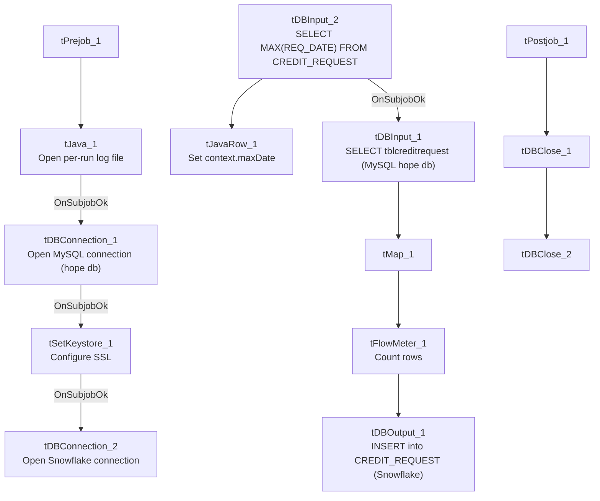

# Talend Job: HOPE_Credit_Request

## Overview

Loads commission/credit-adjustment requests (who requested it, when, which table/transaction it applies to, whether it was granted, the reason, request type, new commission rate, and a reference ID) from the "HOPE" MySQL system's `tblcreditrequest` table into the Snowflake `CREDIT_REQUEST` table, using an incremental load keyed on the request date. HOPE appears to be an internal collector-performance/commission-tracking system (see the related `HOPE_Goals_Load`, `HOPE_Notes_Load`, `HOPE_SPTransactions_Load`, and `HOPE_Transactions_Load` jobs).

## Detail table

| Field | Value |
|---|---|
| Job name | HOPE_Credit_Request |
| Version | 0.1 |
| Project | EDW2SF |
| Author | jmach@harriscollect.com |
| Created | 2022-03-15T14:23:19.958-0700 |
| Last Modified | 2025-11-04T11:08:21.049-0800 |

## Step-by-step data flow

**Setup subjob:** `tPrejob_1` → `tJava_1` opens a per-run log file at `context.logDir + jobName + "_" + <timestamp> + ".log"` → on subjob-ok, `tDBConnection_1` opens the MySQL connection to host `"MP-HOPE-V01"`, database `"hope"`, user `"svc_edw"` (password redacted) → on subjob-ok, `tSetKeystore_1` configures SSL trust/keystore from `context.keystorePath` → on subjob-ok, `tDBConnection_2` opens the Snowflake connection.

**Main subjob:**

1. `tDBInput_2` runs `SELECT CAST(COALESCE(MAX(REQ_DATE),'2000-01-01') AS VARCHAR(50)) AS MAX_DATE FROM CREDIT_REQUEST;` against Snowflake.
2. `tJavaRow_1` captures the value into `context.maxDate`.
3. On success, `tDBInput_1` reads from MySQL repository schema `tblcreditrequest`, selecting `tblReqID`, `TransactionID`, `Initials`, `ReqDate`, `curTable`, `Completed`, `Granted`, `Reason`, `ReqType`, `NewRate`, `RefID` (query text truncated — does not visibly show a `WHERE` filter referencing `context.maxDate` in the captured portion; see Issues observed).
4. `tMap_1` renames/passes columns through to `TRANS_IDX`, `INITIALS`, `REQ_DATE`, `CURRENT_TABLE`, `COMPLETED`, `GRANTED`, `REASON`, `REQ_TYPE`, `NEW_RATE`, `REF_ID` (`DIE_ON_ERROR=true`).
5. `tFlowMeter_1` counts rows passing through.
6. `tDBOutput_1` inserts the rows into Snowflake table `CREDIT_REQUEST` (`INSERT`, `tableAction=NONE`, no merge step).

**Teardown subjob:** `tPostjob_1` → `tDBClose_1` (close MySQL) → `tDBClose_2` (close Snowflake).

## Settings tables

### Source: `tDBInput_1` (`tMysqlInput`)

| Setting | Value | What it means |
|---|---|---|
| Connection | Shared `tDBConnection_1` (host `MP-HOPE-V01`, db `hope`, user `svc_edw`) | Reuses the job's MySQL connection to the HOPE system. |
| Table | `tblcreditrequest` | Source commission/credit-request table. |
| Query | `SELECT tblReqID, TransactionID, Initials, ReqDate, curTable, Completed, Granted, Reason, ReqType, NewRate, RefID FROM tblcreditrequest` (truncated) | No visible date filter in the captured portion — see Issues observed. |

### Target: `tDBOutput_1` (`tSnowflakeOutput`)

| Setting | Value | What it means |
|---|---|---|
| Table | `CREDIT_REQUEST` | Destination table in Snowflake. |
| Output action | `INSERT` | Appends rows — relies entirely on the source query being correctly filtered to avoid duplicates, since there's no `TRUNCATE` or `UPSERT`. |

## Dependencies & configuration

- **Triggers/depends on other jobs:** none — no `tRunJob` links found.
- **Context variables used:** `keystorePath`, `logDir`, `maxDate` (computed internally).
- **1 hardcoded path finding:** `tSetKeystore_1.SSL_TRUSTSERVER_TRUSTSTORE` = `"C:/clientTrustStore.trustStore"`.

## Glossary

| Component type | Plain-English meaning |
|---|---|
| `tMysqlConnection` / `tMysqlInput` / `tMysqlClose` | Open a MySQL connection, run a query against it, and close it. |
| `tSnowflakeConnection` / `tSnowflakeInput` / `tSnowflakeOutput` / `tSnowflakeClose` | Open a Snowflake connection, query it, write rows to a table, and close the connection. |
| `tMap` | Maps/transforms columns from one schema to another. |
| `tFlowMeter` | Counts rows passing a point in the flow for logging/monitoring. |
| `tJavaRow` | Runs custom Java code once per input row — here used to unpack a single query result into a context variable. |
| `tSetKeystore` | Configures SSL/TLS trust and client certificate settings used by subsequent secure connections in the job. |

## Issues observed

- **The incremental-load logic may not actually be applied** — `context.maxDate` is computed from Snowflake before reading MySQL, but the captured `tDBInput_1.QUERY` text is truncated and does not show a `WHERE ReqDate > ...` clause referencing `context.maxDate` in the visible portion. Combined with a plain `INSERT` (no `TRUNCATE`/`UPSERT`), if the filter isn't actually applied, every run would duplicate all previously loaded credit-request rows in `CREDIT_REQUEST`. This should be verified directly in Talend Studio.
- **No error/row-count logging specific to this job's business outcome** (no `tWarn`/`tDie`/`tSendMail`) — a load failure here would only surface as a generic Talend execution error.
