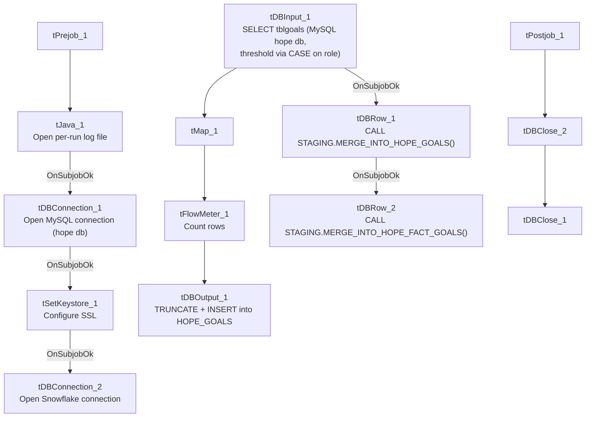

# Talend Job: HOPE_Goals_Load

## Overview

Loads collector performance-goal records (username, initials, vertical, role, a calculated threshold, credit month/year, and goal type) from the "HOPE" MySQL system's `tblgoals` table into the Snowflake `HOPE_GOALS` table, truncating and reloading the table each run, then calling two stored procedures in sequence to merge the data into `HOPE_GOALS` and a downstream `HOPE_FACT_GOALS` fact table. Unlike its sibling `HOPE_Credit_Request` (incremental, insert-only, no merge), this job is a full-refresh-then-merge design.

## Detail table

| Field | Value |
|---|---|
| Job name | HOPE_Goals_Load |
| Version | 0.1 |
| Project | EDW2SF |
| Author | jmach@harriscollect.com |
| Created | 2022-03-17T16:21:43.345-0700 |
| Last Modified | 2025-11-04T11:18:03.414-0800 |

## Step-by-step data flow

**Setup subjob:** `tPrejob_1` → `tJava_1` opens a per-run log file → on subjob-ok, `tDBConnection_1` opens the MySQL connection to `"MP-HOPE-V01"` / `"hope"` / `"svc_edw"` (password redacted) → on subjob-ok, `tSetKeystore_1` configures SSL trust/keystore from `context.keystorePath` → on subjob-ok, `tDBConnection_2` opens the Snowflake connection.

**Main subjob:**

1. `tDBInput_1` reads from MySQL table `tblgoals` via a stored query (repository query store `usergoals`) selecting `username`, `initials`, `vertical`, `role`, a `CASE`-derived `threshold` (rounding logic varies by role — visible portion mentions `'COLLECTOR - BILINGUAL'` and `'FLOOR COACH'` roles), `CREDIT_MONTH`, `CREDIT_YEAR`, `GOAL_TYPE` (query truncated beyond this point).
2. `tMap_1` maps the columns to `INITIALS`, `GOAL`, `LOAD_DATE`, `CREDIT_MONTH`, `CREDIT_YEAR`, `CREDIT_DATE`, `EFF_DATE`, `EXP_DATE`, `VERTICAL`, `USER_ROLE`, `GOAL_TYPE` (`DIE_ON_ERROR=true`).
3. `tFlowMeter_1` counts rows passing through.
4. `tDBOutput_1` writes to Snowflake table `HOPE_GOALS` with `outputAction=INSERT` and **`tableAction=TRUNCATE`** — a full refresh each run.
5. On subjob-ok, `tDBRow_1` runs `CALL STAGING.MERGE_INTO_HOPE_GOALS();`, then on subjob-ok, `tDBRow_2` runs `CALL STAGING.MERGE_INTO_HOPE_FACT_GOALS();` — two chained merge calls.

**Teardown subjob:** `tPostjob_1` → `tDBClose_2` (close MySQL) → `tDBClose_1` (close Snowflake).

## Settings tables

### Source: `tDBInput_1` (`tMysqlInput`)

| Setting | Value | What it means |
|---|---|---|
| Table | `tblgoals` | Source performance-goal table. |
| Query | `SELECT u.username, u.initials, u.vertical, u.role, CASE WHEN u.role IN ('COLLECTOR - BILINGUAL', 'FLOOR COACH') THEN ROUND(th....` (truncated) | Role-dependent threshold calculation embedded in SQL — the full rounding logic isn't visible in this metadata. |
| TRIM_ALL_COLUMN | `true` | Trims whitespace from all fields. |

### Target: `tDBOutput_1` (`tSnowflakeOutput`)

| Setting | Value | What it means |
|---|---|---|
| Table | `HOPE_GOALS` | Written with `TRUNCATE` + `INSERT` each run — a full-refresh staging pattern, unlike `HOPE_Credit_Request`'s incremental append. |

### Merge steps: `tDBRow_1` / `tDBRow_2`

| Setting | Value | What it means |
|---|---|---|
| Query 1 | `CALL STAGING.MERGE_INTO_HOPE_GOALS();` | Merges the freshly truncated/loaded staging data into the `HOPE_GOALS` warehouse structure. |
| Query 2 | `CALL STAGING.MERGE_INTO_HOPE_FACT_GOALS();` | Chained a second merge into a `HOPE_FACT_GOALS` fact table — the only job in this batch with two sequential merge calls to different targets. |

## Dependencies & configuration

- **Triggers/depends on other jobs:** none — no `tRunJob` links found.
- **Context variables used:** `keystorePath`, `logDir`.
- **1 hardcoded path finding:** `tSetKeystore_1.SSL_TRUSTSERVER_TRUSTSTORE` = `"C:/clientTrustStore.trustStore"`.

## Glossary

| Component type | Plain-English meaning |
|---|---|
| `tMysqlConnection` / `tMysqlInput` / `tMysqlClose` | Open a MySQL connection, run a query against it, and close it. |
| `tSnowflakeConnection` / `tSnowflakeOutput` / `tSnowflakeRow` / `tSnowflakeClose` | Open a Snowflake connection, write rows to a table, run an arbitrary SQL statement, and close the connection. |
| `tMap` | Maps/transforms columns from one schema to another. |
| `tFlowMeter` | Counts rows passing a point in the flow for logging/monitoring. |
| `tSetKeystore` | Configures SSL/TLS trust and client certificate settings used by subsequent secure connections in the job. |

## Issues observed

- **Neither merge call's result (`RETVALUE`) is captured or checked** — unlike `Fact_Electronic_Media_Load`, `ADP_Payroll_Load`, and `HH_E_Media_Load`, this job's two `tDBRow` merge calls have no `tJavaRow` capturing a return value and no `tWarn`/`tDie` branching on success or failure. If either `MERGE_INTO_HOPE_GOALS()` or `MERGE_INTO_HOPE_FACT_GOALS()` fails silently (e.g., returns an error code rather than throwing an exception Talend would catch), this job would report success with no record of the merge's actual outcome.
- **`tDBRow_1`'s "start" trigger is `tDBInput_1`'s `OnSubjobOk`, not the completion of the truncate/insert (`tDBOutput_1`)** — per the captured connections, `tDBRow_1` fires when the MySQL read subjob completes successfully, running in parallel with (not strictly after) the `tMap_1` → `tFlowMeter_1` → `tDBOutput_1` chain. If the merge is meant to run only after the fresh data has been loaded into the `HOPE_GOALS` staging table, this wiring could let the merge run against stale or partially-loaded staging data. Verify actual subjob ordering directly in Talend Studio.
- **The role-based threshold calculation is embedded directly in the source SQL query** (a `CASE` statement referencing specific role names) rather than in `tMap_1` or a lookup table — business logic like this is harder to discover, test, or update independently of the query text, and any change to role names in the HOPE source system's `role` column would need this SQL updated in lockstep, not just a config value changed.
