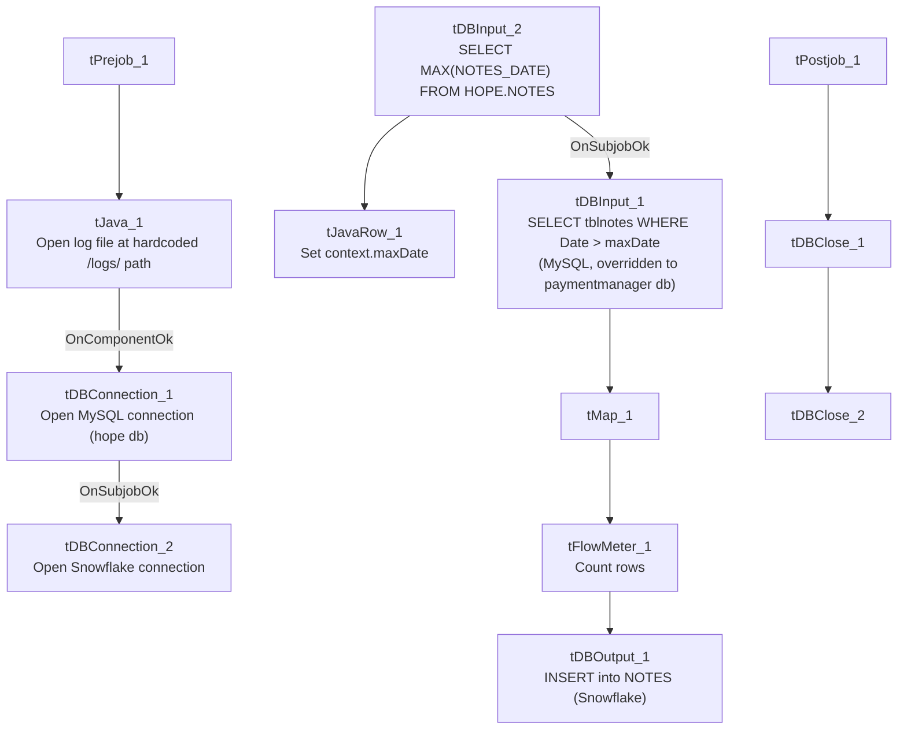

# Talend Job: HOPE_Notes_Load

## Overview

Loads collector notes (transaction ID, note text, date/time, initials, and pay amount) from a MySQL `paymentmanager` database's `tblnotes` table into the Snowflake `NOTES` table, using an incremental load keyed on the note date. Despite being one of the "HOPE" family of jobs (alongside `HOPE_Credit_Request`, `HOPE_Goals_Load`, `HOPE_SPTransactions_Load`, `HOPE_Transactions_Load`), its actual source is the separate `paymentmanager` MySQL database, not the `hope` database its own connection component is configured for — see Issues observed.

## Detail table

| Field | Value |
|---|---|
| Job name | HOPE_Notes_Load |
| Version | 0.1 |
| Project | EDW2SF |
| Author | jmach@harriscollect.com |
| Created | 2022-03-15T10:13:23.695-0700 |
| Last Modified | 2025-11-04T10:24:18.036-0800 |

## Step-by-step data flow

**Setup subjob:** `tPrejob_1` → `tJava_1` opens a per-run log file at a **hardcoded** `/logs/` path (see Issues observed) → on component-ok, `tDBConnection_1` opens the MySQL connection (host `"MP-HOPE-V01"`, db `"hope"`, user `"svc_edw"`, password redacted) → on subjob-ok, `tDBConnection_2` opens the Snowflake connection.

**Main subjob:**

1. `tDBInput_2` runs `SELECT CAST(MAX(NOTES_DATE) AS VARCHAR(50)) AS MAX_DATE FROM HOPE.NOTES;` against Snowflake.
2. `tJavaRow_1` captures the value into `context.maxDate`.
3. On success, `tDBInput_1` reads MySQL, but with its own `HOST`/`DBNAME` overridden to `"HH-MP-PMGR"` / `"paymentmanager"` (see Issues observed): `SELECT PrimKey, TransactionID, Notes, Date, Time, Initials, PayAmt FROM tblnotes WHERE Date > '" + context.maxDate + "'` — this is the one job in the HOPE family where the incremental filter **is** clearly visible and applied.
4. `tMap_1` maps to `TRANS_IDX`, `NOTES`, `NOTES_DATE`, `INITIALS`, `PAY_AMT` (`DIE_ON_ERROR=true`).
5. `tFlowMeter_1` counts rows passing through.
6. `tDBOutput_1` inserts the rows into Snowflake table `NOTES` (`INSERT`, `tableAction=NONE`, no merge step).

**Teardown subjob:** `tPostjob_1` → `tDBClose_1` (close MySQL) → `tDBClose_2` (close Snowflake).

## Settings tables

### Source: `tDBInput_1` (`tMysqlInput`)

| Setting | Value | What it means |
|---|---|---|
| CONNECTION | `tDBConnection_1` (`USE_EXISTING_CONNECTION=true`) | Declares it reuses the shared connection... |
| HOST / DBNAME (component's own) | `"HH-MP-PMGR"` / `"paymentmanager"` | ...but the component's own `HOST`/`DBNAME` parameters are set to a **different** server/database than `tDBConnection_1`'s (`MP-HOPE-V01` / `hope`) — see Issues observed. |
| Query | `SELECT PrimKey, TransactionID, Notes, Date, Time, Initials, PayAmt FROM tblnotes WHERE Date > '" + context.maxDate + "'` | The incremental filter is fully visible and clearly applied here, unlike most other incremental jobs in this batch. |

### Target: `tDBOutput_1` (`tSnowflakeOutput`)

| Setting | Value | What it means |
|---|---|---|
| Table | `NOTES` | Destination table in Snowflake, `INSERT`/`NONE` — relies on the source query's date filter to avoid duplicates. |

## Dependencies & configuration

- **Triggers/depends on other jobs:** none — no `tRunJob` links found.
- **Context variables used:** `maxDate` (computed internally). Notably, this job does **not** reference `context.logDir` or `context.keystorePath` — see Issues observed.
- No hardcoded developer-workstation paths were flagged in the extracted `hardcoded_path_findings` field for this job, though see Issues observed regarding the hardcoded `/logs/` log path.

## Glossary

| Component type | Plain-English meaning |
|---|---|
| `tMysqlConnection` / `tMysqlInput` / `tMysqlClose` | Open a MySQL connection, run a query against it, and close it. |
| `tSnowflakeConnection` / `tSnowflakeInput` / `tSnowflakeOutput` / `tSnowflakeClose` | Open a Snowflake connection, query it, write rows to a table, and close the connection. |
| `tMap` | Maps/transforms columns from one schema to another. |
| `tFlowMeter` | Counts rows passing a point in the flow for logging/monitoring. |
| `tJavaRow` | Runs custom Java code once per input row — here used to unpack a single query result into a context variable. |

## Issues observed

- **`tDBInput_1` declares `USE_EXISTING_CONNECTION=true` pointing at `tDBConnection_1` (host `MP-HOPE-V01`, database `hope`), but its own `HOST` and `DBNAME` parameters are separately set to `"HH-MP-PMGR"` / `"paymentmanager"`.** When a Talend DB input component is set to use an existing connection, its own connection parameters are typically ignored at runtime in favor of the shared connection's settings — meaning this query most likely actually runs against `MP-HOPE-V01`/`hope`, not the `HH-MP-PMGR`/`paymentmanager` values visibly configured on the component. This is very likely a copy-paste artifact (the component's standalone connection settings were probably configured before it was switched to share `tDBConnection_1`, and never cleared). This same pattern also appears in `HOPE_SPTransactions_Load`. **Which database this job actually reads from cannot be confirmed from static metadata alone** — verify directly in Talend Studio, since it materially affects which system's `tblnotes` table is the real source of this job's data.
- **The log-file path is hardcoded to `/logs/` rather than using `context.logDir`** (`tJava_1`'s code reads `new java.io.File("/logs/"+jobName+...)`), unlike every other job in this batch that opens a log file, all of which use `context.logDir`. This is a Linux-style absolute path with no context-variable indirection — if `logDir` differs by environment (dev/test/prod) as suggested by `_shared_context.json`'s `StandardFolders_0.1` group, this job's logs would always go to a fixed location regardless of environment, unlike its siblings.
- **This is the only "HOPE" family job with the incremental date filter fully visible and applied in the captured query text** (`WHERE Date > '" + context.maxDate + "'`), giving higher confidence that it works as intended, compared to the load-bearing uncertainty flagged in other jobs' truncated queries.
