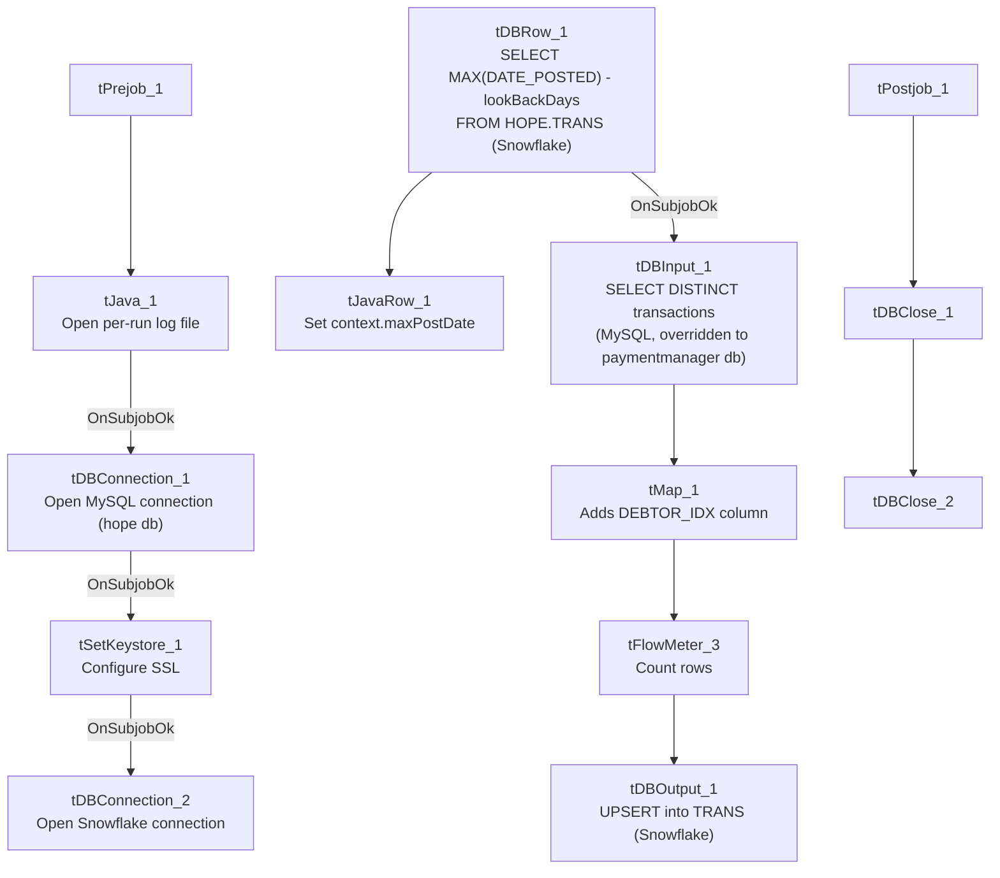

# Talend Job: HOPE_SPTransactions_Load

## Overview

Loads collector transaction records with split-commission details (transaction ID, date posted, debtor/logon, transaction code, commission rate/amount, pay amount, collector initials, client ID, split percentage, credit month/year) from a MySQL `paymentmanager` database's transaction data into a Snowflake `TRANS` table, using an incremental load keyed on a rolling look-back window. Despite the very similar name, this job is structurally unrelated to `HOPE_Transactions_Load` — that job is a one-time flat-file backfill into a differently-named table (`HOPE_TRANSACTION`); this job is the ongoing, recurring database-driven load. See Issues observed for the full comparison.

## Detail table

| Field | Value |
|---|---|
| Job name | HOPE_SPTransactions_Load |
| Version | 0.2 |
| Project | EDW2SF |
| Author | jmach@harriscollect.com |
| Created | 2024-03-11T12:45:26.277-0700 |
| Last Modified | 2025-11-04T11:05:29.738-0800 |

## Step-by-step data flow

**Setup subjob:** `tPrejob_1` → `tJava_1` opens a per-run log file → on subjob-ok, `tDBConnection_1` opens the MySQL connection (host `"MP-HOPE-V01"`, db `"hope"`, user `"svc_edw"`, password redacted) → on subjob-ok, `tSetKeystore_1` configures SSL trust/keystore from `context.keystorePath` → on subjob-ok, `tDBConnection_2` opens the Snowflake connection.

**Main subjob:**

1. `tDBRow_1` runs a Snowflake query computing a rolling look-back date: `SELECT CAST(DATEADD(D,-<context.lookBackDays>,MAX(DATE_POSTED)) AS VARCHAR(10)) AS MAX_POST_DATE FROM HOPE.TRANS;` (the captured query text has an apparent quoting artifact around the `context.lookBackDays` concatenation — see Issues observed).
2. `tJavaRow_1` captures the value into `context.maxPostDate`.
3. On success, `tDBInput_1` reads MySQL, again with its own `HOST`/`DBNAME` overridden to `"HH-MP-PMGR"` / `"paymentmanager"` (same pattern flagged in `HOPE_Notes_Load` — see Issues observed): a `SELECT DISTINCT` of `TransactionID`, `DatePosted`, `Debtor`, `Logon`, `TransCode` (cast to `DECIMAL(11,0)`), `CommRate`, `CommAmt`, `CollInitials`, `PayAmt`, `ClientID`, `SplitPercentage`, `CreditMonth` (cast), and more (query truncated).
4. `tMap_1` maps the columns to `LOGON`, `TRANSACTION_ID`, `DATE_POSTED`, `TRANS_CODE`, `COMM_RATE`, `COMM_AMT`, `PAY_AMT`, `COLL_INITIALS`, `DEBTOR_NUMBER`, `CLIENT_ID`, `SPLIT_PERCENTAGE`, `CREDIT_MONTH`, `CREDIT_YEAR`, and adds a `DEBTOR_IDX` column not present in the source schema (`DIE_ON_ERROR=true`).
5. `tFlowMeter_3` counts rows passing through.
6. `tDBOutput_1` **upserts** the rows into Snowflake table `TRANS`.

**Teardown subjob:** `tPostjob_1` → `tDBClose_1` (close Snowflake) → `tDBClose_2` (close MySQL).

## Settings tables

### Look-back calculation: `tDBRow_1` (`tSnowflakeRow`)

| Setting | Value | What it means |
|---|---|---|
| Query | `SELECT CAST(DATEADD(D,-"+context.lookBackDays+",MAX(DATE_POSTED)) AS VARCHAR(10)) AS MAX_POST_DATE FROM HOPE.TRANS;` | Rather than a hard incremental cutoff, this job re-pulls a rolling window: the max posted date minus `context.lookBackDays`, to catch late-arriving or updated transactions. |

### Source: `tDBInput_1` (`tMysqlInput`)

| Setting | Value | What it means |
|---|---|---|
| CONNECTION | `tDBConnection_1` (`USE_EXISTING_CONNECTION=true`) | Declares reuse of the shared MySQL connection to `hope`... |
| HOST / DBNAME (component's own) | `"HH-MP-PMGR"` / `"paymentmanager"` | ...but its own parameters point elsewhere — same pattern as `HOPE_Notes_Load`; see Issues observed. |
| Query | `SELECT DISTINCT TransactionID, DatePosted, Debtor, Logon, CAST(TransCode AS DECIMAL(11,0)) AS TRANS_CODE, CommRate, CommAmt, CollInitials, PayAmt, ClientID, SplitPercentage, CAST(CreditMonth AS DECIMAL(2,0)) AS CREDIT_MONT...` (truncated) | Does not visibly reference `context.maxPostDate` in the captured portion — unable to confirm the look-back filter is actually applied. |

### Target: `tDBOutput_1` (`tSnowflakeOutput`)

| Setting | Value | What it means |
|---|---|---|
| Table | `TRANS` | Destination table in Snowflake, `UPSERT` — safer against duplication than plain insert if the look-back window re-reads already-loaded rows. |

## Dependencies & configuration

- **Triggers/depends on other jobs:** none — no `tRunJob` links found.
- **Context variables used:** `keystorePath`, `logDir`, `maxPostDate` (computed internally), and `lookBackDays` (referenced in the SQL but not listed in this job's own `context_vars_referenced` array — see Issues observed).
- **1 hardcoded path finding:** `tSetKeystore_1.SSL_TRUSTSERVER_TRUSTSTORE` = `"C:/clientTrustStore.trustStore"`.

## Glossary

| Component type | Plain-English meaning |
|---|---|
| `tMysqlConnection` / `tMysqlInput` / `tMysqlClose` | Open a MySQL connection, run a query against it, and close it. |
| `tSnowflakeConnection` / `tSnowflakeRow` / `tSnowflakeOutput` / `tSnowflakeClose` | Open a Snowflake connection, run an arbitrary SQL statement, write rows to a table, and close the connection. |
| `tMap` | Maps/transforms columns from one schema to another. |
| `tFlowMeter` | Counts rows passing a point in the flow for logging/monitoring. |
| `tJavaRow` | Runs custom Java code once per input row — here used to unpack a single query result into a context variable. |
| `tSetKeystore` | Configures SSL/TLS trust and client certificate settings used by subsequent secure connections in the job. |

## Issues observed

- **`context.lookBackDays` is referenced directly in `tDBRow_1`'s SQL text but does not appear in this job's own `context_vars_referenced` metadata list** — this is either an extraction gap (the variable-usage scanner may not have picked up references inside embedded SQL string concatenation) or a sign that `lookBackDays` is set as a job-level default not tracked the same way as other context references. Unable to determine its actual value or which context group defines it from this job's metadata alone; verify in Talend Studio.
- **The `tDBRow_1` query text shows an unusual quoting pattern** (`"SELECT CAST(DATEADD(D,-"+context.lookBackDays+",MAX(DATE_POSTED))...`) where the opening quote appears immediately before `SELECT` with no leading escape visible, unlike the cleanly-escaped concatenation seen in `HOPE_Notes_Load`'s equivalent query. This may simply be an artifact of how this metadata extraction serialized the string-concatenation expression, not a real syntax error in the job itself — unable to confirm either way from static metadata; if this job's look-back query has ever failed at runtime with a syntax error, this is the first place to check.
- **Same connection-parameter mismatch as `HOPE_Notes_Load`:** `tDBInput_1` declares `USE_EXISTING_CONNECTION=true` against `tDBConnection_1` (host `MP-HOPE-V01`, db `hope`) but its own `HOST`/`DBNAME` are set to `"HH-MP-PMGR"` / `"paymentmanager"`. Which database this job actually queries at runtime cannot be confirmed from static metadata — verify directly in Talend Studio.
- **`tMap_1` adds a `DEBTOR_IDX` column not present in the source query's schema** — same pattern seen in `FactPaymentManager_Load`; either derived via an internal lookup not captured here, or passed through blank. Verify the mapping expression directly.
- **Do not confuse this job with `HOPE_Transactions_Load`** — despite the similar name, that job is a one-time flat-file backfill (`/mnt/analytics_team/Drop_zone/HOPE_detail_20220908_085732.csv`) loading into a differently-named table (`HOPE_TRANSACTION`, truncate+insert, no incremental logic), while this job is the ongoing, incremental, MySQL-driven load into `TRANS`. See that job's own doc.
