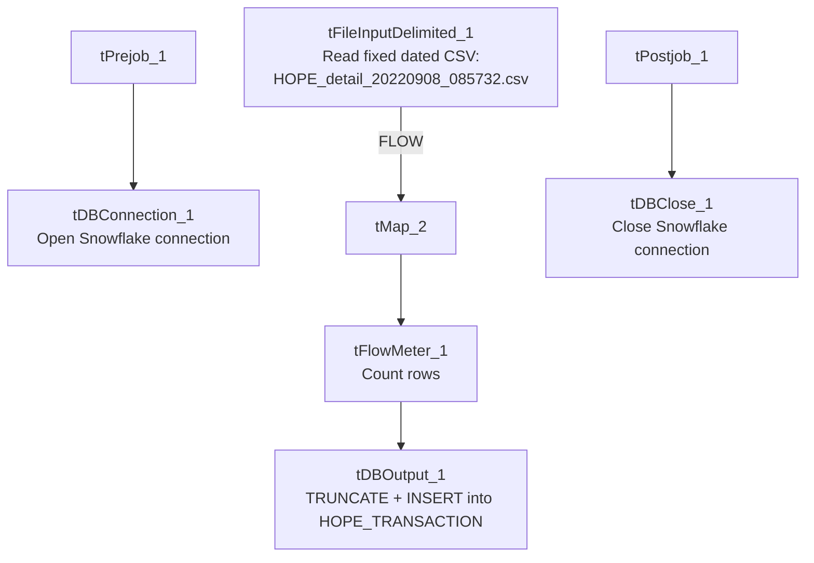

# Talend Job: HOPE_Transactions_Load

## Overview

A one-time flat-file backfill of collector transaction records (transaction ID, date posted, transaction code, commission rate/amount, pay amount, collector initials, debtor number, client ID, split percentage, credit month/year) from a fixed, dated CSV file (`/mnt/analytics_team/Drop_zone/HOPE_detail_20220908_085732.csv`) into a Snowflake table `HOPE_TRANSACTION`. Despite the near-identical name, this job is structurally and functionally unrelated to the ongoing, recurring `HOPE_SPTransactions_Load` — see Issues observed for the full comparison.

## Detail table

| Field | Value |
|---|---|
| Job name | HOPE_Transactions_Load |
| Version | 0.1 |
| Project | EDW2SF |
| Author | jmach@harriscollect.com |
| Created | 2022-09-12T11:24:51.689-0700 |
| Last Modified | 2022-09-12T13:38:29.744-0700 |

## Step-by-step data flow

**Setup subjob:** `tPrejob_1` → `tDBConnection_1` opens the Snowflake connection.

**Main subjob:** `tFileInputDelimited_1` reads the fixed, dated CSV file `/mnt/analytics_team/Drop_zone/HOPE_detail_20220908_085732.csv` (comma-delimited, header row, `TRIMALL=true`, `REMOVE_EMPTY_ROW=true`, `DIE_ON_ERROR=false`), pulling `RECORD_NUM`, `TRANSACTION_ID`, `DATE_POSTED`, `TRANS_CODE`, `COMM_RATE`, `COMM_AMT`, `PAY_AMT`, `COLL_INITIALS`, `DEBTOR_NUMBER`, `CLIENT_ID`, `SPLIT_PERCENTAGE`, `CREDIT_MONTH`, `CREDIT_YEAR` → `tMap_2` passes the columns through unchanged (`DIE_ON_ERROR=true`) → `tFlowMeter_1` counts rows passing through → `tDBOutput_1` writes to Snowflake table `HOPE_TRANSACTION` with `outputAction=INSERT` and **`tableAction=TRUNCATE`**.

**Teardown subjob:** `tPostjob_1` → `tDBClose_1` closes the Snowflake connection.

## Settings tables

### Source: `tFileInputDelimited_1`

| Setting | Value | What it means |
|---|---|---|
| FILENAME | `"/mnt/analytics_team/Drop_zone/HOPE_detail_20220908_085732.csv"` (hardcoded, dated) | A fixed, one-time source file with a timestamp embedded in its own name — not driven by any context variable, file-listing loop, or date-parameterized pattern. |
| TEMP_DIR | `"C:/Talend-Studio-20211109_1610-V8.0.1/workspace"` (hardcoded) | Same project-wide developer-workstation path risk documented in `05_operational_runbook.md` — notably a Windows path even though the source `FILENAME` itself uses a Linux-style `/mnt/...` path, suggesting this job was built/tested on Windows but intended to run against a Linux-mounted share. |

### Target: `tDBOutput_1` (`tSnowflakeOutput`)

| Setting | Value | What it means |
|---|---|---|
| Table | `HOPE_TRANSACTION` | Destination table — note this is a **different table name** than `HOPE_SPTransactions_Load`'s target (`TRANS`), despite both jobs loading HOPE transaction data. |
| Output action / Table action | `INSERT` / `TRUNCATE` | Table is cleared and reloaded from this single fixed file every run. |

## Dependencies & configuration

- **Triggers/depends on other jobs:** none — no `tRunJob` links found.
- **Context variables used:** none — this job uses no context variables at all, consistent with a one-off, hardcoded design.
- **1 hardcoded path finding:** `tFileInputDelimited_1.TEMP_DIR` = `"C:/Talend-Studio-20211109_1610-V8.0.1/workspace"`. The source file path itself is also hardcoded and dated but was not separately flagged in the extracted `hardcoded_path_findings` field.

## Glossary

| Component type | Plain-English meaning |
|---|---|
| `tFileInputDelimited` | Reads a delimited (CSV-style) text file according to a schema. |
| `tMap` | Maps/transforms columns from one schema to another (here, a straight pass-through). |
| `tFlowMeter` | Counts rows passing a point in the flow for logging/monitoring. |
| `tSnowflakeConnection` / `tSnowflakeOutput` / `tSnowflakeClose` | Open a Snowflake connection, write rows to a table, and close the connection. |

## Issues observed

- **Do not confuse this job with `HOPE_SPTransactions_Load`.** Despite both jobs loading "HOPE" collector transaction data with a very similar column set, they are structurally unrelated: this job is a one-time flat-file backfill (fixed, dated CSV, `TRUNCATE`+`INSERT`, no incremental logic, no MySQL connection at all) loading into `HOPE_TRANSACTION`, while `HOPE_SPTransactions_Load` is the ongoing, recurring, MySQL-driven incremental load into a differently-named table `TRANS`. The two jobs do not appear to feed each other and were not found to share a `tRunJob` link.
- **`tableAction=TRUNCATE` against a single fixed, dated source file** means this job is designed to be run exactly once (or, if re-run, will simply reload the identical historical file again, wiping out anything else that may have since been loaded into `HOPE_TRANSACTION` by another process). Given the September 2022 timestamp embedded in both the filename and this job's own creation date, this job has very likely already served its purpose — worth confirming with the team whether it should be retired or archived, especially since `TRUNCATE` makes it destructive if accidentally re-run against a table that other processes now also write to.
- **The hardcoded `TEMP_DIR` uses a Windows path while `FILENAME` uses a Linux `/mnt/...` path** — an inconsistency suggesting the job was developed in a Windows-based Talend Studio environment but its actual source file lives on a Linux-mounted network share. This mismatch is cosmetic for `TEMP_DIR`'s purpose (temp file staging) but is a reminder that this job's paths are not portable across environments without manual adjustment, consistent with the project-wide hardcoded-path risk in `05_operational_runbook.md`.
