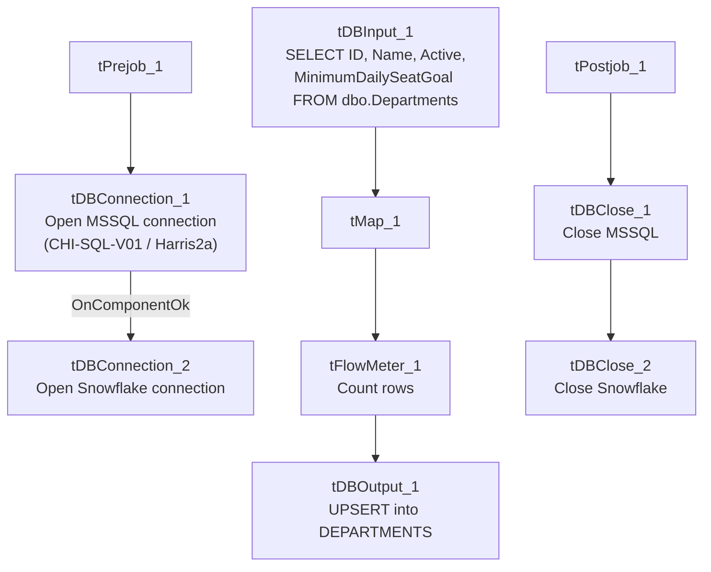

# Talend Job: HUB_Departments_Load

## Overview

Loads the `Departments` reference table (department ID, name, active flag, minimum daily seat goal) from the legacy MSSQL "HUB" database (host `CHI-SQL-V01`, database `Harris2a`) into the Snowflake `DEPARTMENTS` table. This is one of six small, near-identical `HUB_*_Load` jobs that populate the workforce/organizational-hierarchy reference tables (departments, segments, teams, employees, transactions) referenced elsewhere in the project as the "HUB" mart — see `01_system_architecture.md`, which lists the `HUB` MSSQL connection label as used by exactly 6 jobs.

## Detail table

| Field | Value |
|---|---|
| Job name | HUB_Departments_Load |
| Version | 0.1 |
| Project | EDW2SF |
| Author | jmach@harriscollect.com |
| Created | 2022-03-08T14:15:32.048-0800 |
| Last Modified | 2025-11-16T19:14:26.285-0800 |

## Step-by-step data flow

**Setup subjob:** `tPrejob_1` → `tDBConnection_1` opens the MSSQL connection to `CHI-SQL-V01`/`Harris2a` (user `svc_HUB`, password redacted) → on success, `tDBConnection_2` opens the Snowflake connection.

**Main subjob:**

1. `tDBInput_1` runs a fixed `SELECT ID, Name, Active, MinimumDailySeatGoal FROM dbo.Departments` against the MSSQL connection.
2. `tMap_1` passes the four columns through unchanged (renamed to uppercase: `DEPARTMENTID`, `DEPARTMENTNAME`, `ACTIVE`, `MINIMUMDAILYSEATGOAL`); `DIE_ON_ERROR=true`.
3. `tFlowMeter_1` counts rows passing through (labeled "MyLabel", not renamed for this job).
4. `tDBOutput_1` UPSERTs the rows into Snowflake table `DEPARTMENTS` (no table-recreate action).

**Teardown subjob:** `tPostjob_1` → `tDBClose_1` (close MSSQL) → `tDBClose_2` (close Snowflake).

## Settings tables

### Source: `tDBInput_1` (`tMSSqlInput`)

| Setting | Value | What it means |
|---|---|---|
| Connection | `HUB` (host `CHI-SQL-V01`, db `Harris2a`, user `svc_HUB`, password `***REDACTED***`) | Legacy HR/timekeeping database — see `01_system_architecture.md`'s connection-label table. |
| Table / Query | `Departments` / `SELECT dbo.Departments."ID", dbo.Departments.Name, dbo.Departments.Active, dbo.Departments.MinimumDailySeatGoal FROM dbo.Departments` | Fixed, unfiltered read of the full source table — no incremental key or WHERE clause. |
| TRIM_ALL_COLUMN | `false` | Values are loaded as-is, without trimming whitespace. |

### Target: `tDBOutput_1` (`tSnowflakeOutput`)

| Setting | Value | What it means |
|---|---|---|
| Table | `DEPARTMENTS` | Destination table in Snowflake. |
| Output action | `UPSERT` | Inserts new rows and updates existing ones by key — safe to rerun without truncating first, since UPSERT is idempotent for unchanged/updated rows. |
| Table action | `NONE` | Table is not recreated/altered by this job. |

## Dependencies & configuration

- **Triggers/depends on other jobs:** none — no `tRunJob` links found.
- **Context variables used:** none — every connection setting and the source query are hardcoded on the components rather than parameterized via `context.*`, unlike most other jobs in this project.
- **Hardcoded paths:** none found in this job's own components.

## Glossary

| Component type | Plain-English meaning |
|---|---|
| `tMSSqlConnection` / `tMSSqlInput` / `tMSSqlClose` | Open a Microsoft SQL Server connection, run a query against it, and close it. |
| `tSnowflakeConnection` / `tSnowflakeOutput` / `tSnowflakeClose` | Open a Snowflake connection, write rows to a table, and close the connection. |
| `tMap` | Maps/transforms columns from one schema to another. |
| `tFlowMeter` | Counts rows passing through a point in the flow, for logging/monitoring. |

## Issues observed

- **No context variables at all** — every connection detail (host, database, user) and the source query are hardcoded directly on the MSSQL connection and input components, rather than parameterized through a context group as is standard elsewhere in this project (e.g. `EDWProdHH_0.1`). This means changing environments (dev/test/prod) for this job would require editing the job itself rather than switching a context. The same pattern repeats across all six `HUB_*_Load` jobs in this batch, which is a project-wide inconsistency worth flagging (see `05_operational_runbook.md` for other project-wide risk patterns), not unique to this job.
- **No incremental logic, no error handling** — the source query pulls the entire table every run with no `tWarn`/`tDie` on failure; a load failure here would only surface as a generic Talend execution error. Given `UPSERT` is used on the output side, this is low-risk (rerunning simply re-upserts the same data), consistent with `05_operational_runbook.md`'s general restart guidance.
- Beyond the above, this job has no notable anomalies of its own — it is a straightforward, small reference-table load.
