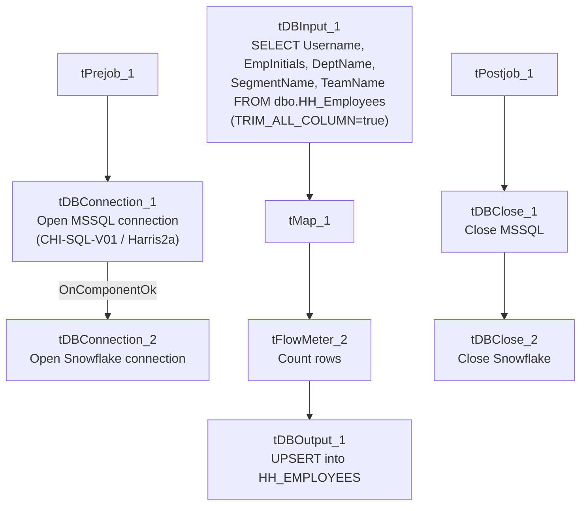

# Talend Job: HUB_HH_Employee_Load

## Overview

Loads the `HH_Employees` reference table (username, employee initials, department name, segment name, team name) from the legacy MSSQL "HUB" database (host `CHI-SQL-V01`, database `Harris2a`) into the Snowflake `HH_EMPLOYEES` table. Sibling of `HUB_Departments_Load`, `HUB_Segments_Load`, and `HUB_Teams_Load`; this one maps individual employees to their department/segment/team by name rather than by numeric ID, unlike the other three reference-table loads.

## Detail table

| Field | Value |
|---|---|
| Job name | HUB_HH_Employee_Load |
| Version | 0.1 |
| Project | EDW2SF |
| Author | jmach@harriscollect.com |
| Created | 2022-03-07T14:41:51.649-0800 |
| Last Modified | 2025-11-16T19:14:27.443-0800 |

## Step-by-step data flow

**Setup subjob:** `tPrejob_1` → `tDBConnection_1` opens the MSSQL connection to `CHI-SQL-V01`/`Harris2a` (user `svc_HUB`) → on success, `tDBConnection_2` opens the Snowflake connection.

**Main subjob:**

1. `tDBInput_1` runs a repository-schema-backed `SELECT Username, EmpInitials, DeptName, SegmentName, TeamName FROM dbo.HH_Employees`, with `TRIM_ALL_COLUMN=true` (unlike its `HUB_Departments_Load`/`HUB_Segments_Load`/`HUB_Teams_Load` siblings, which all use `false`).
2. `tMap_1` passes the five columns through, renamed to uppercase; `DIE_ON_ERROR=true`.
3. `tFlowMeter_2` counts rows passing through.
4. `tDBOutput_1` UPSERTs the rows into Snowflake table `HH_EMPLOYEES`.

**Teardown subjob:** `tPostjob_1` → `tDBClose_1` (close MSSQL) → `tDBClose_2` (close Snowflake).

## Settings tables

### Source: `tDBInput_1` (`tMSSqlInput`)

| Setting | Value | What it means |
|---|---|---|
| Connection | `HUB` (host `CHI-SQL-V01`, db `Harris2a`, user `svc_HUB`) | Same legacy HR/timekeeping database as the other `HUB_*_Load` jobs. |
| Table / Query | `HH_Employees` / `SELECT dbo.HH_Employees.Username, dbo.HH_Employees.EmpInitials, dbo.HH_Employees.DeptName, dbo.HH_Employees.SegmentName, dbo.HH_Employees.TeamName FROM dbo.HH_Employees` | Fixed, unfiltered read of the full source table. |
| Schema | Repository schema `HH_Employees` | Column layout is sourced from a shared repository schema, unlike the other HUB reference-load jobs which have no named repository schema on their input. |
| TRIM_ALL_COLUMN | `true` | Leading/trailing whitespace is stripped from every column value — the only one of the four small HUB reference loads in this batch that does this. |

### Target: `tDBOutput_1` (`tSnowflakeOutput`)

| Setting | Value | What it means |
|---|---|---|
| Table | `HH_EMPLOYEES` | Destination table in Snowflake. |
| Output action | `UPSERT` | Idempotent — safe to rerun. |
| Table action | `NONE` | Table is not recreated/altered by this job. |
| Schema | Includes 8 extra columns (`columnName`, `rowNumber`, `category`, `character`, `errorMessage`, `byteOffset`, `line`, `sqlState`, `code`) beyond the 5 business columns | These are Talend's standard reject-row error-schema columns, but no reject flow is wired into this component — see Issues observed. |

## Dependencies & configuration

- **Triggers/depends on other jobs:** none — no `tRunJob` links found.
- **Context variables used:** none — same as the other three small HUB reference-table loads, all connection/query details are hardcoded on the components.
- **Hardcoded paths:** none found in this job's own components.

## Glossary

| Component type | Plain-English meaning |
|---|---|
| `tMSSqlConnection` / `tMSSqlInput` / `tMSSqlClose` | Open a Microsoft SQL Server connection, run a query against it, and close it. |
| `tSnowflakeConnection` / `tSnowflakeOutput` / `tSnowflakeClose` | Open a Snowflake connection, write rows to a table, and close the connection. |
| `tMap` | Maps/transforms columns from one schema to another. |
| `tFlowMeter` | Counts rows passing through a point in the flow, for logging/monitoring. |

## Issues observed

- **`tDBOutput_1`'s schema carries 8 extra error/reject-style columns** (`columnName`, `rowNumber`, `category`, `character`, `errorMessage`, `byteOffset`, `line`, `sqlState`, `code`) that don't appear anywhere upstream in `tMap_1`'s or `tFlowMeter_2`'s schema, and there is no reject flow connected to this component. This looks like a schema left over from copying/reconfiguring the component (possibly from a version that once had error handling wired up) rather than an active reject-row capture — it doesn't affect the job's actual behavior since the main `FLOW` connection only carries the 5 business columns, but it's worth cleaning up so the component's declared schema matches what it actually receives. The same pattern also appears in this batch's `HUB_Teams_Load`.
- **No context variables at all**, same project-wide pattern noted in `HUB_Departments_Load`'s doc — see that doc's Issues section for the shared implication.
- **`TRIM_ALL_COLUMN=true` here vs. `false` in the sibling HUB reference loads** is a minor but real inconsistency: if source data in `HH_Employees` has incidental whitespace, this job's uppercase-mapped columns would be trimmed while `Departments`/`Segments`/`Teams` loads would not, which could affect exact-match joins against those tables downstream. Unable to determine from metadata whether this is intentional; verify with the team.
