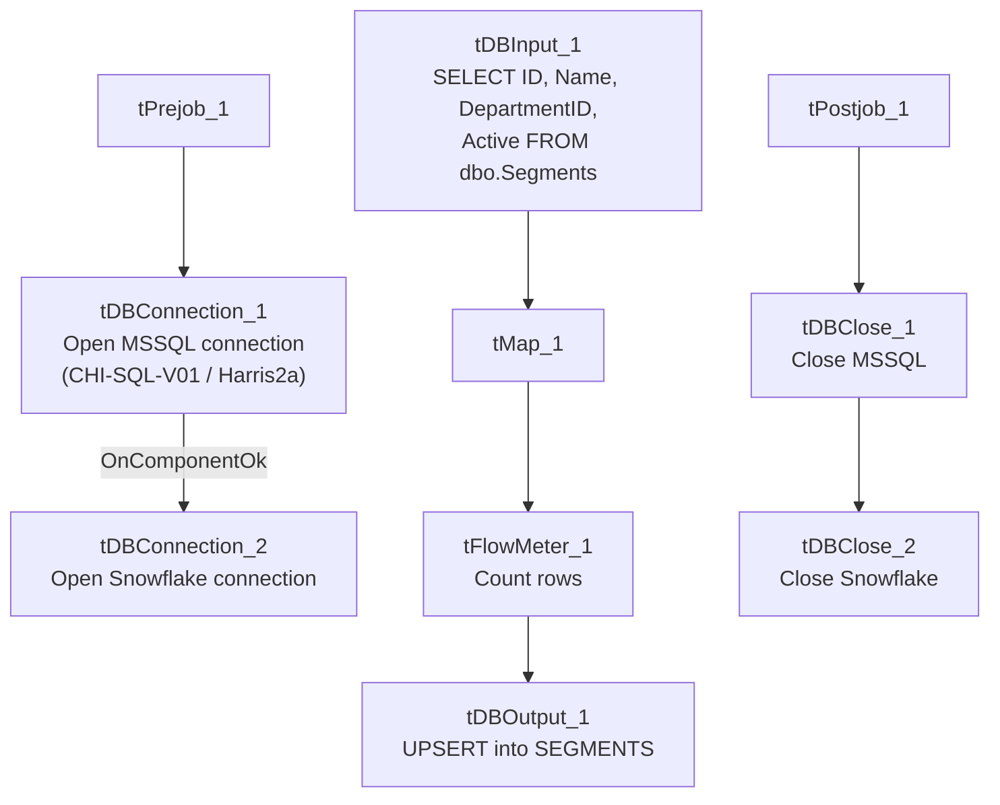

# Talend Job: HUB_Segments_Load

## Overview

Loads the `Segments` reference table (segment ID, name, parent department ID, active flag) from the legacy MSSQL "HUB" database (host `CHI-SQL-V01`, database `Harris2a`) into the Snowflake `SEGMENTS` table. Sibling of `HUB_Departments_Load`; segments are the next level down in the organizational hierarchy, each tied to a `DepartmentID`.

## Detail table

| Field | Value |
|---|---|
| Job name | HUB_Segments_Load |
| Version | 0.1 |
| Project | EDW2SF |
| Author | jmach@harriscollect.com |
| Created | 2022-03-07T16:21:31.495-0800 |
| Last Modified | 2025-11-16T19:14:26.643-0800 |

## Step-by-step data flow

**Setup subjob:** `tPrejob_1` → `tDBConnection_1` opens the MSSQL connection to `CHI-SQL-V01`/`Harris2a` (user `svc_HUB`) → on success, `tDBConnection_2` opens the Snowflake connection.

**Main subjob:**

1. `tDBInput_1` runs a fixed `SELECT ID, Name, DepartmentID, Active FROM dbo.Segments`.
2. `tMap_1` passes the four columns through, renamed to uppercase (`SEGMENTID`, `SEGMENTNAME`, `DEPARTMENTID`, `ACTIVE`); `DIE_ON_ERROR=true`.
3. `tFlowMeter_1` counts rows passing through.
4. `tDBOutput_1` UPSERTs the rows into Snowflake table `SEGMENTS`.

**Teardown subjob:** `tPostjob_1` → `tDBClose_1` (close MSSQL) → `tDBClose_2` (close Snowflake).

## Settings tables

### Source: `tDBInput_1` (`tMSSqlInput`)

| Setting | Value | What it means |
|---|---|---|
| Connection | `HUB` (host `CHI-SQL-V01`, db `Harris2a`, user `svc_HUB`) | Same legacy HR/timekeeping database as the other `HUB_*_Load` jobs. |
| Table / Query | `Segments` / `SELECT dbo.Segments."ID", dbo.Segments.Name, dbo.Segments.DepartmentID, dbo.Segments.Active FROM dbo.Segments` | Fixed, unfiltered read of the full source table. |
| TRIM_ALL_COLUMN | `false` | Values are loaded as-is. |

### Target: `tDBOutput_1` (`tSnowflakeOutput`)

| Setting | Value | What it means |
|---|---|---|
| Table | `SEGMENTS` | Destination table in Snowflake. |
| Output action | `UPSERT` | Idempotent — safe to rerun. |
| Table action | `NONE` | Table is not recreated/altered by this job. |

## Dependencies & configuration

- **Triggers/depends on other jobs:** none — no `tRunJob` links found.
- **Context variables used:** none — same pattern as the other three small HUB reference-table loads.
- **Hardcoded paths:** none found in this job's own components.

## Glossary

| Component type | Plain-English meaning |
|---|---|
| `tMSSqlConnection` / `tMSSqlInput` / `tMSSqlClose` | Open a Microsoft SQL Server connection, run a query against it, and close it. |
| `tSnowflakeConnection` / `tSnowflakeOutput` / `tSnowflakeClose` | Open a Snowflake connection, write rows to a table, and close the connection. |
| `tMap` | Maps/transforms columns from one schema to another. |
| `tFlowMeter` | Counts rows passing through a point in the flow, for logging/monitoring. |

## Issues observed

- **No context variables at all**, same project-wide pattern noted in `HUB_Departments_Load`'s doc.
- **`DepartmentID` is carried through with no validation against `HUB_Departments_Load`'s `DEPARTMENTS` table** — if this job runs before or independently of `HUB_Departments_Load`, a segment could reference a department ID not yet present in Snowflake. Unable to determine from metadata whether these jobs are scheduled together or in a specific order; there is no `tRunJob` orchestration tying them together in this extraction.
- Beyond the above, this job has no notable anomalies of its own — it is a straightforward, small reference-table load, structurally identical to `HUB_Departments_Load` and `HUB_Teams_Load`.
