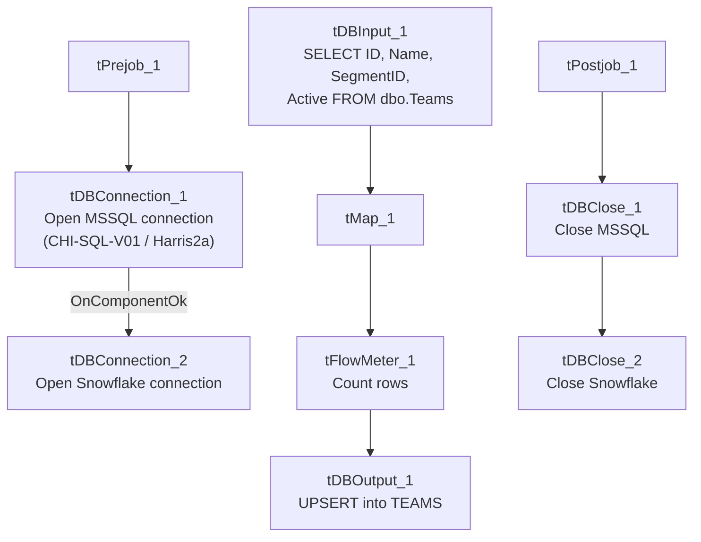

# Talend Job: HUB_Teams_Load

## Overview

Loads the `Teams` reference table (team ID, name, parent segment ID, active flag) from the legacy MSSQL "HUB" database (host `CHI-SQL-V01`, database `Harris2a`) into the Snowflake `TEAMS` table. Third level of the organizational hierarchy loaded by the HUB reference jobs (Department → Segment → Team), each team tied to a `SegmentID`.

## Detail table

| Field | Value |
|---|---|
| Job name | HUB_Teams_Load |
| Version | 0.1 |
| Project | EDW2SF |
| Author | jmach@harriscollect.com |
| Created | 2022-03-07T15:45:43.957-0800 |
| Last Modified | 2025-11-16T19:14:25.923-0800 |

## Step-by-step data flow

**Setup subjob:** `tPrejob_1` → `tDBConnection_1` opens the MSSQL connection to `CHI-SQL-V01`/`Harris2a` (user `svc_HUB`) → on success, `tDBConnection_2` opens the Snowflake connection.

**Main subjob:**

1. `tDBInput_1` runs a repository-schema-backed `SELECT ID, Name, SegmentID, Active FROM dbo.Teams`.
2. `tMap_1` passes the four columns through, renamed to uppercase (`TEAMID`, `TEAMNAME`, `SEGMENTID`, `ACTIVE`); `DIE_ON_ERROR=true`.
3. `tFlowMeter_1` counts rows passing through.
4. `tDBOutput_1` UPSERTs the rows into Snowflake table `TEAMS`.

**Teardown subjob:** `tPostjob_1` → `tDBClose_1` (close MSSQL) → `tDBClose_2` (close Snowflake).

## Settings tables

### Source: `tDBInput_1` (`tMSSqlInput`)

| Setting | Value | What it means |
|---|---|---|
| Connection | `HUB` (host `CHI-SQL-V01`, db `Harris2a`, user `svc_HUB`) | Same legacy HR/timekeeping database as the other `HUB_*_Load` jobs. |
| Table / Query | `Teams` / `SELECT dbo.Teams."ID", dbo.Teams.Name, dbo.Teams.SegmentID, dbo.Teams.Active FROM dbo.Teams` | Fixed, unfiltered read of the full source table. |
| Schema | Repository schema `Teams` | Column layout is sourced from a shared repository schema. |
| TRIM_ALL_COLUMN | `false` | Values are loaded as-is. |

### Target: `tDBOutput_1` (`tSnowflakeOutput`)

| Setting | Value | What it means |
|---|---|---|
| Table | `TEAMS` | Destination table in Snowflake. |
| Output action | `UPSERT` | Idempotent — safe to rerun. |
| Table action | `NONE` | Table is not recreated/altered by this job. |
| Schema | Includes 8 extra columns (`columnName`, `rowNumber`, `category`, `character`, `errorMessage`, `byteOffset`, `line`, `sqlState`, `code`) beyond the 4 business columns | Standard Talend reject-row error-schema columns, but no reject flow is wired into this component — see Issues observed. |

## Dependencies & configuration

- **Triggers/depends on other jobs:** none — no `tRunJob` links found.
- **Context variables used:** none — same pattern as the other three small HUB reference-table loads.
- **Hardcoded paths:** none found in this job's own components.

## Glossary

| Component type | Plain-English meaning |
|---|---|
| `tMSSqlConnection` / `tMSSqlInput` / `tMSSqlClose` | Open a Microsoft SQL Server connection, run a query against it, and close it. |
| `tSnowflakeConnection` / `tSnowflakeOutput` / `tSnowflakeClose` | Open a Snowflake connection, write rows to a table, and close the connection. |
| `tMap` | Maps/transforms columns from one schema to another. |
| `tFlowMeter` | Counts rows passing through a point in the flow, for logging/monitoring. |

## Issues observed

- **`tDBOutput_1`'s schema carries 8 extra error/reject-style columns** not present in the upstream flow and not backed by any wired reject connection — the same artifact documented in `HUB_HH_Employee_Load`'s doc. Cosmetic/schema-drift only; doesn't affect this job's behavior since the main `FLOW` connection carries only the 4 business columns.
- **No context variables at all**, same project-wide pattern noted in `HUB_Departments_Load`'s doc.
- **`SegmentID` is carried through with no validation against `HUB_Segments_Load`'s `SEGMENTS` table**, mirroring the same cross-job ordering concern noted in `HUB_Segments_Load`'s own doc regarding `DepartmentID`. No `tRunJob` orchestration ties these HUB reference loads together in this extraction, so the actual run order (if any) is unable to determine from metadata.
