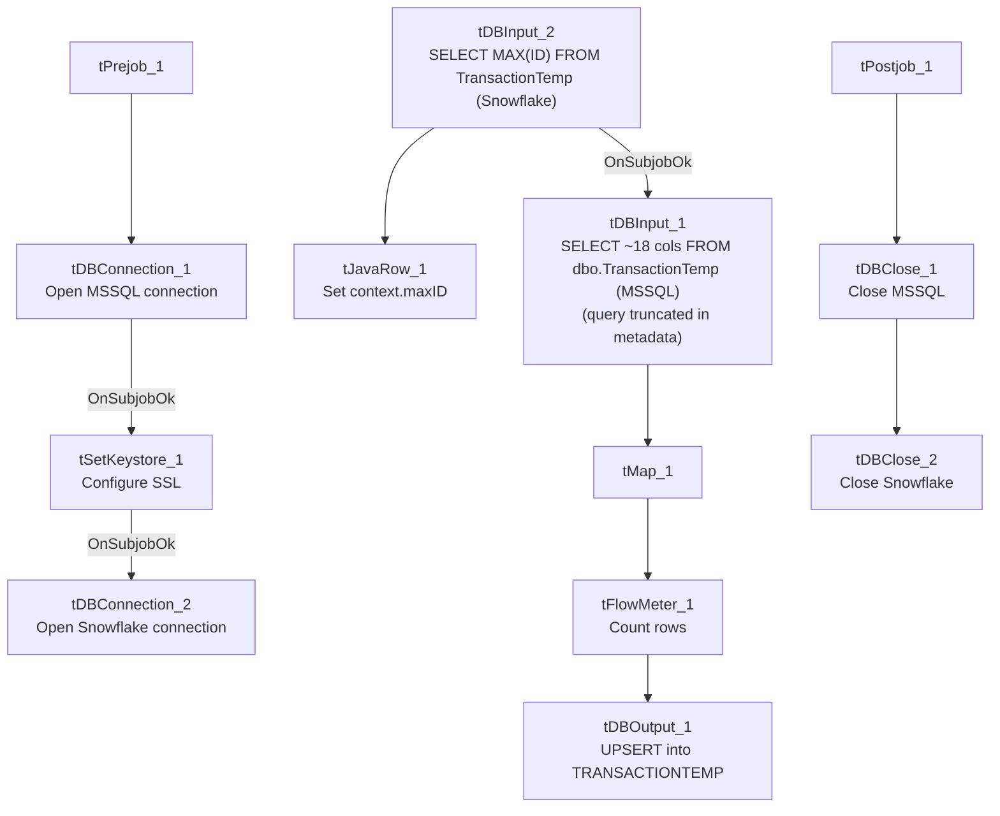

# Talend Job: HUB_TempTransaction_Load

## Overview

Loads the `TransactionTemp` table (a staging/temp transaction table — user, team, client, debtor identifiers, amount, transaction/post dates, payment type) from the legacy MSSQL "HUB" database (host `CHI-SQL-V01`, database `Harris2a`) into the Snowflake `TRANSACTIONTEMP` table. Unlike the four small HUB reference loads (Departments/Segments/Teams/HH_Employees), this job first computes the highest `ID` already loaded into Snowflake before reading the MSSQL source, suggesting an intended incremental-load design.

## Detail table

| Field | Value |
|---|---|
| Job name | HUB_TempTransaction_Load |
| Version | 0.1 |
| Project | EDW2SF |
| Author | jmach@harriscollect.com |
| Created | 2022-03-08T14:49:28.155-0800 |
| Last Modified | 2025-11-16T19:15:29.339-0800 |

## Step-by-step data flow

**Setup subjob:** `tPrejob_1` → `tDBConnection_1` opens the MSSQL connection (`CHI-SQL-V01`/`Harris2a`, user `svc_HUB`) → on subjob-ok, `tSetKeystore_1` configures SSL trust/keystore (truststore path hardcoded, keystore path from `context.keystorePath`, passwords redacted) → on subjob-ok, `tDBConnection_2` opens the Snowflake connection.

**Main subjob** — runs independently of the setup subjob:

1. `tDBInput_2` (Snowflake) runs `SELECT CAST(COALESCE(MAX(ID),0) AS VARCHAR(10)) AS MAX_ID FROM TransactionTemp;` to find the highest `ID` already loaded.
2. `tJavaRow_1` captures that value into `context.maxID`.
3. On success, `tDBInput_1` (MSSQL) runs a `SELECT` of ~18 columns from `dbo.TransactionTemp` (user/team/client/debtor identifiers, amount, transaction/post/added/modified/delete dates, payment type) — the captured query text is truncated in this metadata after the first several columns, so whether it actually filters on `context.maxID` cannot be confirmed (see Issues observed).
4. `tMap_1` passes the columns through, renamed to uppercase; `DIE_ON_ERROR=true`.
5. `tFlowMeter_1` counts rows passing through.
6. `tDBOutput_1` UPSERTs the rows into Snowflake table `TRANSACTIONTEMP`.

**Teardown subjob:** `tPostjob_1` → `tDBClose_1` (close MSSQL) → `tDBClose_2` (close Snowflake).

## Settings tables

### Incremental-key check: `tDBInput_2` (`tSnowflakeInput`)

| Setting | Value | What it means |
|---|---|---|
| Query | `SELECT CAST(COALESCE(MAX(ID),0) AS VARCHAR(10)) AS MAX_ID FROM TransactionTemp;` | Finds the highest `ID` already loaded into the Snowflake `TRANSACTIONTEMP` table, defaulting to 0 if the table is empty. |
| Result handling | `MAX_ID` → `context.maxID` (`tJavaRow_1`) | Stored for (intended) use filtering the MSSQL source read. |

### Source: `tDBInput_1` (`tMSSqlInput`)

| Setting | Value | What it means |
|---|---|---|
| Connection | `HUB` (host `CHI-SQL-V01`, db `Harris2a`, user `svc_HUB`) | Same legacy HR/timekeeping database as the other `HUB_*` jobs. |
| Table / Query | `TransactionTemp` / `SELECT dbo.TransactionTemp."ID", ...` (truncated in this metadata) | Whether the query's `WHERE` clause actually references `context.maxID` is not visible in the captured text — see Issues observed. |

### Target: `tDBOutput_1` (`tSnowflakeOutput`)

| Setting | Value | What it means |
|---|---|---|
| Table | `TRANSACTIONTEMP` | Destination table in Snowflake. |
| Output action | `UPSERT` | Idempotent — even if the source read is not actually filtered by `context.maxID`, re-reading and re-upserting the whole source table would not create duplicates (unlike a plain `INSERT`). |
| Table action | `NONE` | Table is not recreated/altered by this job. |
| Schema | Includes 8 extra reject-style error columns (`columnName`, `rowNumber`, `category`, `character`, `errorMessage`, `byteOffset`, `line`, `sqlState`, `code`) with no wired reject flow | Same schema-drift artifact seen in `HUB_HH_Employee_Load` and `HUB_Teams_Load`. |

### SSL setup: `tSetKeystore_1`

| Setting | Value | What it means |
|---|---|---|
| SSL_TRUSTSERVER_TRUSTSTORE | `"C:/clientTrustStore.trustStore"` (hardcoded) | A developer-workstation-style hardcoded path — see Issues observed. |
| SSL_KEYSTORE | `context.keystorePath` | Parameterized via context, unlike the truststore path above. |

## Dependencies & configuration

- **Triggers/depends on other jobs:** none — no `tRunJob` links found.
- **Context variables used:** `keystorePath`, `maxID` (set internally from the Snowflake max-key query).
- **1 hardcoded path finding:** `tSetKeystore_1.SSL_TRUSTSERVER_TRUSTSTORE` = `"C:/clientTrustStore.trustStore"`.

## Glossary

| Component type | Plain-English meaning |
|---|---|
| `tMSSqlConnection` / `tMSSqlInput` / `tMSSqlClose` | Open a Microsoft SQL Server connection, run a query against it, and close it. |
| `tSnowflakeConnection` / `tSnowflakeInput` / `tSnowflakeOutput` / `tSnowflakeClose` | Open a Snowflake connection, query it, write rows to a table, and close the connection. |
| `tJavaRow` | Runs custom Java code once per input row — here used to unpack a single query result into a context variable. |
| `tSetKeystore` | Configures SSL trust/keystore settings used by subsequent database connections in the job. |
| `tMap` | Maps/transforms columns from one schema to another. |
| `tFlowMeter` | Counts rows passing through a point in the flow, for logging/monitoring. |

## Issues observed

- **Whether the incremental-load logic is actually applied is unable to determine from this metadata** — the same pattern flagged in `i3_CallDetail_40_Load`'s doc. `context.maxID` is computed before the MSSQL read, but the captured `tDBInput_1.QUERY` text is truncated after the column list and does not show a `WHERE ID > ...` clause in the visible portion. Unlike `i3_CallDetail_40_Load`, however, this job's output action is `UPSERT` rather than `INSERT`, so even an unfiltered full-table re-read would not accumulate duplicate rows — it would just mean the max-key computation and the `context.maxID` variable are unused overhead rather than an active correctness risk. Verify directly in Talend Studio.
- **`SSL_TRUSTSERVER_TRUSTSTORE` is a hardcoded local path** (`C:/clientTrustStore.trustStore`) rather than parameterized via context, while the keystore path on the same component does use `context.keystorePath` — an inconsistency within the same component. Same project-wide hardcoded-path risk documented in `05_operational_runbook.md`.
- **`tDBOutput_1`'s schema carries unused reject-style error columns**, the same schema-drift artifact seen in other HUB jobs in this batch — cosmetic only.
- **This job's sibling `HUB_Transactions_Load` (see its own doc) targets a similarly-named but different table (`Transactions`/`TRANSACTIONS`) using the same max-key pattern but with `INSERT` instead of `UPSERT`** — worth checking with the team whether `HUB_TempTransaction_Load` was created as a safer replacement for (or complement to) `HUB_Transactions_Load`, since `HUB_Transactions_Load` was last modified in 2022 while this job and the other HUB loads were all touched again in November 2025.
