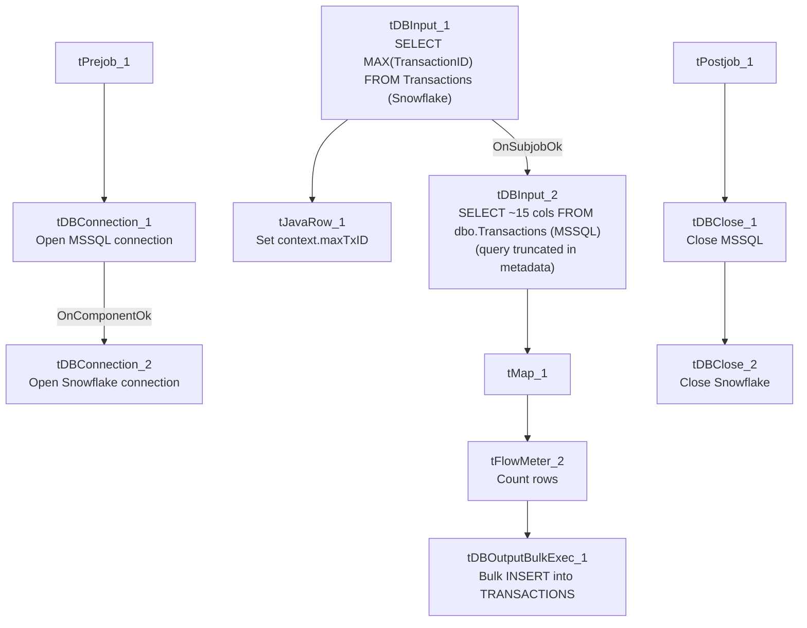

# Talend Job: HUB_Transactions_Load

## Overview

Loads the `Transactions` table (user, team, client, debtor identifiers, transaction type, amount, transaction/post/added/modified/delete dates, payment type — no `ClientInitials`/`PostDateNum` columns, unlike its `TransactionTemp` counterpart) from the legacy MSSQL "HUB" database (host `CHI-SQL-V01`, database `Harris2a`) into the Snowflake `TRANSACTIONS` table using a bulk-load output component. Structurally the same incremental-check pattern as `HUB_TempTransaction_Load`, but targets a different table and uses a plain `INSERT` rather than `UPSERT`, which changes the risk profile if the incremental filter isn't actually applied (see Issues observed).

## Detail table

| Field | Value |
|---|---|
| Job name | HUB_Transactions_Load |
| Version | 0.1 |
| Project | EDW2SF |
| Author | jmach@harriscollect.com |
| Created | 2022-03-08T09:32:10.218-0800 |
| Last Modified | 2022-05-24T09:48:49.796-0700 |

## Step-by-step data flow

**Setup subjob:** `tPrejob_1` → `tDBConnection_1` opens the MSSQL connection (`CHI-SQL-V01`/`Harris2a`, user `svc_HUB`) → on success, `tDBConnection_2` opens the Snowflake connection.

**Main subjob** — runs independently of the setup subjob:

1. `tDBInput_1` (Snowflake) runs `SELECT CAST(COALESCE(MAX(TransactionID),0) AS VARCHAR(10)) AS MAX_ID FROM Transactions;` to find the highest `TransactionID` already loaded.
2. `tJavaRow_1` captures that value into `context.maxTxID`.
3. On success, `tDBInput_2` (MSSQL) runs a `SELECT` of ~15 columns from `dbo.Transactions` — the captured query text is truncated after the initial columns, so whether it filters on `context.maxTxID` cannot be confirmed (same uncertainty as `HUB_TempTransaction_Load` and `i3_CallDetail_40_Load`).
4. `tMap_1` passes the columns through, renamed to uppercase; `DIE_ON_ERROR=true`.
5. `tFlowMeter_2` counts rows passing through.
6. `tDBOutputBulkExec_1` inserts the rows into Snowflake table `TRANSACTIONS` using a bulk-load mechanism (`INSERT`, no table-recreate action).

**Teardown subjob:** `tPostjob_1` → `tDBClose_1` (close MSSQL) → `tDBClose_2` (close Snowflake).

## Settings tables

### Incremental-key check: `tDBInput_1` (`tSnowflakeInput`)

| Setting | Value | What it means |
|---|---|---|
| Query | `SELECT CAST(COALESCE(MAX(TransactionID),0) AS VARCHAR(10)) AS MAX_ID FROM Transactions;` | Finds the highest `TransactionID` already loaded, defaulting to 0 if empty. |
| Result handling | `MAX_ID` → `context.maxTxID` (`tJavaRow_1`) | Stored for (intended) use filtering the MSSQL source read. |

### Source: `tDBInput_2` (`tMSSqlInput`)

| Setting | Value | What it means |
|---|---|---|
| Connection | `HUB` (host `CHI-SQL-V01`, db `Harris2a`, user `svc_HUB`) | Same legacy HR/timekeeping database as the other `HUB_*` jobs. |
| Table / Query | `Transactions` / `SELECT dbo.Transactions."ID", dbo.Transactions.UserName, dbo.Transactions.CubsInitials, ...` (truncated in this metadata) | Whether the query's `WHERE` clause actually references `context.maxTxID` is not visible in the captured text — see Issues observed. |

### Target: `tDBOutputBulkExec_1` (`tSnowflakeOutputBulkExec`)

| Setting | Value | What it means |
|---|---|---|
| Table | `TRANSACTIONS` | Destination table in Snowflake. |
| Output action | `INSERT` | **Not** `UPSERT` — appends rows. There is no `TRUNCATE` step before this insert. |
| Table action | `NONE` | Table is not recreated/altered by this job. |

## Dependencies & configuration

- **Triggers/depends on other jobs:** none — no `tRunJob` links found.
- **Context variables used:** `maxTxID` (set internally from the Snowflake max-key query).
- **Hardcoded paths:** none found in this job's own components.

## Glossary

| Component type | Plain-English meaning |
|---|---|
| `tMSSqlConnection` / `tMSSqlInput` / `tMSSqlClose` | Open a Microsoft SQL Server connection, run a query against it, and close it. |
| `tSnowflakeConnection` / `tSnowflakeInput` / `tSnowflakeClose` | Open a Snowflake connection, query it, and close the connection. |
| `tSnowflakeOutputBulkExec` | Writes rows to a Snowflake table via a bulk-load mechanism (typically staging a file then a `COPY INTO`), generally faster than row-by-row insert for large volumes. |
| `tJavaRow` | Runs custom Java code once per input row — here used to unpack a single query result into a context variable. |
| `tMap` | Maps/transforms columns from one schema to another. |
| `tFlowMeter` | Counts rows passing through a point in the flow, for logging/monitoring. |

## Issues observed

- **If the source query is not actually filtered by `context.maxTxID`, this job would duplicate every previously-loaded row on each run.** Unlike `HUB_TempTransaction_Load`/`i3_CallDetail_40_Load` (which mask the same uncertainty with an `UPSERT` output action), this job uses a plain `INSERT` with no `TRUNCATE` beforehand — so if the intended incremental filter isn't actually wired into the truncated query text, every run would re-insert the entire `Transactions` table on top of what's already in Snowflake, growing `TRANSACTIONS` unboundedly. This is a materially higher-risk version of the same unconfirmed pattern seen elsewhere in this project; verify the query's `WHERE` clause directly in Talend Studio before assuming this job is safe to run repeatedly.
- **Not modified since 2022-05-24**, while its apparent successor/sibling `HUB_TempTransaction_Load` (and the four other HUB reference loads) were all touched again in November 2025. This may indicate `HUB_Transactions_Load` has been superseded by `HUB_TempTransaction_Load` and is no longer actively scheduled — unable to determine from metadata; verify with the team before assuming this job is still in production use, especially given the duplicate-row risk above.
- **No error/row-count logging specific to this job's business outcome** (no `tWarn`/`tDie`/`tSendMail`) — a load failure or an unexpectedly large insert would only surface as a generic Talend execution error or an unusually long run, with no job-specific alert.
