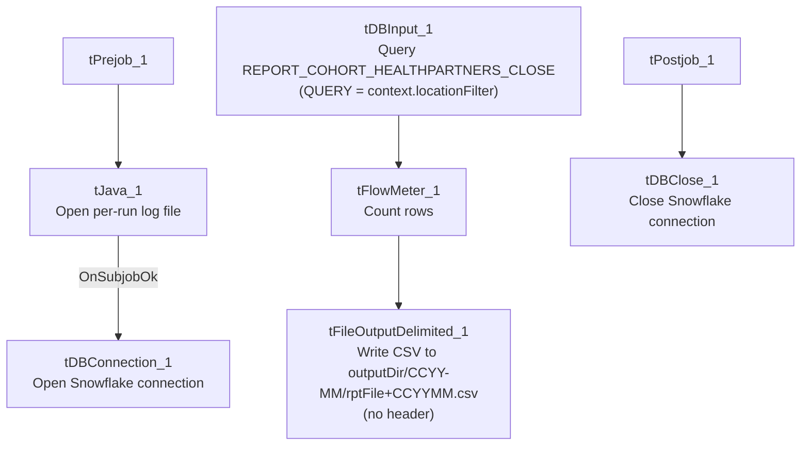

# Talend Job: HealthPartners_Close_Reports_Extract

## Overview

Extracts a HealthPartners "close" cohort report (debtor/account close-report fields: location, client, name, CDN, account, assignment date/PN, status code, cancelled amount/date, total balance, principal collected, last payment date, status-change date) from the Snowflake `REPORT_COHORT_HEALTHPARTNERS_CLOSE` view/table and writes it to a monthly CSV file. This job is never run directly on a schedule by itself — it is called 12 times by `HealthPartners_Close_Rpt_Master` (see that job's doc), almost certainly once per location/context variant, though the specific per-call differences aren't visible in this job's own metadata.

## Detail table

| Field | Value |
|---|---|
| Job name | HealthPartners_Close_Reports_Extract |
| Version | 0.1 |
| Project | EDW2SF |
| Author | jmach@harriscollect.com |
| Created | 2024-01-07T20:50:35.134-0800 |
| Last Modified | 2025-09-24T10:46:40.310-0700 |

## Step-by-step data flow

**Setup subjob:** `tPrejob_1` → `tJava_1` opens a per-run log file at `context.logDir + jobName + "_" + <timestamp> + ".log"` and redirects `System.out`/`System.err` to it → on subjob-ok, `tDBConnection_1` opens the Snowflake connection.

**Main subjob** — runs independently of the setup subjob:

1. `tDBInput_1` queries the `REPORT_COHORT_HEALTHPARTNERS_CLOSE` table; the actual `QUERY` parameter is set to `context.locationFilter` rather than a literal SQL string — i.e. the filtering SQL text itself is supplied entirely by a context variable (see Issues observed).
2. `tFlowMeter_1` counts rows passing through (labeled "MyLabel").
3. `tFileOutputDelimited_1` writes the 14 columns to a comma-delimited CSV at `context.outputDir + <CCYY-MM> + "/" + context.rptFile + <CCYYMM> + ".csv"` (no header row, `INCLUDEHEADER=false`).

**Teardown subjob:** `tPostjob_1` → `tDBClose_1` (close Snowflake).

## Settings tables

### Source: `tDBInput_1` (`tSnowflakeInput`)

| Setting | Value | What it means |
|---|---|---|
| Table | `REPORT_COHORT_HEALTHPARTNERS_CLOSE` | Named as the table, but the actual query text executed is... |
| Query | `context.locationFilter` | ...entirely supplied by a context variable rather than a literal query in this component — meaning the real SQL run each time (including any `WHERE`/location filter) is not visible in this job's own metadata at all. See Issues observed. |
| Columns | `LOCATION`, `CLIENT`, `NAME`, `CDN`, `ACCOUNT`, `DT_ASSIGN`, `PN_ASSIGN`, `ST_CD`, `CANCELLED_AMT`, `CANCELLED_DATE`, `TOT_BAL`, `PRIN_COL`, `LST_PAY`, `DATE_SC_CHANGED` | Close-report cohort fields — location/client/account identifiers, assignment and cancellation info, balances, and last-activity dates. |

### Target: `tFileOutputDelimited_1`

| Setting | Value | What it means |
|---|---|---|
| FILENAME | `context.outputDir + TalendDate.getDate("CCYY-MM") + "/" + context.rptFile + TalendDate.getDate("CCYYMM") + ".csv"` | Writes into a year-month subfolder, with the report filename also carrying the year-month — parameterized entirely via context, no hardcoded path. |
| FIELDSEPARATOR | `,` | Comma-delimited. |
| INCLUDEHEADER | `false` | No header row in the output file. |

## Dependencies & configuration

- **Triggers/depends on other jobs:** none of its own — but is itself called 12 times by `HealthPartners_Close_Rpt_Master` (see `06_dependency_matrix.md`'s "Jobs → jobs" table, which lists this exact 12x call count).
- **Context variables used:** `logDir`, `outputDir`, `rptFile`. Additionally, the query itself is driven by `context.locationFilter`, which is referenced inside the `tDBInput_1.QUERY` parameter's string value but not separately listed in `context_vars_referenced` in this job's extracted metadata (it is present as literal parameter text, not a parsed context reference) — see Issues observed.
- **Hardcoded paths:** none found in this job's own components.

## Glossary

| Component type | Plain-English meaning |
|---|---|
| `tSnowflakeConnection` / `tSnowflakeInput` / `tSnowflakeClose` | Open a Snowflake connection, query it, and close the connection. |
| `tFlowMeter` | Counts rows passing through a point in the flow, for logging/monitoring. |
| `tFileOutputDelimited` | Writes rows to a delimited (CSV-style) text file. |

## Issues observed

- **The actual query executed by `tDBInput_1` is entirely opaque in this metadata** — its `QUERY` parameter is literally the string `context.locationFilter`, meaning the real SQL (including whatever location/cohort filter differentiates each of the 12 calls from `HealthPartners_Close_Rpt_Master`) lives in a context variable value not captured in this job's own JSON or in `_shared_context.json`. This is the mechanism that presumably makes each of the 12 `tRunJob` calls extract a different location's data, but the specific filter values, and therefore what makes each of the 12 runs distinct, is **unable to determine from metadata** — verify directly in Talend Studio's context configuration for this job (likely a per-call context override on each `tRunJob_*` component in the master job).
- **No error handling specific to this job's business outcome** — no `tWarn`/`tDie`/`tSendMail` if the query returns zero rows or fails; a problem would only surface as a generic Talend execution error, and given it's called 12 times per run of the master job, a failure in one call could be hard to distinguish from the others without checking per-call logs.
- **No archiving of the source data or the previous month's output file** — each run simply (re)writes to a year-month-stamped path, so accidental overwrites are only prevented by the filename changing month to month, not by any explicit archive step.
