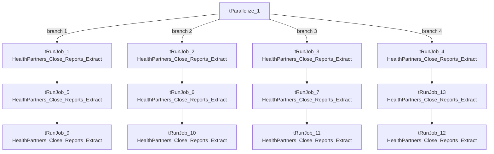

# Talend Job: HealthPartners_Close_Rpt_Master

## Overview

This is a pure orchestrator job — like `CO_Master_Load`, it moves no data itself. Its only job is to call `HealthPartners_Close_Reports_Extract` 12 separate times, arranged as 4 parallel branches of 3 sequential calls each, almost certainly once per HealthPartners location/report variant per call (the CSV-writing job it calls is filtered entirely by a `context.locationFilter` value not visible in this job's own metadata — see `HealthPartners_Close_Reports_Extract`'s doc). This matches the `06_dependency_matrix.md` finding that this job calls the same target job 12 times.

## Detail table

| Field | Value |
|---|---|
| Job name | HealthPartners_Close_Rpt_Master |
| Version | 0.1 |
| Project | EDW2SF |
| Author | jmach@harriscollect.com |
| Created | 2024-01-09T09:56:14.506-0800 |
| Last Modified | 2025-08-28T08:57:17.268-0700 |

## Step-by-step data flow

`tParallelize_1` starts 4 parallel branches, each a chain of 3 sequential `tRunJob` calls (all 12 targeting `HealthPartners_Close_Reports_Extract` with `CONTEXT_NAME=Default`, `DIE_ON_CHILD_ERROR=true`, `TRANSMIT_ORIGINAL_CONTEXT=true`):

- **Branch 1:** `tRunJob_1` → `tRunJob_5` → `tRunJob_9`
- **Branch 2:** `tRunJob_2` → `tRunJob_6` → `tRunJob_10`
- **Branch 3:** `tRunJob_3` → `tRunJob_7` → `tRunJob_11`
- **Branch 4:** `tRunJob_4` → `tRunJob_13` → `tRunJob_12`

Each step in each chain only proceeds to the next after the previous call succeeds (`OnSubjobOk`). All 12 `tRunJob` components share identical configuration in this metadata — none carries a visibly different context override, so what actually differentiates each of the 12 calls (presumably a different `locationFilter`/`rptFile` value per call) is not captured here.

## Settings tables

### Orchestration: `tRunJob_*` components (all 12 share identical settings in this metadata)

| Setting | Value | What it means |
|---|---|---|
| PROCESS | `HealthPartners_Close_Reports_Extract` | Every one of the 12 calls targets the exact same job. |
| CONTEXT_NAME | `Default` | No per-call named context group is visibly selected — if the 12 calls differ, that difference is set some other way (e.g. a per-`tRunJob` context parameter override not captured by this extraction). |
| DIE_ON_CHILD_ERROR | `true` (all 12) | If any called extract fails, the branch (and ultimately this master job) fails. |
| USE_INDEPENDENT_PROCESS | `false` (all 12) | Every call runs inside this master job's own JVM rather than as a separate process — unlike `CO_Master_Load`, where only one of ten calls behaves this way. |
| TRANSMIT_ORIGINAL_CONTEXT | `true` (all 12) | Each call receives the parent job's context values. |

## Dependencies & configuration

- **This job calls `HealthPartners_Close_Reports_Extract` 12 times** via `tRunJob`, confirmed against `06_dependency_matrix.md`'s "Jobs → jobs" table.
- **Context variables used:** none referenced directly in this job's own components (`context_vars_referenced` is empty) — all configuration lives in the called job.
- **Hardcoded paths:** none found in this job's own components.

## Glossary

| Component type | Plain-English meaning |
|---|---|
| `tRunJob` | Runs another Talend job as a sub-process (or, since `USE_INDEPENDENT_PROCESS=false` here, inline in the same JVM), optionally waiting for it to finish before continuing. |
| `tParallelize` | Runs its downstream branches at the same time instead of one after another — here, 4 branches of 3-deep sequential chains run concurrently. |

## Issues observed

- **All 12 `tRunJob` components have identical visible configuration** — same `PROCESS`, same `CONTEXT_NAME=Default`, no distinguishing parameter captured in this metadata. Per `06_dependency_matrix.md`'s note, confirming exactly what differs per call (almost certainly a location or report-variant context value set via a mechanism this extraction doesn't surface, such as a per-component context override) requires opening each `tRunJob` component individually in Talend Studio. Until that's done, it is **unable to determine from metadata** whether all 12 calls actually produce 12 different output files, or whether some are unintentional duplicates.
- **`USE_INDEPENDENT_PROCESS=false` on all 12 calls** means every one of the 12 extract runs shares this master job's JVM — unlike `CO_Master_Load`, which runs 9 of its 10 sub-jobs as independent processes. Running 12 sequential-chain-of-3 extracts in-process could mean a memory leak or unhandled exception in one extract affects the others sharing the JVM; this is a project-wide design choice specific to this job, not something flagged elsewhere.
- **If any of the 12 branches' first call fails, `DIE_ON_CHILD_ERROR=true` fails that whole branch's remaining 2 calls** (and ultimately this master job), but the branch structure means diagnosing which of the 12 individual calls broke requires checking each sub-job's own log — the same orchestrator-diagnosis difficulty documented for `CO_Master_Load` in `05_operational_runbook.md`.
