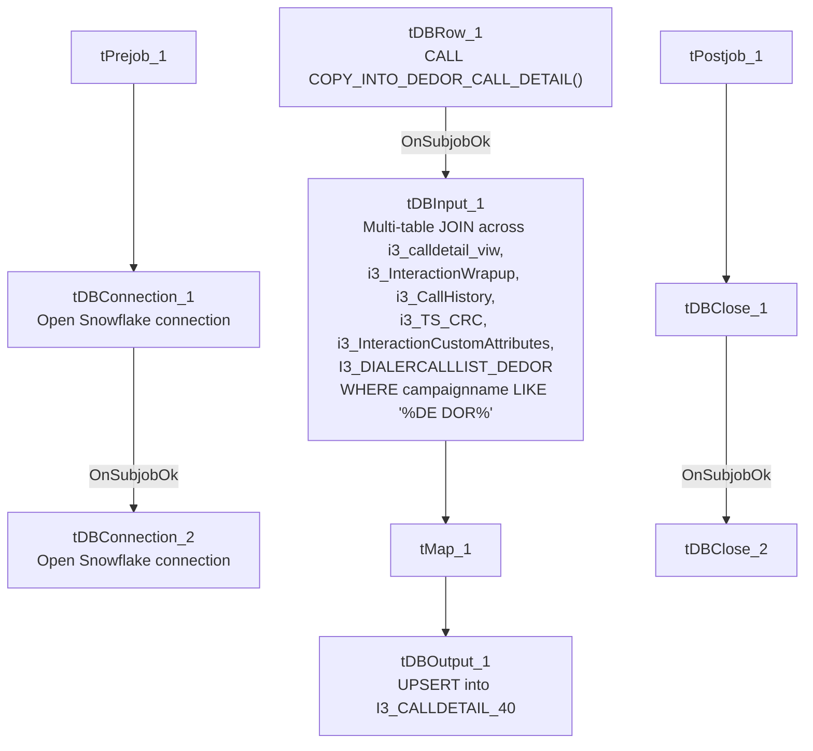

# Talend Job: I3_CALLDETAIL_DEDOR_LOAD

## Overview

Builds a consolidated call-detail record for the "DE DOR" (Delaware Department of Revenue, inferred from the `campaignname like '%DE DOR%'` filter and job-name prefix "DEDOR" seen elsewhere in this project, e.g. the `DEDOR_DW_0.1` context group) campaign by joining five Snowflake tables/views (`i3_calldetail_viw`, `i3_InteractionWrapup`, `i3_CallHistory`, `i3_TS_CRC`, `i3_InteractionCustomAttributes`, plus a lookup table `I3_DIALERCALLLIST_DEDOR`) entirely inside Snowflake, then writes the merged result into the `I3_CALLDETAIL_40` table and runs a `COPY_INTO_DEDOR_CALL_DETAIL()` stored procedure afterward. Unlike most jobs in this project, there is no file or MSSQL source at all — everything happens against Snowflake.

## Detail table

| Field | Value |
|---|---|
| Job name | I3_CALLDETAIL_DEDOR_LOAD |
| Version | 0.1 |
| Project | EDW2SF |
| Author | jmach@harriscollect.com |
| Created | 2023-09-14T11:17:19.192-0700 |
| Last Modified | 2025-09-24T11:06:27.303-0700 |

## Step-by-step data flow

**Setup subjob:** `tPrejob_1` → `tDBConnection_1` opens a Snowflake connection → on subjob-ok, `tDBConnection_2` opens a second Snowflake connection.

**Main subjob** — runs independently of the setup subjob:

1. `tDBRow_1` runs `CALL COPY_INTO_DEDOR_CALL_DETAIL();` — a stored procedure called *before* the main read/write flow, on the `errorCode`/`errorMessage` schema (result not captured into a context variable or branched on).
2. On subjob-ok, `tDBInput_1` runs a large multi-table Snowflake `SELECT` (distinct rows) joining `i3_calldetail_viw` (cd), `i3_InteractionWrapup` (w), `i3_CallHistory` (h), `i3_TS_CRC` (cr), `i3_InteractionCustomAttributes` (ca), and `I3_DIALERCALLLIST_DEDOR` (dcl) — deriving ~39 output columns including campaign, site, agent/debtor/client identifiers, call timing fields (adjusted by `h.odsoffset`), wrap-up code (built from a multi-branch `CASE` expression), call duration/hold/line-duration metrics, RPC/P2P flags, and a `MessageType` derived from wrap-up category. The query filters to `LEN(RemoteNumber)>5`, `PurposeCode not in ('4')`, and `campaignname like '%DE DOR%'`.
3. `tMap_1` passes the ~39 columns through to a same-shaped uppercase target schema.
4. `tDBOutput_1` UPSERTs the rows into Snowflake table `I3_CALLDETAIL_40`.

**Teardown subjob:** `tPostjob_1` → `tDBClose_1` → on subjob-ok, `tDBClose_2`.

## Settings tables

### Pre-step: `tDBRow_1` (`tSnowflakeRow`)

| Setting | Value | What it means |
|---|---|---|
| Query | `CALL COPY_INTO_DEDOR_CALL_DETAIL();` | Calls a stored procedure (not shown in this metadata) before the main read — presumably stages/refreshes some source data the join below depends on. Its result is not checked or branched on. |

### Source: `tDBInput_1` (`tSnowflakeInput`)

| Setting | Value | What it means |
|---|---|---|
| Table (label) | `DEDOR_CALL_DETAIL` | The component's declared table name, though the actual `db.query` is a full hand-written multi-table join, not a simple table read. |
| Joins | `i3_calldetail_viw` LEFT JOIN `i3_InteractionWrapup`, `i3_CallHistory`, `i3_TS_CRC`, `i3_InteractionCustomAttributes`; LEFT JOIN `I3_DIALERCALLLIST_DEDOR` on `I3_IDENTITY` | Merges call-detail, wrap-up, call-history, and dialer-list-lookup data into one row per call. |
| Filter | `LEN(RemoteNumber)>5 AND PurposeCode not in ('4') AND h.campaignname like '%DE DOR%'` | Restricts to calls with a plausible phone number, excludes purpose code 4, and scopes to the DE DOR campaign specifically. |
| Key derived fields | `wrapupcode` (multi-branch `CASE` prioritizing `w.WrapUpCode` then `h.WrapUpCode`), `agentid` (`COALESCE(dcl.HH_AGENTID, cd.LocalUserId, h.agentid, cd.LocalUserId)`), `DebtorNumber` (`COALESCE(dcl.case_id, cd.CustomString1, '')`), `combinedID` (concatenation used as a dedup/join key) | Business logic embedded directly in SQL rather than in a Talend `tMap` expression — see Issues observed. |

### Target: `tDBOutput_1` (`tSnowflakeOutput`)

| Setting | Value | What it means |
|---|---|---|
| Table | `I3_CALLDETAIL_40` | Destination table — same target table name used by the (separate, non-DEDOR-specific) `i3_CallDetail_40_Load` job documented elsewhere in this project. |
| Output action | `UPSERT` | Idempotent — safe to rerun. |
| Table action | `NONE` | Table is not recreated/altered by this job. |
| Schema | Includes 8 extra reject-style error columns with no wired reject flow | Same schema-drift artifact seen in several `HUB_*` jobs in this batch. |

## Dependencies & configuration

- **Triggers/depends on other jobs:** none — no `tRunJob` links found.
- **Context variables used:** none — every setting, including the entire multi-table SQL query, is hardcoded on the components.
- **Hardcoded paths:** none found in this job's own components.
- **Relationship to `i3_CallDetail_40_Load`:** both jobs write into the same `I3_CALLDETAIL_40` Snowflake table, but from entirely different sources — this job builds its rows from a Snowflake-side multi-table join scoped to the "DE DOR" campaign, while `i3_CallDetail_40_Load` reads directly from the MSSQL `i3_CallDetail_40` source table with no campaign filter. Whether these two jobs' outputs are meant to coexist in the same target table (e.g. DEDOR rows plus everything else) or whether one supersedes the other for DEDOR-specific rows is **unable to determine from metadata** — verify with the team, since both use `UPSERT` and could silently overwrite each other's rows if their key columns overlap unexpectedly.

## Glossary

| Component type | Plain-English meaning |
|---|---|
| `tSnowflakeConnection` / `tSnowflakeInput` / `tSnowflakeOutput` / `tSnowflakeRow` / `tSnowflakeClose` | Open a Snowflake connection, query it, write rows to a table, run an arbitrary SQL statement/procedure call, and close the connection. |
| `tMap` | Maps/transforms columns from one schema to another. |

## Issues observed

- **This job's business logic lives almost entirely in one large hand-written SQL query**, not in Talend's visual mapping components — the `wrapupcode`, `agentid`, `DebtorNumber`, and `combinedID` derivations are all multi-branch `CASE`/`COALESCE` expressions embedded in `tDBInput_1`'s query text. This makes the job's actual behavior hard to audit from the Talend canvas alone; any future change to this logic would need to be made in the SQL text, not the job's visual flow. Not a defect, but a maintainability note distinct from the mapping-based `tMap`-driven jobs seen elsewhere in this project.
- **`tDBRow_1`'s `COPY_INTO_DEDOR_CALL_DETAIL()` call result is not checked** — no `tWarn`/`tDie`/branching on its `errorCode`/`errorMessage` output, so a silent failure in that procedure would let the job continue to the main join step regardless, potentially reading stale or incomplete `DEDOR_CALL_DETAIL`-related data.
- **Potential target-table collision with `i3_CallDetail_40_Load`** — see the Dependencies section above; both jobs write to `I3_CALLDETAIL_40` via `UPSERT` from different sources.
- **`tDBOutput_1`'s schema carries unused reject-style error columns**, the same schema-drift artifact seen in several other jobs in this batch — cosmetic only.
