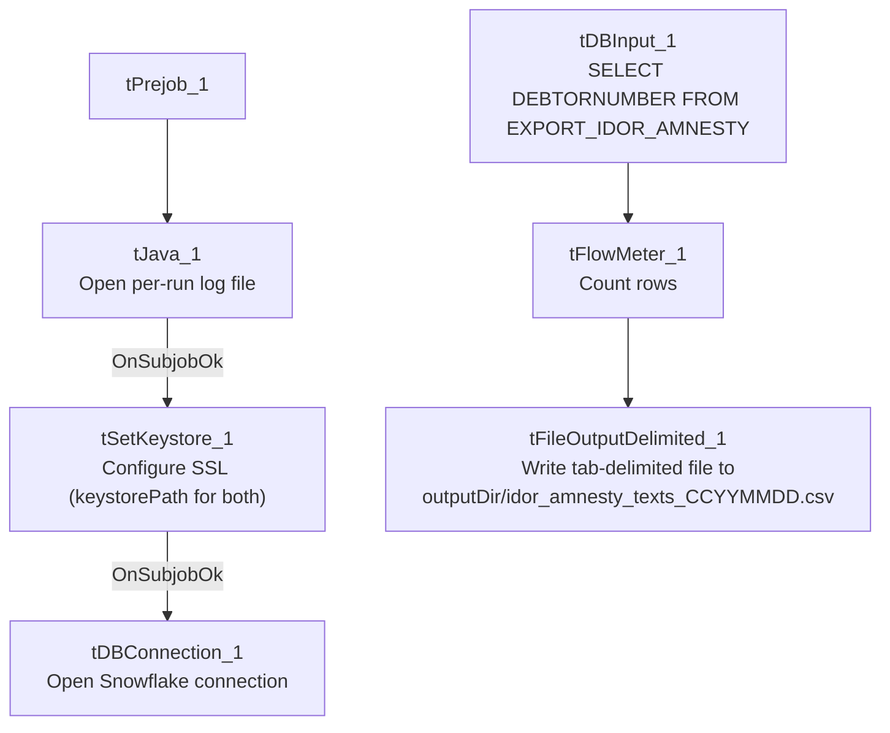

# Talend Job: IDOR_Amnesty_Extract

## Overview

Extracts a single-column list of debtor numbers from the Snowflake `EXPORT_IDOR_AMNESTY` table (or view) and writes it to a tab-delimited text file — almost certainly a list of accounts eligible for an "amnesty" program tied to IDOR (Illinois Department of Revenue, inferred from the job-name prefix, consistent with this project's pattern of state-agency-named extract jobs, e.g. `ISO_Request_Export`). This is the most recently created job in this batch (created and modified the same day in September 2025).

## Detail table

| Field | Value |
|---|---|
| Job name | IDOR_Amnesty_Extract |
| Version | 0.1 |
| Project | EDW2SF |
| Author | jmach@harriscollect.com |
| Created | 2025-09-25T09:33:54.478-0700 |
| Last Modified | 2025-09-25T09:47:16.176-0700 |

## Step-by-step data flow

**Setup subjob:** `tPrejob_1` → `tJava_1` opens a per-run log file at `context.logDir + jobName + "_" + <timestamp> + ".log"` and redirects `System.out`/`System.err` to it → on subjob-ok, `tSetKeystore_1` configures SSL trust/keystore using `context.keystorePath` for both the truststore and keystore paths (passwords redacted) → on subjob-ok, `tDBConnection_1` opens the Snowflake connection.

**Main subjob** — runs independently of the setup subjob:

1. `tDBInput_1` reads the single `DEBTORNUMBER` column from Snowflake table `EXPORT_IDOR_AMNESTY` (no `WHERE` clause captured — `query` is blank, meaning it's a plain table read).
2. `tFlowMeter_1` counts rows passing through.
3. `tFileOutputDelimited_1` writes the rows, tab-delimited, no header, to `context.outputDir + "idor_amnesty_texts_" + <CCYYMMDD> + ".csv"`.

## Settings tables

### Source: `tDBInput_1` (`tSnowflakeInput`)

| Setting | Value | What it means |
|---|---|---|
| Table | `EXPORT_IDOR_AMNESTY` | Source table/view — presumably pre-filtered upstream to just the amnesty-eligible debtor list. |
| Query | (blank) | No additional filtering applied by this job — a straight, unfiltered read of the source. |
| Schema | Single column `DEBTORNUMBER` (string) | The job's entire output is just a list of debtor numbers. |

### Target: `tFileOutputDelimited_1`

| Setting | Value | What it means |
|---|---|---|
| FILENAME | `context.outputDir + "idor_amnesty_texts_" + TalendDate.getDate("CCYYMMDD") + ".csv"` | Date-stamped output filename, despite the tab-delimited field separator (the `.csv` extension is misleading given the actual separator — see Issues observed). |
| FIELDSEPARATOR | `\t` (tab) | Tab-delimited, not comma-delimited, despite the `.csv` extension. |
| INCLUDEHEADER | `false` | No header row. |

## Dependencies & configuration

- **Triggers/depends on other jobs:** none — no `tRunJob` links found.
- **Context variables used:** `keystorePath`, `logDir`, `outputDir`.
- **Hardcoded paths:** none found in this job's own components — this is one of the few jobs in this batch with zero entries in `hardcoded_path_findings`.

## Glossary

| Component type | Plain-English meaning |
|---|---|
| `tSnowflakeConnection` / `tSnowflakeInput` / `tSnowflakeClose` | Open a Snowflake connection, query it, and close the connection (note: no explicit `tDBClose`/`tPostjob` teardown is present in this job — see Issues observed). |
| `tSetKeystore` | Configures SSL trust/keystore settings used by subsequent database connections in the job. |
| `tFlowMeter` | Counts rows passing through a point in the flow, for logging/monitoring. |
| `tFileOutputDelimited` | Writes rows to a delimited text file. |

## Issues observed

- **No `tPostjob`/`tDBClose` teardown exists in this job's metadata** — every other job in this batch that opens a Snowflake connection also explicitly closes it in a `tPostjob` subjob; this job has no `tPostjob_1` or `tDBClose_*` component at all. The Snowflake connection opened by `tDBConnection_1` is presumably closed implicitly when the job's JVM exits, but this is a deviation from the project's otherwise-consistent open/close pattern and is worth confirming isn't an oversight, especially if this job is ever called as a sub-job via `tRunJob` (where an unclosed connection could linger in a shared JVM).
- **Output file is named `.csv` but is actually tab-delimited**, not comma-delimited — a naming/format mismatch that could confuse a downstream consumer expecting genuine comma-separated values.
- **No error handling specific to this job's business outcome** — no `tWarn`/`tDie`/`tSendMail`; a query failure or an empty result set would only surface as a generic Talend execution error or a silently empty/near-empty output file.
- **`tSetKeystore_1` uses `context.keystorePath` for both the truststore and keystore paths** — unlike several other jobs in this batch (e.g. `INPUT_DIALER_LIST_GOV_Load`, `HUB_TempTransaction_Load`) which hardcode the truststore path separately from the context-driven keystore path. This job's more consistent use of context variables here is a positive difference worth noting, not a defect.
