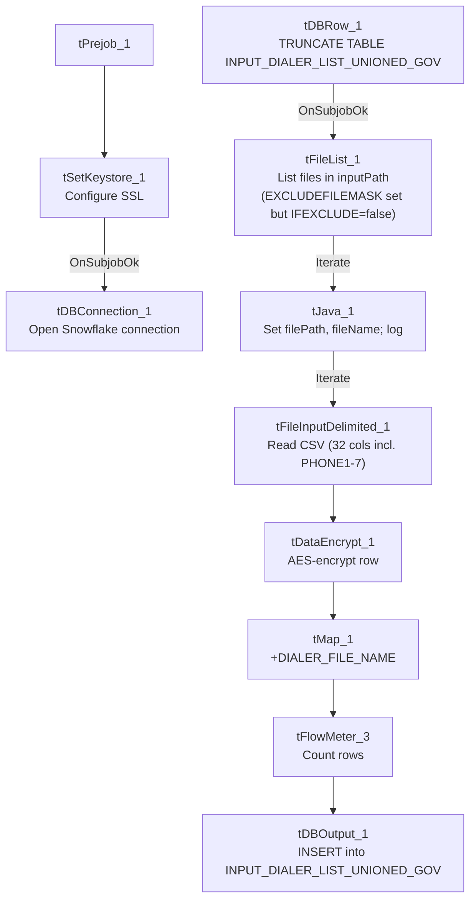

# Talend Job: INPUT_DIALER_LIST_GOV_Load

## Overview

Loads government-portfolio ("GOV") dialer-list extract files (account, address, balance, multiple phone numbers, scoring fields — 32 columns) from a source directory into the Snowflake `INPUT_DIALER_LIST_UNIONED_GOV` table, encrypting each row with a `tDataEncrypt` step before mapping and loading. This is one of two nearly-identical dialer-list loader jobs in this batch; the other, `INPUT_DIALER_LIST_HC_Load`, targets a different portfolio ("HC" — healthcare, inferred from its distinct phone/skip-trace column layout) with a different column set and target table.

## Detail table

| Field | Value |
|---|---|
| Job name | INPUT_DIALER_LIST_GOV_Load |
| Version | 0.1 |
| Project | EDW2SF |
| Author | jmach@harriscollect.com |
| Created | 2022-09-21T10:10:48.388-0700 |
| Last Modified | 2025-11-16T19:37:37.733-0800 |

## Step-by-step data flow

**Setup subjob:** `tPrejob_1` → `tSetKeystore_1` configures SSL trust/keystore (truststore path hardcoded, keystore path from `context.keystorePath`) → on subjob-ok, `tDBConnection_1` opens the Snowflake connection.

**Main subjob** — gated on the truncate step completing first:

1. `tDBRow_1` runs `TRUNCATE TABLE INPUT_DIALER_LIST_UNIONED_GOV;` against Snowflake.
2. On subjob-ok, `tFileList_1` lists files in `context.inputPath` (an `EXCLUDEFILEMASK` of `*.txt` is configured but `IFEXCLUDE=false`, so the exclusion is not actually applied — every file is picked up, same pattern flagged in `ADP_Payroll_Load`'s doc).
3. For each file, `tJava_1` sets `context.filePath`/`context.fileName` and logs "Processing file `<name>`".
4. `tFileInputDelimited_1` reads the CSV (comma-delimited, header row present, `DIE_ON_ERROR=false`, no named repository schema — schema defined inline, 32 columns: account/address/balance fields plus `PHONE1`–`PHONE7`, `SCORE`, `MEDIAN`).
5. `tDataEncrypt_1` encrypts the row using AES (key/secret/password redacted) against `context.cryptoPath`.
6. `tMap_1` passes the columns through, adding a `DIALER_FILE_NAME` column (presumably populated from `context.fileName`, though the mapping expression itself isn't captured in this metadata).
7. `tFlowMeter_3` counts rows passing through.
8. `tDBOutput_1` inserts the rows into Snowflake table `INPUT_DIALER_LIST_UNIONED_GOV` (`INSERT`, following the earlier `TRUNCATE`).

## Settings tables

### Truncate step: `tDBRow_1` (`tSnowflakeRow`)

| Setting | Value | What it means |
|---|---|---|
| Query | `TRUNCATE TABLE INPUT_DIALER_LIST_UNIONED_GOV;` | Clears the target table before reload — standard truncate-then-load pattern, unlike the HUB reference jobs which use UPSERT with no truncate. |

### Source: `tFileInputDelimited_1`

| Setting | Value | What it means |
|---|---|---|
| FILENAME | `context.filePath` | Current file from `tFileList_1`'s iteration. |
| Schema | 32 columns including `ACCOUNT_NUM`, `LOGON`, `CAMPAIGN`, `ADDRESS`/`CITY`/`ST`/`ZIP`, `BALANCE`, `PHONE_RES`, `EMP1_PHN`, `EMP2_PHN`, `AP_PHONE`, `PHONE1`–`PHONE7`, `SCORE`, `MEDIAN` | No named repository schema (unlike `INPUT_DIALER_LIST_HC_Load`, which uses a repository schema labeled "HC10A_CLTAUTH"). |
| DIE_ON_ERROR | `false` | Malformed rows do not fail the job; no reject flow is wired, so rejected rows are silently dropped (same pattern flagged in `ADP_Payroll_Load`). |
| TEMP_DIR | `"C:/Talend-Studio-20211109_1610-V8.0.1/workspace"` (hardcoded) | Developer-workstation path — see Issues observed. |

### Encryption: `tDataEncrypt_1`

| Setting | Value | What it means |
|---|---|---|
| CRYPTO_METHOD | `AES` | Symmetric encryption applied to the row before it reaches the target table. |
| SECRET_KEY / SECRET_TYPE / PASSWORD_M1 | `***REDACTED***` | Encryption key material — preserved as redacted, not guessed. |
| CRYPTO_FILE_PATH | `context.cryptoPath` | Parameterized via context. |

### Target: `tDBOutput_1` (`tSnowflakeOutput`)

| Setting | Value | What it means |
|---|---|---|
| Table | `INPUT_DIALER_LIST_UNIONED_GOV` | Destination table in Snowflake. |
| Output action | `INSERT` | Appends rows; relies on the earlier `TRUNCATE` to prevent duplicate accumulation. |
| Table action | `NONE` | Table is not recreated/altered by this job. |

### SSL setup: `tSetKeystore_1`

| Setting | Value | What it means |
|---|---|---|
| SSL_TRUSTSERVER_TRUSTSTORE | `"C:/clientTrustStore.trustStore"` (hardcoded) | Developer-workstation path — see Issues observed. |
| SSL_KEYSTORE | `context.keystorePath` | Parameterized via context. |

## Dependencies & configuration

- **Triggers/depends on other jobs:** none — no `tRunJob` links found.
- **Context variables used:** `cryptoPath`, `fileName`, `filePath`, `inputPath`, `keystorePath`.
- **2 hardcoded path findings:** `tFileInputDelimited_1.TEMP_DIR` = `"C:/Talend-Studio-20211109_1610-V8.0.1/workspace"`; `tSetKeystore_1.SSL_TRUSTSERVER_TRUSTSTORE` = `"C:/clientTrustStore.trustStore"` — the same project-wide developer-path risk documented in `05_operational_runbook.md`.

## Glossary

| Component type | Plain-English meaning |
|---|---|
| `tFileList` | Lists files in a directory for the job to iterate over one at a time. |
| `tFileInputDelimited` | Reads a delimited (CSV-style) text file according to a schema. |
| `tDataEncrypt` | Encrypts specified column values (here, effectively the whole row) using a configured algorithm and key file. |
| `tMap` | Maps/transforms columns from one schema to another. |
| `tFlowMeter` | Counts rows passing through a point in the flow, for logging/monitoring. |
| `tSnowflakeConnection` / `tSnowflakeOutput` / `tSnowflakeRow` | Open a Snowflake connection, write rows to a table, and run an arbitrary SQL statement against Snowflake. |
| `tSetKeystore` | Configures SSL trust/keystore settings used by subsequent database connections. |

## Issues observed

- **`EXCLUDEFILEMASK="*.txt"` is configured but `IFEXCLUDE=false`**, so the exclusion never actually applies — every file in `context.inputPath` is picked up regardless of extension, the same dead-configuration pattern documented in `ADP_Payroll_Load`'s doc. If a stray `.txt` or other non-CSV file lands in the input directory, it would be read (and likely rejected row-by-row, silently, given `DIE_ON_ERROR=false` and no reject flow) rather than being skipped as the mask's presence suggests was intended.
- **No reject flow wired from `tFileInputDelimited_1`** — malformed rows are silently dropped with no record of how many or which ones failed to parse.
- **2 hardcoded developer-workstation paths** (`TEMP_DIR`, `SSL_TRUSTSERVER_TRUSTSTORE`) — same portability risk documented project-wide in `05_operational_runbook.md`.
- **No archiving or deletion of the source dialer-list files after load** — unlike file-load jobs elsewhere in this project (e.g. `ADP_Payroll_Load`) that zip and delete the source file on success, this job leaves processed files in place with no visible cleanup step, which could lead to the same files being re-read (and, given `INSERT` with only a table-level `TRUNCATE`, re-inserted without duplication risk since the whole table is cleared first) on the next run.
