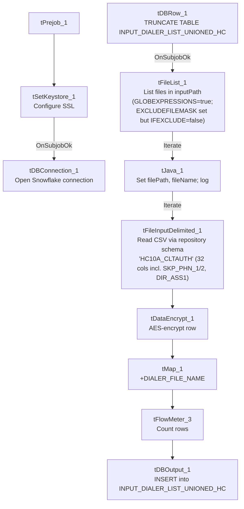

# Talend Job: INPUT_DIALER_LIST_HC_Load

## Overview

Loads "HC" portfolio (healthcare, inferred from the distinct phone/skip-trace-oriented column layout compared to its `INPUT_DIALER_LIST_GOV_Load` sibling) dialer-list extract files into the Snowflake `INPUT_DIALER_LIST_UNIONED_HC` table, encrypting each row with a `tDataEncrypt` step before mapping and loading. Structurally identical to `INPUT_DIALER_LIST_GOV_Load` (see that job's doc), but with a different source schema and target table.

## Detail table

| Field | Value |
|---|---|
| Job name | INPUT_DIALER_LIST_HC_Load |
| Version | 0.1 |
| Project | EDW2SF |
| Author | jmach@harriscollect.com |
| Created | 2022-09-09T09:04:45.960-0700 |
| Last Modified | 2025-11-16T19:40:23.696-0800 |

## Step-by-step data flow

**Setup subjob:** `tPrejob_1` → `tSetKeystore_1` configures SSL trust/keystore (truststore path hardcoded, keystore path from `context.keystorePath`) → on subjob-ok, `tDBConnection_1` opens the Snowflake connection.

**Main subjob** — gated on the truncate step completing first:

1. `tDBRow_1` runs `TRUNCATE TABLE INPUT_DIALER_LIST_UNIONED_HC;` against Snowflake.
2. On subjob-ok, `tFileList_1` lists files in `context.inputPath` (`GLOBEXPRESSIONS=true` here, unlike `INPUT_DIALER_LIST_GOV_Load`'s `false`; same dead `EXCLUDEFILEMASK="*.txt"`/`IFEXCLUDE=false` combination — the exclusion never applies).
3. For each file, `tJava_1` sets `context.filePath`/`context.fileName` and logs "Processing file `<name>`".
4. `tFileInputDelimited_1` reads the CSV using repository schema `HC10A_CLTAUTH` (comma-delimited, header row present, `DIE_ON_ERROR=false`) — 32 columns including `SKP_PHN_1`, `SKP_PHN_2`, `PHO_1`, `PHONE2`–`PHONE4`, `DIR_ASS1` (a healthcare/skip-trace-style column set, distinct from `INPUT_DIALER_LIST_GOV_Load`'s `PHONE1`–`PHONE7` layout).
5. `tDataEncrypt_1` encrypts the row using AES (key/secret/password redacted) against `context.cryptoPath`.
6. `tMap_1` passes the columns through, adding a `DIALER_FILE_NAME` column.
7. `tFlowMeter_3` counts rows passing through.
8. `tDBOutput_1` inserts the rows into Snowflake table `INPUT_DIALER_LIST_UNIONED_HC` (`INSERT`, following the earlier `TRUNCATE`).

## Settings tables

### Truncate step: `tDBRow_1` (`tSnowflakeRow`)

| Setting | Value | What it means |
|---|---|---|
| Query | `TRUNCATE TABLE INPUT_DIALER_LIST_UNIONED_HC;` | Clears the target table before reload. |

### Source: `tFileInputDelimited_1`

| Setting | Value | What it means |
|---|---|---|
| FILENAME | `context.filePath` | Current file from `tFileList_1`'s iteration. |
| Schema | Repository schema `HC10A_CLTAUTH` — 32 columns including `ACCOUNT_NUM`, `LOGON`, `CAMPAIGN`, `ADDRESS`/`CITY`/`ST`/`ZIP`, `BALANCE`, `PHONE_RES`, `EMP1_PHN`, `EMP2_PHN`, `AP_PHONE`, `SKP_PHN_1`, `SKP_PHN_2`, `PHO_1`, `PHONE2`–`PHONE4`, `DIR_ASS1`, `SCORE`, `MEDIAN` | Uses a named repository schema, unlike `INPUT_DIALER_LIST_GOV_Load`'s inline schema. The `SKP_PHN_*`/`DIR_ASS1` columns (skip-trace and directory-assistance fields) replace GOV's `PHONE5`–`PHONE7`. |
| DIE_ON_ERROR | `false` | Malformed rows do not fail the job; no reject flow is wired. |
| TEMP_DIR | `"C:/Talend-Studio-20211109_1610-V8.0.1/workspace"` (hardcoded) | Developer-workstation path — see Issues observed. |

### Encryption: `tDataEncrypt_1`

| Setting | Value | What it means |
|---|---|---|
| CRYPTO_METHOD | `AES` | Symmetric encryption applied to the row before it reaches the target table. |
| SECRET_KEY / SECRET_TYPE / PASSWORD_M1 | `***REDACTED***` | Encryption key material — preserved as redacted. |
| CRYPTO_FILE_PATH | `context.cryptoPath` | Parameterized via context. |

### Target: `tDBOutput_1` (`tSnowflakeOutput`)

| Setting | Value | What it means |
|---|---|---|
| Table | `INPUT_DIALER_LIST_UNIONED_HC` | Destination table in Snowflake. |
| Output action | `INSERT` | Appends rows; relies on the earlier `TRUNCATE`. |
| Table action | `NONE` | Table is not recreated/altered by this job. |

## Dependencies & configuration

- **Triggers/depends on other jobs:** none — no `tRunJob` links found.
- **Context variables used:** `cryptoPath`, `fileName`, `filePath`, `inputPath`, `keystorePath` — identical set to `INPUT_DIALER_LIST_GOV_Load`.
- **2 hardcoded path findings:** `tFileInputDelimited_1.TEMP_DIR` = `"C:/Talend-Studio-20211109_1610-V8.0.1/workspace"`; `tSetKeystore_1.SSL_TRUSTSERVER_TRUSTSTORE` = `"C:/clientTrustStore.trustStore"`.

## Glossary

| Component type | Plain-English meaning |
|---|---|
| `tFileList` | Lists files in a directory for the job to iterate over one at a time. |
| `tFileInputDelimited` | Reads a delimited (CSV-style) text file according to a schema. |
| `tDataEncrypt` | Encrypts specified column values (here, effectively the whole row) using a configured algorithm and key file. |
| `tMap` | Maps/transforms columns from one schema to another. |
| `tFlowMeter` | Counts rows passing through a point in the flow, for logging/monitoring. |
| `tSnowflakeConnection` / `tSnowflakeOutput` / `tSnowflakeRow` | Open a Snowflake connection, write rows to a table, and run an arbitrary SQL statement against Snowflake. |
| `tSetKeystore` | Configures SSL trust/keystore settings used by subsequent database connections. |

## Issues observed

- **Same dead `EXCLUDEFILEMASK`/`IFEXCLUDE` combination as `INPUT_DIALER_LIST_GOV_Load`** — `EXCLUDEFILEMASK="*.txt"` is set but `IFEXCLUDE=false`, so it never applies; every file in `context.inputPath` is picked up.
- **`GLOBEXPRESSIONS=true` here vs. `false` in `INPUT_DIALER_LIST_GOV_Load`'s otherwise-identical `tFileList_1`** — this sibling job allows glob-style wildcard matching in its file listing while GOV does not. Given both configure the same (non-functional) `EXCLUDEFILEMASK`, this difference likely has no practical effect today, but it is a real configuration divergence between two structurally identical jobs — verify with the team whether this was intentional.
- **No reject flow wired from `tFileInputDelimited_1`** — malformed rows are silently dropped, same as `INPUT_DIALER_LIST_GOV_Load`.
- **2 hardcoded developer-workstation paths** (`TEMP_DIR`, `SSL_TRUSTSERVER_TRUSTSTORE`) — same portability risk documented project-wide in `05_operational_runbook.md`.
- **No archiving or deletion of source files after load** — same as `INPUT_DIALER_LIST_GOV_Load`.
