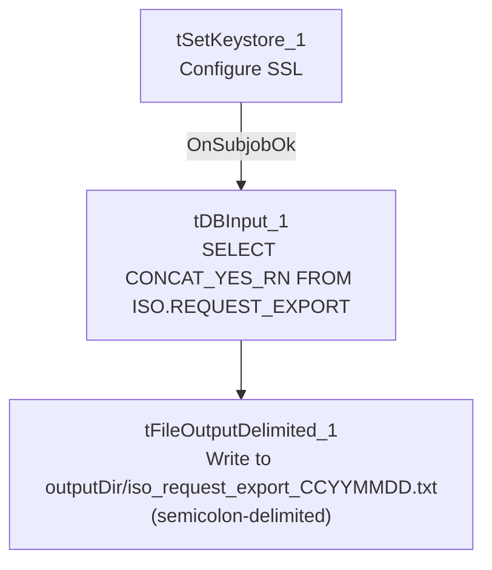

# Talend Job: ISO_Request_Export

## Overview

A minimal, single-column export job: reads a `CONCAT_YES_RN` value from the Snowflake `ISO.REQUEST_EXPORT` table and writes it to a semicolon-delimited text file, date-stamped by filename. The job's shape (no `tPrejob`/`tPostjob`, no explicit `tDBConnection`/`tDBClose` component, and a blank `author` field) suggests this is a very lightweight, possibly hastily-built or template-derived utility job rather than a fully-formed production pipeline — it was also created and last modified on the same day.

## Detail table

| Field | Value |
|---|---|
| Job name | ISO_Request_Export |
| Version | 0.1 |
| Project | EDW2SF |
| Author | (blank — not recorded in metadata) |
| Created | 2026-06-08T11:15:54.414-0700 |
| Last Modified | 2026-06-08T11:30:16.503-0700 |

## Step-by-step data flow

There is no `tPrejob`/`tPostjob` or explicit database connection/close component in this job — it consists of exactly three components in a single linear chain:

1. `tSetKeystore_1` configures SSL trust/keystore (truststore path hardcoded, keystore path from `context.keystorePath`, passwords redacted).
2. On subjob-ok, `tDBInput_1` runs `SELECT CONCAT_YES_RN FROM ISO.REQUEST_EXPORT;` against Snowflake — no visible connection-opening component precedes it in this job's own metadata (see Issues observed).
3. `tFileOutputDelimited_1` writes the single `CONCAT_YES_RN` column, semicolon-delimited, no header, to `context.outputDir + "iso_request_export_" + <CCYYMMDD> + ".txt"`.

## Settings tables

### Source: `tDBInput_1` (`tSnowflakeInput`)

| Setting | Value | What it means |
|---|---|---|
| Query | `SELECT CONCAT_YES_RN FROM ISO.REQUEST_EXPORT;` | A single pre-concatenated column, suggesting the actual row-formatting logic lives in the `ISO.REQUEST_EXPORT` table/view definition in Snowflake, not in this Talend job. |
| Schema | Single column `CONCAT_YES_RN` (string) | Confirms this job is a thin export wrapper around a Snowflake-side view. |

### Target: `tFileOutputDelimited_1`

| Setting | Value | What it means |
|---|---|---|
| FILENAME | `context.outputDir + "iso_request_export_" + TalendDate.getDate("CCYYMMDD") + ".txt"` | Date-stamped output filename, parameterized via context. |
| FIELDSEPARATOR | `;` (semicolon) | Unusual choice compared to the comma/tab separators used elsewhere in this batch — may reflect a specific downstream ISO (state agency, inferred from naming) file-format requirement. |
| INCLUDEHEADER | `false` | No header row. |

### SSL setup: `tSetKeystore_1`

| Setting | Value | What it means |
|---|---|---|
| SSL_TRUSTSERVER_TRUSTSTORE | `"C:/clientTrustStore.trustStore"` (hardcoded) | Developer-workstation path — see Issues observed. |
| SSL_KEYSTORE | `context.keystorePath` | Parameterized via context. |

## Dependencies & configuration

- **Triggers/depends on other jobs:** none — no `tRunJob` links found.
- **Context variables used:** `keystorePath`, `outputDir`.
- **1 hardcoded path finding:** `tSetKeystore_1.SSL_TRUSTSERVER_TRUSTSTORE` = `"C:/clientTrustStore.trustStore"`.

## Glossary

| Component type | Plain-English meaning |
|---|---|
| `tSetKeystore` | Configures SSL trust/keystore settings used by subsequent database connections. |
| `tSnowflakeInput` | Runs a query against Snowflake and returns its result rows. |
| `tFileOutputDelimited` | Writes rows to a delimited text file. |

## Issues observed

- **No `tPrejob`/`tPostjob`, and no explicit `tDBConnection`/`tDBClose` component anywhere in this job's metadata** — every other job in this batch that queries Snowflake does so through an explicit `tDBConnection`/`tDBClose` pair (often wrapped in `tPrejob`/`tPostjob`). Here, `tDBInput_1` runs directly with no visible connection-opening step feeding it. This could mean the job relies on an implicit/default Snowflake connection configured outside this component (not captured in this extraction), or it could be an incomplete job. **Unable to determine from metadata** whether this job would actually run successfully as-is; verify directly in Talend Studio.
- **`author` field is blank** — every other job in this batch (and the vast majority of the project) records `jmach@harriscollect.com` as author; this is the only job in the batch with no author recorded, consistent with it being a newer, possibly still-in-progress job (created mid-2026, the most recent creation date of any job in this batch).
- **No error handling** — no `tWarn`/`tDie`/`tSendMail`; a query or file-write failure would only surface as a generic Talend execution error.
- **No teardown/connection-close step**, consistent with the missing `tDBConnection` noted above — if a connection is in fact opened somewhere not captured here, it may never be explicitly closed by this job.
