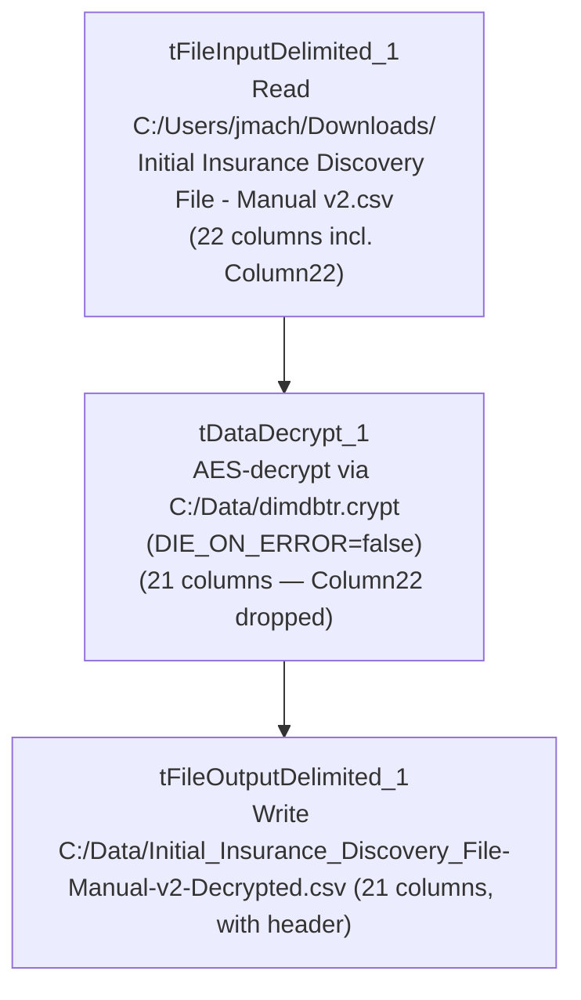

# Talend Job: Initial_Ins_Discovery_V2_Decrypted

## Overview

The "v2" successor to `Initial_Insurance_Discovery_File`: reads a manually-prepared "Initial Insurance Discovery File - Manual v2.csv" from a developer's personal Downloads folder, decrypts it against the same `dimdbtr.crypt` key file, and writes the decrypted result to a "v2-Decrypted" output file. Same file-to-file utility shape as its sibling — no database connection, no `tPrejob`/`tPostjob`, no context variables — but adds one extra column (`Column22`) to the schema and relaxes the decrypt step's error handling.

## Detail table

| Field | Value |
|---|---|
| Job name | Initial_Ins_Discovery_V2_Decrypted |
| Version | 0.1 |
| Project | EDW2SF |
| Author | jmach@harriscollect.com |
| Created | 2025-05-20T11:38:08.755-0700 |
| Last Modified | 2025-08-28T08:57:23.705-0700 |

## Step-by-step data flow

A single linear chain, no setup/teardown subjobs:

1. `tFileInputDelimited_1` reads `C:/Users/jmach/Downloads/Initial Insurance Discovery File - Manual v2.csv` (comma-delimited, header row present, `DIE_ON_ERROR=false`, `ENCODING=US-ASCII`) using repository schema `metadata` — 22 columns: the same 21 patient/guarantor/claim fields as `Initial_Insurance_Discovery_File`, plus one additional unnamed/generic `Column22` field not present in the v1 job.
2. `tDataDecrypt_1` decrypts the row using AES against a hardcoded crypto file path `C:/Data/dimdbtr.crypt` (key/secret/password redacted), with `DIE_ON_ERROR=false` — **unlike the v1 job**, a decryption failure here does *not* fail the job (see Issues observed). Note the decrypt step's own schema only carries the original 21 columns, not `Column22` — see Issues observed.
3. `tFileOutputDelimited_1` writes the decrypted rows, comma-delimited with header, to the hardcoded path `C:/Data/Initial_Insurance_Discovery_File-Manual-v2-Decrypted.csv` (also only 21 columns — `Column22` is dropped somewhere between input and output; see Issues observed).

## Settings tables

### Source: `tFileInputDelimited_1`

| Setting | Value | What it means |
|---|---|---|
| FILENAME | `"C:/Users/jmach/Downloads/Initial Insurance Discovery File - Manual v2.csv"` (hardcoded) | Same personal Downloads-folder pattern as the v1 job, with a "v2" source filename. |
| Schema | Repository schema `metadata` — 22 columns, same 21 as v1 (`PACKET_IDX` through `REQUEST_ID`) plus `Column22` | The extra column suggests the v2 source file has one more field than the original — its business meaning is not captured in this metadata (generic placeholder name). |
| REMOVE_EMPTY_ROW | `false` | Same as v1. |

### Decryption: `tDataDecrypt_1`

| Setting | Value | What it means |
|---|---|---|
| CRYPTO_FILE_PATH | `"C:/Data/dimdbtr.crypt"` (hardcoded) | Same key file as `Initial_Insurance_Discovery_File` and `Insurance_Discovery_Test`. |
| DIE_ON_ERROR | `false` | **Differs from v1's `true`** — a decryption failure here does not stop the job; see Issues observed. |

### Target: `tFileOutputDelimited_1`

| Setting | Value | What it means |
|---|---|---|
| FILENAME | `"C:/Data/Initial_Insurance_Discovery_File-Manual-v2-Decrypted.csv"` (hardcoded) | Fixed output path, named to reflect the "v2-Decrypted" origin. |
| INCLUDEHEADER | `true` | Output includes a header row. |

## Dependencies & configuration

- **Triggers/depends on other jobs:** none — no `tRunJob` links found.
- **Context variables used:** none — every path in this job is hardcoded, same pattern as its v1 sibling.
- **1 hardcoded path finding** (per extraction): `tFileInputDelimited_1.TEMP_DIR` = `"C:/Talend-Studio-20211109_1610-V8.0.1/workspace"`. As with the v1 job, the source filename, crypto file path, and output filename are all additional hardcoded local paths visible in the job's own parameters but not separately flagged by the extraction.

## Glossary

| Component type | Plain-English meaning |
|---|---|
| `tFileInputDelimited` | Reads a delimited (CSV-style) text file according to a schema. |
| `tDataDecrypt` | Decrypts specified column values (here, effectively the whole row) using a configured algorithm and key file. |
| `tFileOutputDelimited` | Writes rows to a delimited text file. |

## Issues observed

- **`Column22` is present in `tFileInputDelimited_1`'s schema but absent from both `tDataDecrypt_1`'s and `tFileOutputDelimited_1`'s schemas** — the extra column read from the v2 source file appears to be silently dropped before decryption, rather than passed through or explicitly excluded with a documented reason. Whether this is intentional (the column isn't needed downstream) or an oversight (the v2 schema update wasn't fully propagated through the job) is **unable to determine from metadata** — verify with the team, especially since `Column22`'s business meaning isn't captured anywhere in this extraction.
- **`DIE_ON_ERROR=false` on `tDataDecrypt_1`, unlike the v1 job's `true`** — this v2 job will continue processing (and presumably write a malformed/undecrypted row, or skip it silently) if decryption fails for a given row, whereas `Initial_Insurance_Discovery_File` would stop the whole job. Given both jobs decrypt the same kind of sensitive PII (SSN, DOB, patient/guarantor names), this relaxation is worth confirming with the team — a silently-failed decryption on sensitive data could produce an output file with unexpectedly garbled or missing values with no job-level failure signal.
- **Same hardcoded-path and personal-machine-dependency concerns as `Initial_Insurance_Discovery_File`** — no context variables anywhere, all paths point to a specific developer's Downloads folder or a fixed `C:/Data/` location.
