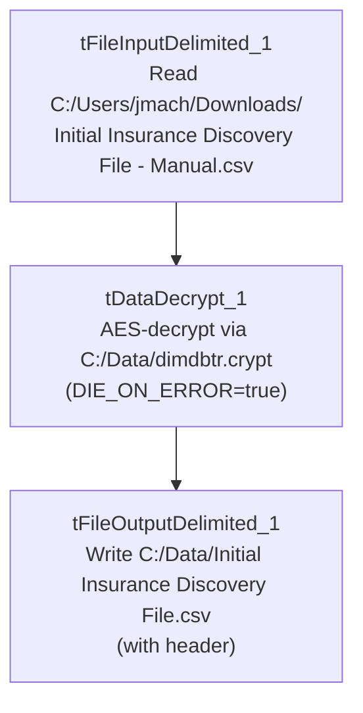

# Talend Job: Initial_Insurance_Discovery_File

## Overview

A standalone, file-to-file utility job: reads a manually-prepared "Initial Insurance Discovery File" CSV (patient/guarantor demographic and billing fields — 22 columns) from a developer's personal Downloads folder, decrypts specific values using the project's `dimdbtr.crypt` key file, and writes the decrypted result to another fixed local path. There is no database connection, no `tPrejob`/`tPostjob`, and no context variables anywhere in this job — it appears to be a one-off manual tool rather than a scheduled production pipeline, consistent with its "Manual" file-naming and personal-folder source path.

## Detail table

| Field | Value |
|---|---|
| Job name | Initial_Insurance_Discovery_File |
| Version | 0.1 |
| Project | EDW2SF |
| Author | jmach@harriscollect.com |
| Created | 2025-04-18T10:15:20.847-0700 |
| Last Modified | 2025-08-28T08:57:23.740-0700 |

## Step-by-step data flow

A single linear chain, no setup/teardown subjobs:

1. `tFileInputDelimited_1` reads `C:/Users/jmach/Downloads/Initial Insurance Discovery File - Manual.csv` (comma-delimited, header row present, `DIE_ON_ERROR=false`, `ENCODING=US-ASCII`) using repository schema `metadata` — 21 patient/guarantor/claim columns (packet ID, client/facility, patient name/DOB/sex/SSN/address, guarantor name/SSN, amount due, current balance, admit/discharge dates, NPI, request ID).
2. `tDataDecrypt_1` decrypts the row using AES against a hardcoded crypto file path `C:/Data/dimdbtr.crypt` (key/secret/password redacted), with `DIE_ON_ERROR=true` — a decryption failure here **does** fail the job (unlike its sibling job, see Issues observed).
3. `tFileOutputDelimited_1` writes the decrypted rows, comma-delimited with header, to the hardcoded path `C:/Data/Initial Insurance Discovery File.csv`.

## Settings tables

### Source: `tFileInputDelimited_1`

| Setting | Value | What it means |
|---|---|---|
| FILENAME | `"C:/Users/jmach/Downloads/Initial Insurance Discovery File - Manual.csv"` (hardcoded) | A specific developer's personal Downloads folder — not a shared server path. |
| Schema | Repository schema `metadata` — 21 columns (`PACKET_IDX`, `CLIENT_FACILITY`, `CLIENT`, `DEBTOR_ACCOUNT_NUMBER`, patient/guarantor name/DOB/SSN/address fields, `AMOUNT_DUE`, `CURRENT_BALANCE`, `ADMIT_DATE`, `DISCHARGE_DATE`, `NPI`, `REQUEST_ID`) | Patient billing/insurance-discovery record layout, containing SSN and other sensitive PII fields. |
| ENCODING | `US-ASCII` | Fixed character encoding for reading the source file. |

### Decryption: `tDataDecrypt_1`

| Setting | Value | What it means |
|---|---|---|
| CRYPTO_METHOD | `AES` | Symmetric decryption. |
| CRYPTO_FILE_PATH | `"C:/Data/dimdbtr.crypt"` (hardcoded) | Same key file referenced (via `context.cryptoPath`) elsewhere in this project's insurance-discovery jobs, but hardcoded directly here rather than parameterized. |
| SECRET_KEY / SECRET_TYPE / PASSWORD_M1 | `***REDACTED***` | Decryption key material — preserved as redacted. |
| DIE_ON_ERROR | `true` | A decryption failure fails the job outright. |

### Target: `tFileOutputDelimited_1`

| Setting | Value | What it means |
|---|---|---|
| FILENAME | `"C:/Data/Initial Insurance Discovery File.csv"` (hardcoded) | Fixed output path, distinct from the source's personal Downloads folder. |
| INCLUDEHEADER | `true` | Output file includes a header row, unlike most other file-output jobs in this batch. |

## Dependencies & configuration

- **Triggers/depends on other jobs:** none — no `tRunJob` links found.
- **Context variables used:** none — every path in this job is hardcoded.
- **1 hardcoded path finding** (per extraction): `tFileInputDelimited_1.TEMP_DIR` = `"C:/Talend-Studio-20211109_1610-V8.0.1/workspace"`. Additionally, the source filename, the `tDataDecrypt_1` crypto file path, and the output filename are all hardcoded local paths not captured in the extraction's `hardcoded_path_findings` array but directly visible in the job's own parameters.

## Glossary

| Component type | Plain-English meaning |
|---|---|
| `tFileInputDelimited` | Reads a delimited (CSV-style) text file according to a schema. |
| `tDataDecrypt` | Decrypts specified column values (here, effectively the whole row) using a configured algorithm and key file. |
| `tFileOutputDelimited` | Writes rows to a delimited text file. |

## Issues observed

- **Every file path in this job is hardcoded to a specific developer's machine** (`C:/Users/jmach/Downloads/...` for input, `C:/Data/...` for both the crypto key file and the output) — no `context.*` variables are used anywhere. Combined with the "Manual" naming and the personal Downloads-folder source, this strongly suggests the job is a one-off developer utility rather than a scheduled production job. If it is in fact scheduled or relied upon by others, it would only work correctly on the original author's workstation. Verify with the team whether this job is still needed and, if so, whether it should be parameterized like the rest of the project's file-handling jobs.
- **This job contains patient PII (SSN, DOB, name, address) flowing through an encryption/decryption step with no logging or masking of row counts** — appropriate given the sensitive data, but there is also no audit trail (no `tFlowMeter`, no row-count log) confirming how many records were processed on any given run.
- **Sibling job `Initial_Ins_Discovery_V2_Decrypted` performs the same decrypt operation against a "v2" source file with `DIE_ON_ERROR=false` on `tDataDecrypt_1`**, unlike this job's `true` — see that job's own doc for the comparison. This job fails hard on a decryption problem; the v2 job does not.
