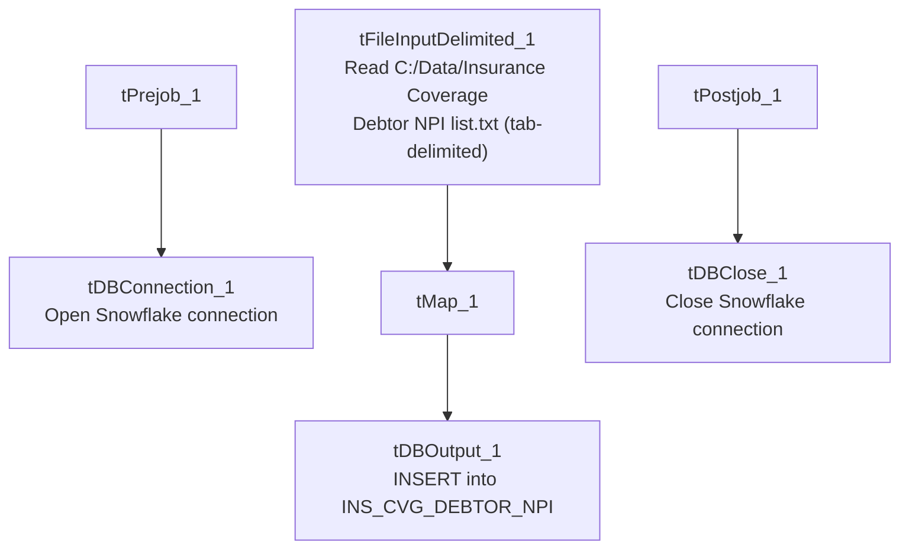

# Talend Job: Ins_Cvg_Debtor_NPI_Load

## Overview

Loads a debtor-to-NPI (National Provider Identifier — a healthcare provider identifier, consistent with this job's role alongside the other Insurance Discovery/Insurance Coverage jobs in this batch) mapping from a fixed local text file into the Snowflake `INS_CVG_DEBTOR_NPI` table. This is a simple two-column reference load with no incremental logic, truncate step, or archiving.

## Detail table

| Field | Value |
|---|---|
| Job name | Ins_Cvg_Debtor_NPI_Load |
| Version | 0.1 |
| Project | EDW2SF |
| Author | jmach@harriscollect.com |
| Created | 2023-02-23T11:09:10.416-0800 |
| Last Modified | 2025-08-28T08:57:23.780-0700 |

## Step-by-step data flow

**Setup subjob:** `tPrejob_1` → `tDBConnection_1` opens the Snowflake connection.

**Main subjob:**

1. `tFileInputDelimited_1` reads a fixed, hardcoded local file `C:/Data/Insurance Coverage Debtor NPI list.txt` (tab-delimited, header row present, `DIE_ON_ERROR=false`) — two columns, `DEBTOR_IDX` and `NPI`.
2. `tMap_1` passes both columns through unchanged.
3. `tDBOutput_1` inserts the rows into Snowflake table `INS_CVG_DEBTOR_NPI` (`INSERT`, no table-recreate action).

**Teardown subjob:** `tPostjob_1` → `tDBClose_1` (close Snowflake).

## Settings tables

### Source: `tFileInputDelimited_1`

| Setting | Value | What it means |
|---|---|---|
| FILENAME | `"C:/Data/Insurance Coverage Debtor NPI list.txt"` (hardcoded, not parameterized via context) | A fixed local path on whatever machine runs this job — see Issues observed. |
| FIELDSEPARATOR | `\t` (tab) | Tab-delimited. |
| Schema | `DEBTOR_IDX` (string), `NPI` (string) | Simple two-column mapping file. |
| DIE_ON_ERROR | `false` | Malformed rows do not fail the job; no reject flow is wired, so rejected rows are silently dropped. |
| TEMP_DIR | `"C:/Talend-Studio-20211109_1610-V8.0.1/workspace"` (hardcoded) | Developer-workstation path — captured in `hardcoded_path_findings`. |

### Target: `tDBOutput_1` (`tSnowflakeOutput`)

| Setting | Value | What it means |
|---|---|---|
| Table | `INS_CVG_DEBTOR_NPI` | Destination table in Snowflake. |
| Output action | `INSERT` | Appends rows; there is no `TRUNCATE` step before this insert. |
| Table action | `NONE` | Table is not recreated/altered by this job. |
| Schema | Includes 8 extra reject-style error columns with no wired reject flow | Same schema-drift artifact seen in several `HUB_*` jobs in this batch. |

## Dependencies & configuration

- **Triggers/depends on other jobs:** none — no `tRunJob` links found.
- **Context variables used:** none — this job uses no `context.*` variables at all; every path is either hardcoded or (for the Snowflake connection) presumably defaulted.
- **1 hardcoded path finding** (per extraction): `tFileInputDelimited_1.TEMP_DIR` = `"C:/Talend-Studio-20211109_1610-V8.0.1/workspace"`. Additionally, **`tFileInputDelimited_1.FILENAME` itself is hardcoded** to `"C:/Data/Insurance Coverage Debtor NPI list.txt"` — not flagged in the extraction's `hardcoded_path_findings` array (which only captured the `TEMP_DIR` value), but directly visible in the job's own parameters and equally a portability/reproducibility risk.

## Glossary

| Component type | Plain-English meaning |
|---|---|
| `tSnowflakeConnection` / `tSnowflakeOutput` / `tSnowflakeClose` | Open a Snowflake connection, write rows to a table, and close the connection. |
| `tFileInputDelimited` | Reads a delimited (tab-separated, in this case) text file according to a schema. |
| `tMap` | Maps/transforms columns from one schema to another. |

## Issues observed

- **The source file path is fully hardcoded** (`C:/Data/Insurance Coverage Debtor NPI list.txt`), not parameterized through a `context.sourceDir`-style variable as most other file-reading jobs in this project are. This means the file must exist at that exact path on whatever machine runs this job, and running it in a different environment (e.g. a Linux-based scheduler or a different developer's machine) would require editing the job itself. This is the same class of risk as the project-wide `TEMP_DIR` hardcoding documented in `05_operational_runbook.md`, but applied to the actual business-data source path rather than just a scratch directory — a more direct operational risk for this specific job.
- **`tFileInputDelimited_1`'s schema_columns list shows `DEBTOR_IDX` and `NPI` each listed twice** in the raw extracted metadata (once for the main flow, once seemingly duplicated) — likely a metadata-capture artifact rather than an actual duplicate-column schema, since the downstream `tMap_1` and `tDBOutput_1` both cleanly show only the two expected columns. Not a functional concern, but noted for completeness.
- **No reject flow, no truncate/incremental logic, no archiving** — this is a minimal append-only load with no error visibility beyond `DIE_ON_ERROR=false` silently dropping malformed rows, and repeated runs would keep appending the same file's contents (no `TRUNCATE`), risking duplicate `DEBTOR_IDX`/`NPI` pairs if the job is ever rerun without the source file changing.
