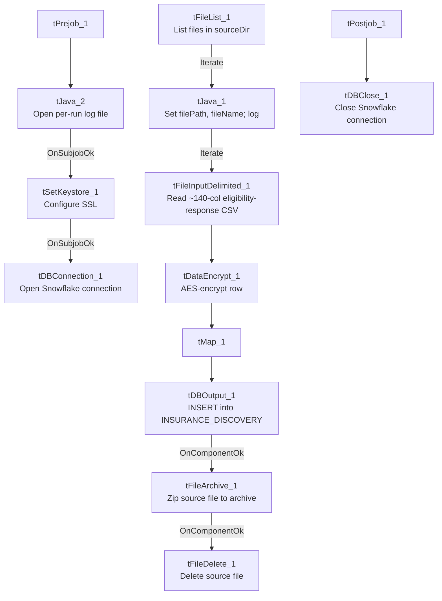

# Talend Job: Insurance_Discovery_Load

## Overview

Loads insurance-eligibility response files (a very wide record — ~140 input columns covering the original discovery request fields plus the payer's eligibility response: subscriber/dependent demographics, Medicaid/Medicare (MBI) details, insurance coverage terms, managed-care-organization info, primary-care-provider info, life-insurance and third-party-liability fields, and free-text summary/issues fields) from a source directory into the Snowflake `INSURANCE_DISCOVERY` table, encrypting each row before loading, then archiving and deleting the source file on success. This is the production counterpart to the ad hoc `Initial_Insurance_Discovery_File`/`Insurance_Discovery_Test` utility jobs elsewhere in this batch — it is schedulable (full `tPrejob`/`tPostjob`, context-driven paths, file archiving) rather than a manual one-off tool.

## Detail table

| Field | Value |
|---|---|
| Job name | Insurance_Discovery_Load |
| Version | 0.1 |
| Project | EDW2SF |
| Author | jmach@harriscollect.com |
| Created | 2023-09-06T06:29:13.291-0700 |
| Last Modified | 2025-11-16T19:42:38.334-0800 |

## Step-by-step data flow

**Setup subjob:** `tPrejob_1` → `tJava_2` opens a per-run log file at `context.logDir + jobName + "_" + <timestamp> + ".log"` and redirects `System.out`/`System.err` to it → on subjob-ok, `tSetKeystore_1` configures SSL trust/keystore (truststore hardcoded, keystore from `context.keystorePath`) → on subjob-ok, `tDBConnection_1` opens the Snowflake connection.

**Main subjob** — runs independently of the setup subjob:

1. `tFileList_1` lists files in `context.sourceDir` (`EXCLUDEFILEMASK="*.txt"` configured but not verified as enforced by an `IFEXCLUDE` flag captured for this component — see Issues observed).
2. For each file, `tJava_1` sets `context.filePath`/`context.fileName` and logs "Processing file `<path>`".
3. `tFileInputDelimited_1` reads the CSV via repository schema `metadata` — a very wide (~140-column) eligibility-response layout combining the original request fields (`inp_*` — patient/subscriber/plan identifiers) with the payer's response fields (`pd_*` — status, payer name, subscriber/dependent demographics, Medicaid/MBI/insurance/MCO/PCP/life-insurance/TPL details, verification notes).
4. `tDataEncrypt_1` encrypts the row using AES against `context.cryptoPath` (key/secret/password redacted).
5. `tMap_1` maps the encrypted row to the target schema.
6. `tDBOutput_1` inserts the rows into Snowflake table `INSURANCE_DISCOVERY` (`INSERT`, no table-recreate action).
7. On success, `tFileArchive_1` zips the source file to an archive location, then `tFileDelete_1` deletes the original from a hardcoded delete folder path.

**Teardown subjob:** `tPostjob_1` → `tDBClose_1` (close Snowflake).

## Settings tables

### Source: `tFileList_1` / `tFileInputDelimited_1`

| Setting | Value | What it means |
|---|---|---|
| DIRECTORY | `context.sourceDir` | Shared source folder, parameterized via context. |
| EXCLUDEFILEMASK | `"*.txt"` | Same mask string used elsewhere in this project (e.g. `INPUT_DIALER_LIST_GOV_Load`) to exclude `.txt` files from the listing — whether the corresponding `IFEXCLUDE` flag is actually `true` here is not confirmed in this job's captured metadata, so the same dead-configuration risk flagged in other jobs' docs may or may not apply. |
| FILENAME | `context.filePath` | Current file from `tFileList_1`'s iteration. |
| Schema | Repository schema `metadata` — ~140 columns (`inp_PC` through `inp_RESP`, `outp_DateStamp`/`outp_EligStatus`/`outp_Trans_Id`, and dozens of `pd_*` payer-response fields covering Medicaid, MBI/Medicare, insurance, MCO, PCP, life insurance, and TPL) | One of the widest single-record schemas in this project — an eligibility-response file format defined by an external clearinghouse/payer integration rather than this project's own warehouse conventions. |
| CSV_OPTION | `true` | Uses Talend's CSV-aware parsing mode. |

### Encryption: `tDataEncrypt_1`

| Setting | Value | What it means |
|---|---|---|
| CRYPTO_METHOD | `AES` | Symmetric encryption applied to the row before it reaches the target table. |
| CRYPTO_FILE_PATH | `context.cryptoPath` | Parameterized via context. |
| SECRET_KEY / SECRET_TYPE / PASSWORD_M1 | `***REDACTED***` | Encryption key material — preserved as redacted. |

### Target: `tDBOutput_1` (`tSnowflakeOutput`)

| Setting | Value | What it means |
|---|---|---|
| Table | `INSURANCE_DISCOVERY` | Destination table in Snowflake. |
| Output action | `INSERT` | Appends rows; there is no `TRUNCATE` step before this insert — relies entirely on the archive-and-delete step to prevent the same source file being reprocessed. |
| Table action | `NONE` | Table is not recreated/altered by this job. |

### Cleanup: `tFileArchive_1` / `tFileDelete_1`

| Setting | Value | What it means |
|---|---|---|
| `tFileArchive_1.SOURCE_FILE` | `"C:/Talend-Studio-20211109_1610-V8.0.1/workspace/source.csv"` (hardcoded) | Developer-workstation path — see Issues observed; does not appear to reference `context.filePath`, the actual current file being processed. |
| `tFileDelete_1.DIRECTORY` | `"C:/Talend-Studio-20211109_1610-V8.0.1/workspace/delete_folder"` (hardcoded) | Developer-workstation path. |
| `tFileDelete_1.FILENAME` | `context.filePath` | Correctly references the current file, unlike the archive step's `SOURCE_FILE`. |
| `tFileDelete_1.PATH` | `"C:/Talend-Studio-20211109_1610-V8.0.1/workspace/delete_folder or delete_file"` (hardcoded) | A literal placeholder-looking string value — see Issues observed. |

## Dependencies & configuration

- **Triggers/depends on other jobs:** none — no `tRunJob` links found.
- **Context variables used:** `archiveDir`, `cryptoPath`, `fileName`, `filePath`, `keystorePath`, `logDir`, `sourceDir`.
- **5 hardcoded path findings:** `tFileInputDelimited_1.TEMP_DIR`, `tFileArchive_1.SOURCE_FILE`, `tFileDelete_1.DIRECTORY`, `tFileDelete_1.PATH` (all `C:/Talend-Studio-20211109_1610-V8.0.1/workspace/...`), and `tSetKeystore_1.SSL_TRUSTSERVER_TRUSTSTORE` (`C:/clientTrustStore.trustStore`) — the highest hardcoded-path count of any job in this batch, and notably these affect the archive/delete cleanup steps, not just scratch/temp directories.

## Glossary

| Component type | Plain-English meaning |
|---|---|
| `tFileList` | Lists files in a directory for the job to iterate over one at a time. |
| `tFileInputDelimited` | Reads a delimited (CSV-style) text file according to a schema. |
| `tDataEncrypt` | Encrypts specified column values (here, effectively the whole row) using a configured algorithm and key file. |
| `tMap` | Maps/transforms columns from one schema to another. |
| `tSnowflakeOutput` | Writes rows to a Snowflake table. |
| `tFileArchive` / `tFileDelete` | Zip a processed file to an archive location, then delete the original from the source directory. |
| `tSetKeystore` | Configures SSL trust/keystore settings used by subsequent database connections. |
| `tJava` | Runs arbitrary custom Java code at a point in the flow (here, used for logging setup and to capture the current file path/name during iteration). |

## Issues observed

- **`tFileArchive_1.SOURCE_FILE` is hardcoded to `"C:/Talend-Studio-20211109_1610-V8.0.1/workspace/source.csv"`, a fixed literal filename, rather than referencing `context.filePath` (the actual file currently being iterated over)** — this is a materially different and more serious problem than the usual `TEMP_DIR`-style hardcoding seen elsewhere in this project: if this parameter is genuinely used as configured, the archive step would attempt to zip a fixed, likely-nonexistent developer-workstation file on every run instead of the real source file that was just loaded, meaning **source files may never actually be archived**, only deleted (via `tFileDelete_1`, which does correctly reference `context.filePath`). This would mean processed insurance-discovery files are deleted with no archived copy retained. Verify directly in Talend Studio whether this parameter was correctly captured by the extraction or whether the job's actual production behavior differs from what's shown here.
- **`tFileDelete_1.PATH` is set to the literal string `"C:/Talend-Studio-20211109_1610-V8.0.1/workspace/delete_folder or delete_file"`** — this reads like a placeholder/instructional string left over from a component template rather than an intentional configured value (the actual deletion appears to be driven by `DIRECTORY` + `FILENAME` instead, per the component's other parameters). Worth confirming this stray value doesn't cause unexpected behavior.
- **This job carries the highest hardcoded-path count in this batch (5 findings)**, and unlike most other jobs where hardcoded paths are limited to scratch/temp directories or SSL truststore files, two of these (`tFileArchive_1.SOURCE_FILE`, `tFileDelete_1.DIRECTORY`) are directly in the file-cleanup path for real business data — see the point above. Same general project-wide risk category as `05_operational_runbook.md`, but with unusually direct business impact here.
- **No reject flow or row-count logging** — malformed rows in the ~140-column input are not explicitly handled (no `DIE_ON_ERROR` setting was visible for `tFileInputDelimited_1` in the portion of this job's metadata reviewed), and there is no `tFlowMeter`/`tWarn`/`tDie` reporting how many rows were loaded per file.
