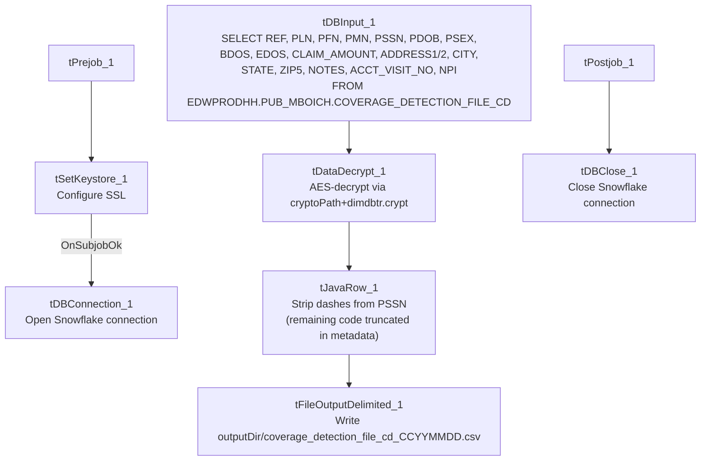

# Talend Job: Insurance_Discovery_Scrub_Extract

## Overview

Extracts a coverage-detection cohort (patient reference, name, SSN, DOB, sex, dates of service, claim amount, address, NPI) from the `EDWPRODHH.PUB_MBOICH.COVERAGE_DETECTION_FILE_CD` Snowflake table, decrypts the sensitive fields, strips dashes from the patient SSN, and writes the result to a date-stamped CSV — the standard "scrub" pattern used for insurance-discovery vendor submissions elsewhere in this project's naming (e.g. `LW_*_Scrub` jobs referenced in `05_operational_runbook.md`).

## Detail table

| Field | Value |
|---|---|
| Job name | Insurance_Discovery_Scrub_Extract |
| Version | 0.2 |
| Project | EDW2SF |
| Author | jmach@harriscollect.com |
| Created | 2023-10-20T13:35:30.328-0700 |
| Last Modified | 2025-11-16T19:46:33.973-0700 |

## Step-by-step data flow

**Setup subjob:** `tPrejob_1` → `tSetKeystore_1` configures SSL trust/keystore (truststore path hardcoded, keystore path from `context.keystorePath`) → on subjob-ok, `tDBConnection_1` opens the Snowflake connection.

**Main subjob** — runs independently of the setup subjob:

1. `tDBInput_1` runs `SELECT REF, PLN, PFN, PMN, PSSN, PDOB, PSEX, BDOS, EDOS, CLAIM_AMOUNT, ADDRESS1, ADDRESS2, CITY, STATE, ZIP5, NOTES, ACCT_VISIT_NO, NPI FROM EDWPRODHH.PUB_MBOICH.COVERAGE_DETECTION_FILE_CD;` against Snowflake.
2. `tDataDecrypt_1` decrypts the row using AES against `context.cryptoPath + "dimdbtr.crypt"` (key/secret/password redacted), with `DIE_ON_ERROR=true`.
3. `tJavaRow_1` copies each field through explicitly, applying `input_row.PSSN.replace("-","")` to strip dashes from the patient SSN (the remainder of the custom code is truncated in this metadata, so any other per-field transformations beyond the SSN cleanup are not visible).
4. `tFileOutputDelimited_1` writes the rows, comma-delimited with header (`CSV_OPTION=true`), to `context.outputDir + "coverage_detection_file_cd_" + <CCYYMMDD> + ".csv"`.

**Teardown subjob:** `tPostjob_1` → `tDBClose_1` (close Snowflake).

## Settings tables

### Source: `tDBInput_1` (`tSnowflakeInput`)

| Setting | Value | What it means |
|---|---|---|
| Query | `SELECT REF, PLN, PFN, PMN, PSSN, PDOB, PSEX, BDOS, EDOS, CLAIM_AMOUNT, ADDRESS1, ADDRESS2, CITY, STATE, ZIP5, NOTES, ACCT_VISIT_NO, NPI FROM EDWPRODHH.PUB_MBOICH.COVERAGE_DETECTION_FILE_CD;` | Reads from a fully-qualified cross-database Snowflake path (`EDWPRODHH.PUB_MBOICH.<table>`) rather than the job's own default connection's database/schema — notable since most other jobs in this project reference tables unqualified. |
| Schema | `REF`, `PLN`, `PFN`, `PMN`, `PSSN`, `PDOB` (date), `PSEX`, `BDOS`/`EDOS` (dates), `CLAIM_AMOUNT`, `ADDRESS1`/`ADDRESS2`, `CITY`, `STATE`, `ZIP5`, `NOTES`, `ACCT_VISIT_NO`, `NPI` (not nullable) | Patient reference, demographics, claim, and address fields; `NPI` is the only non-nullable column. |

### Decryption: `tDataDecrypt_1`

| Setting | Value | What it means |
|---|---|---|
| CRYPTO_FILE_PATH | `context.cryptoPath+"dimdbtr.crypt"` | Parameterized via context, unlike the hardcoded crypto paths used in the Initial-Insurance-Discovery utility jobs elsewhere in this batch. |
| DIE_ON_ERROR | `true` | A decryption failure fails the job outright. |

### Scrub transform: `tJavaRow_1`

| Setting | Value | What it means |
|---|---|---|
| Code (partial, truncated in metadata) | `output_row.PSSN = input_row.PSSN.replace("-","")` (plus other field copies not fully captured) | Strips dashes from the patient SSN before it's written to the output file — a light "scrub"/normalization step, not a full de-identification. |

### Target: `tFileOutputDelimited_1`

| Setting | Value | What it means |
|---|---|---|
| FILENAME | `context.outputDir+"coverage_detection_file_cd_"+TalendDate.getDate("CCYYMMDD")+".csv"` | Date-stamped output filename, parameterized via context. |
| CSV_OPTION | `true` | Uses Talend's CSV-aware output mode (proper quoting/escaping), unlike most other file-output jobs in this batch which leave `CSV_OPTION=false`. |
| INCLUDEHEADER | `true` | Output includes a header row. |

## Dependencies & configuration

- **Triggers/depends on other jobs:** none — no `tRunJob` links found.
- **Context variables used:** `cryptoPath`, `keystorePath`, `outputDir`.
- **1 hardcoded path finding:** `tSetKeystore_1.SSL_TRUSTSERVER_TRUSTSTORE` = `"C:/clientTrustStore.trustStore"`.

## Glossary

| Component type | Plain-English meaning |
|---|---|
| `tSnowflakeConnection` / `tSnowflakeInput` / `tSnowflakeClose` | Open a Snowflake connection, query it, and close the connection. |
| `tDataDecrypt` | Decrypts specified column values using a configured algorithm and key file. |
| `tJavaRow` | Runs custom Java code once per input row — here used to strip dashes from the patient SSN and copy other fields through. |
| `tFileOutputDelimited` | Writes rows to a delimited text file. |
| `tSetKeystore` | Configures SSL trust/keystore settings used by subsequent database connections. |

## Issues observed

- **`tJavaRow_1`'s custom code is truncated in this metadata** after the `PSSN` dash-stripping line — the full extent of what this "scrub" step does to the other 17 columns is **unable to determine from metadata**; verify directly in Talend Studio whether any additional PII-scrubbing logic (e.g. partial masking of other fields) exists beyond the visible SSN cleanup.
- **Source query reads from a fully-qualified cross-database path** (`EDWPRODHH.PUB_MBOICH.COVERAGE_DETECTION_FILE_CD`), while most other Snowflake-reading jobs in this project reference tables unqualified within their own connection's default database/schema. This is a deliberate cross-database reference rather than an anomaly, but worth noting for anyone tracing this job's actual data dependency, since it means the job depends on the `EDWPRODHH` database/`PUB_MBOICH` schema being accessible from whatever Snowflake role/connection this job uses.
- **Output writes patient SSN (with dashes stripped but otherwise in the clear) to a plaintext CSV file** — appropriate if the output is meant for a controlled downstream insurance-discovery vendor process, but there is no masking/redaction of the SSN in the visible portion of the transform logic; confirm the output directory (`context.outputDir`) has appropriate access controls.
- **No row-count logging or `tWarn`/`tDie` on the extract's success/failure** beyond the `DIE_ON_ERROR=true` on decryption — a query returning zero rows, or any failure after decryption, would only surface as a generic Talend execution error.
