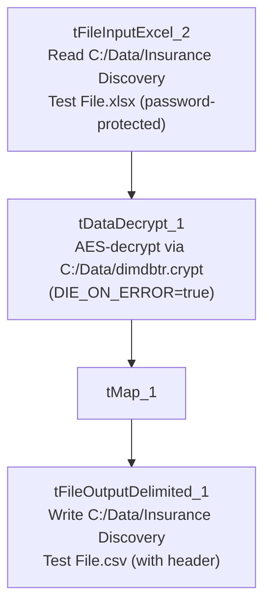

# Talend Job: Insurance_Discovery_Test

## Overview

A test/utility job that reads a fixed local Excel file (`Insurance Discovery Test File.xlsx`, password-protected), decrypts it against the project's `dimdbtr.crypt` key file, and writes the decrypted result back out to a CSV with the same base name. Like `Initial_Insurance_Discovery_File` and `Initial_Ins_Discovery_V2_Decrypted`, this is a standalone file-to-file utility with no database connection, no `tPrejob`/`tPostjob`, and no context variables — but it is the only one of the three that reads from Excel rather than CSV, and the only one whose name ("Test") explicitly signals it is not a production job.

## Detail table

| Field | Value |
|---|---|
| Job name | Insurance_Discovery_Test |
| Version | 0.1 |
| Project | EDW2SF |
| Author | jmach@harriscollect.com |
| Created | 2025-02-19T11:43:39.318-0800 |
| Last Modified | 2025-08-28T08:57:23.814-0700 |

## Step-by-step data flow

A single linear chain, no setup/teardown subjobs:

1. `tFileInputExcel_2` reads `C:/Data/Insurance Discovery Test File.xlsx` (`VERSION_2007=true`, password-protected — password redacted, header row present, `DIE_ON_ERROR=false`) using repository schema `metadata` — 20 patient/guarantor/claim columns (same field set as `Initial_Insurance_Discovery_File` minus `REQUEST_ID`, with `PATIENT_DOB`/`ADMIT_DATE`/`DISCHARGE_DATE` typed as actual dates rather than strings).
2. `tDataDecrypt_1` decrypts the row using AES against a hardcoded crypto file path `C:/Data/dimdbtr.crypt` (key/secret/password redacted), with `DIE_ON_ERROR=true` — a decryption failure fails the job.
3. `tMap_1` passes all 20 columns through unchanged.
4. `tFileOutputDelimited_1` writes the decrypted rows, comma-delimited with header, to the hardcoded path `C:/Data/Insurance Discovery Test File.csv`.

## Settings tables

### Source: `tFileInputExcel_2`

| Setting | Value | What it means |
|---|---|---|
| FILENAME | `"C:/Data/Insurance Discovery Test File.xlsx"` (hardcoded) | Fixed local Excel file, not parameterized via context. |
| PASSWORD | `***REDACTED***` | The Excel file itself is password-protected. |
| Schema | Repository schema `metadata` — 20 columns (`CLIENT_FACILITY` through `NPI`, no `REQUEST_ID`) with `PATIENT_DOB`, `ADMIT_DATE`, `DISCHARGE_DATE` typed as dates | One fewer column than `Initial_Insurance_Discovery_File`'s 21-column layout, and with proper date typing rather than string dates. |
| DIE_ON_ERROR | `false` | Malformed rows on read do not fail the job. |

### Decryption: `tDataDecrypt_1`

| Setting | Value | What it means |
|---|---|---|
| CRYPTO_FILE_PATH | `"C:/Data/dimdbtr.crypt"` (hardcoded) | Same key file used by the other two Initial-Insurance-Discovery utility jobs in this batch. |
| DIE_ON_ERROR | `true` | A decryption failure fails the job outright, same as `Initial_Insurance_Discovery_File`. |

### Target: `tFileOutputDelimited_1`

| Setting | Value | What it means |
|---|---|---|
| FILENAME | `"C:/Data/Insurance Discovery Test File.csv"` (hardcoded) | Same base name as the source Excel file, just a `.csv` extension — writes into the same `C:/Data/` folder as the source. |
| INCLUDEHEADER | `true` | Output includes a header row. |

## Dependencies & configuration

- **Triggers/depends on other jobs:** none — no `tRunJob` links found.
- **Context variables used:** none — every path in this job is hardcoded.
- **Hardcoded paths:** none captured in the extraction's `hardcoded_path_findings` array for this job (unlike its Initial-Insurance-Discovery siblings, which each have a `TEMP_DIR` entry), but the source file path, crypto file path, and output file path are all directly hardcoded in the job's own parameters.

## Glossary

| Component type | Plain-English meaning |
|---|---|
| `tFileInputExcel` | Reads rows from an Excel workbook (optionally password-protected), according to a schema. |
| `tDataDecrypt` | Decrypts specified column values (here, effectively the whole row) using a configured algorithm and key file. |
| `tMap` | Maps/transforms columns from one schema to another. |
| `tFileOutputDelimited` | Writes rows to a delimited text file. |

## Issues observed

- **This is explicitly a "Test" job** (per its name), reading a "Test File" and writing an output file with the same base name into the same folder as the source. If run against real production insurance-discovery data by mistake, it would overwrite `C:/Data/Insurance Discovery Test File.csv` in place — a low-blast-radius risk given the fixed, clearly test-labeled filename, but worth confirming this job is not accidentally scheduled or invoked outside of manual testing.
- **Reads from a password-protected Excel file with the password redacted in this metadata** — consistent with the project's general handling of credentials, but notable that the source file itself carries its own password protection layer independent of the `tDataDecrypt` step that follows.
- **Same hardcoded-path, no-context-variable pattern as `Initial_Insurance_Discovery_File` and `Initial_Ins_Discovery_V2_Decrypted`** — see those docs' Issues sections for the shared implication (personal/fixed-machine dependency, no environment portability).
- **No archiving, no row-count logging** — a single pass with no audit trail of how many rows were processed.
