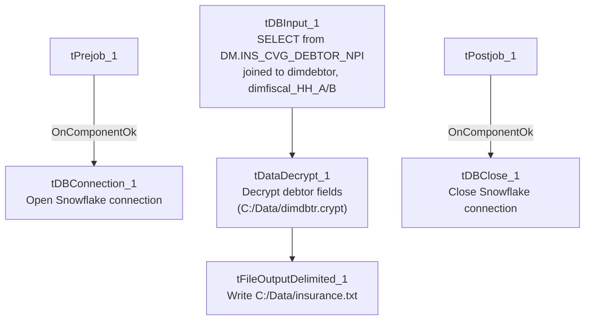

# Talend Job: Insurance_Report_Extract

## Overview

This job pulls one row per debtor with an identified insurance/NPI match from the Snowflake `DM.INS_CVG_DEBTOR_NPI` table (left-joined to `dw.dimdebtor` and two HH fiscal dimension tables, `dw.dimfiscal_HH_A`/`dw.dimfiscal_HH_B`), decrypts the debtor's protected fields, and writes the result to a fixed local file, `C:/Data/insurance.txt`. It is a small, single-purpose extract — likely feeding an insurance-coverage/claims workflow that needs debtor name, SSN, DOB, admit/discharge dates, and assignment amount alongside the matched NPI.

## Detail table

| Field | Value |
|---|---|
| Job name | Insurance_Report_Extract |
| Version | 0.1 |
| Project | EDW2SF |
| Author | jmach@harriscollect.com |
| Created | 2023-02-23T11:55:50.249-0800 |
| Last Modified | 2025-08-28T08:57:23.864-0700 |

## Step-by-step data flow

**Setup:** `tPrejob_1` → `tDBConnection_1` opens the Snowflake connection (`OnComponentOk`).

**Main flow:** `tDBInput_1` runs the join query below, `tDataDecrypt_1` decrypts the resulting rows using a local crypto file (`C:/Data/dimdbtr.crypt`), and `tFileOutputDelimited_1` writes the decrypted rows to `C:/Data/insurance.txt` (tab-delimited, header included, file recreated each run since `APPEND=false`).

**Teardown:** `tPostjob_1` → `tDBClose_1` closes the Snowflake connection.

Note: unlike most other jobs in this project, there is **no explicit connection** in the extracted `connections` array between `tDBConnection_1`/`tPrejob_1` and `tDBInput_1` — the main flow (`tDBInput_1` → `tDataDecrypt_1` → `tFileOutputDelimited_1`) appears in the metadata as a self-contained chain with no incoming trigger link shown. See Issues observed.

## Settings tables

### Source: `tDBInput_1` (`tSnowflakeInput`)

| Setting | Value | What it means |
|---|---|---|
| Query | `SELECT npi.debtor_idx, name1 AS First, '' AS last, '' AS Middle, SSN, patient_dob, SEX_F17 AS Sex, admit_date, discharge_date, asgn_amt, add1, add2, city, st, substring(zip,1,5) AS zip5, '' AS notes, CDN, NPI FROM DM.INS_CVG_DEBTOR_NPI npi LEFT JOIN dw.dimdebtor dd ON dd.debtor_idx = npi.debtor_idx LEFT JOIN dw.dimfiscal_HH_A hha ON hha.debtor_idx = npi.debtor_idx LEFT JOIN dw.dimfiscal_HH_B hhb ON hhb.debtor_idx = npi.debtor_idx;` | Joins the NPI-matched debtor list to core debtor and HH fiscal dimensions. Note `LAST`, `MIDDLE`, and `NOTES` are hardcoded empty-string literals in the query, not real source columns. |

### Transform: `tDataDecrypt_1`

| Setting | Value | What it means |
|---|---|---|
| CRYPTO_METHOD | `AES` | Standard AES decryption, same pattern used across other `LW_*` scrub jobs in this project. |
| CRYPTO_FILE_PATH | `"C:/Data/dimdbtr.crypt"` | Hardcoded local file path for the decryption key material — not driven by a context variable (compare to `LW_Carle_Asset_Scrub`/`LW_ProMedica_Scrub`, which use `context.cryptoPath+"dimdbtr.crypt"`). |
| SECRET_TYPE / SECRET_KEY / PASSWORD_M1 | `***REDACTED***` | Preserved as redacted in source metadata — not guessable. |
| DIE_ON_ERROR | `true` | A decryption failure fails the job outright. |

### Target: `tFileOutputDelimited_1`

| Setting | Value | What it means |
|---|---|---|
| FILENAME | `"C:/Data/insurance.txt"` | Hardcoded local output path, not driven by `context.outputDir` (unlike most other `LW_*` report jobs in this batch). |
| FIELDSEPARATOR | `"\t"` (tab) | Differs from the comma-delimited CSV convention used by the other `LW_*` scrub/report jobs. |
| APPEND / INCLUDEHEADER | `false` / `true` | File is recreated fresh each run with a header row. |

## Dependencies & configuration

- **Triggers/depends on other jobs:** none — no `tRunJob` links found (`runjob_targets` is empty).
- **Context variables used:** none — `context_vars_referenced` is empty. This is unusual for this batch; every other job in this batch references at least `logDir`/`outputDir`/`keystorePath`. This job hardcodes its output path, decryption key path, and has no per-run log file setup (no `tJava_1` log-redirect component at all) or SSL/keystore configuration (no `tSetKeystore` component) — see Issues observed.
- **Hardcoded paths:** `hardcoded_path_findings` is empty in the extracted metadata, but the job's own components show two hardcoded local paths not classified as such by the extraction: `tFileOutputDelimited_1.FILENAME` (`"C:/Data/insurance.txt"`) and `tDataDecrypt_1.CRYPTO_FILE_PATH` (`"C:/Data/dimdbtr.crypt"`). Both point to a local `C:/Data/` directory rather than a shared/context-driven location.

## Glossary

| Component type | Plain-English meaning |
|---|---|
| `tSnowflakeConnection` / `tSnowflakeInput` / `tSnowflakeClose` | Open a Snowflake connection, run a query against it, and close the connection. |
| `tDataDecrypt` | Decrypts one or more input columns using a local key/crypto file — used project-wide to unmask protected debtor fields (SSN, DOB, etc.) before they're written to an output file. |
| `tFileOutputDelimited` | Writes rows to a delimited (CSV/TSV-style) text file. |

## Issues observed

- **No `tJava` log-file setup and no `tSetKeystore` SSL configuration** — every other job in this batch opens a per-run log file (`tJava_1`) and configures a client trust store (`tSetKeystore_1`) before connecting to Snowflake. This job skips both, going straight from `tPrejob_1` to `tDBConnection_1`. Unable to determine from metadata whether this is intentional (e.g., an older/simpler job predating those conventions) or an oversight; it does mean this job's own execution won't produce a dedicated timestamped log file the way its siblings do.
- **No visible connection between the Snowflake connection setup and the main query/decrypt/write chain.** The `connections` array shows `tPrejob_1 → tDBConnection_1` and `tDBInput_1 → tDataDecrypt_1 → tFileOutputDelimited_1` as two separate chains, with nothing explicitly linking the connection-open step to the query step. In practice, Talend jobs typically still execute a "detached" main flow using whatever DB connection is configured on the component, but this means the ordering guarantee (connection is open before the query runs) is not explicit in this job's own wiring — worth confirming directly in Talend Studio rather than assuming from this metadata.
- **Hardcoded local `C:/Data/` paths** for both the decryption key file and the output file, rather than using `context.outputDir`/`context.cryptoPath` as sibling jobs (`LW_Carle_Asset_Scrub`, `LW_ProMedica_Scrub`, `LW_Property_Scrub`) do. This is the same class of portability risk flagged project-wide in `05_operational_runbook.md`, though these two specific paths weren't captured in this job's own `hardcoded_path_findings` list.
- **The query embeds three empty-string literal columns** (`'' AS last`, `'' AS Middle`, `'' AS notes`) rather than sourcing real `LAST`/`MIDDLE`/`NOTES` values, meaning the output file's `LAST`, `MIDDLE`, and `NOTES` columns will always be blank. Unable to determine from metadata whether this is intentional (e.g., those fields are populated downstream, or are simply not tracked for this extract) or a leftover/placeholder from an earlier version of the query; verify with the team.
