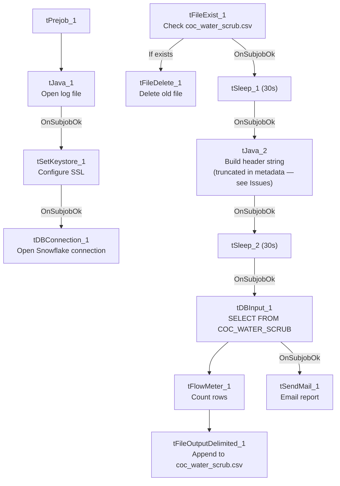

# Talend Job: LW_COC_Water_Scrub

## Overview

This job produces a monthly "City of Chicago Water" scrub report: it queries a curated Snowflake view (`EDWPRODHH.PUB_LWASHINGTON.COC_WATER_SCRUB`) for debtor/collection details relevant to that client relationship, appends the rows to a CSV file, and emails the report to a distribution list. It's one of several `LW_*` client-specific "scrub" report jobs in this project (see also `LW_Carle_Asset_Scrub`, `LW_ProMedica_Scrub`, `LW_Property_Scrub`), all built on a similar delete-old-file/query/write/mail template but pointed at different client tables.

## Detail table

| Field | Value |
|---|---|
| Job name | LW_COC_Water_Scrub |
| Version | 0.1 |
| Project | EDW2SF |
| Author | jmach@harriscollect.com |
| Created | 2024-11-25T11:52:06.376-0800 |
| Last Modified | 2025-11-16T19:54:18.113-0800 |

## Step-by-step data flow

**Setup subjob:** `tPrejob_1` → `tJava_1` opens a per-run log file (`context.logDir+jobName+"_"+<timestamp>+".log"`) → on subjob-ok, `tSetKeystore_1` configures SSL trust/keystore from `context.keystorePath` → on subjob-ok, `tDBConnection_1` opens the Snowflake connection.

**File-reset subjob** (a separate, parallel chain not wired to the connection setup above):
1. `tFileExist_1` checks whether `context.outputDir+"coc_water_scrub.csv"` already exists.
2. If it does (`RUN_IF`), `tFileDelete_1` deletes it.
3. Either way, on subjob-ok, `tSleep_1` pauses 30 seconds, then `tJava_2` builds a header-record string (see Issues observed — the code as captured is truncated and never appears to write anything to the file), then `tSleep_2` pauses another 30 seconds, then `tDBInput_1` runs the query below.

**Query and output:** `tDBInput_1` → `tFlowMeter_1` (row count) → `tFileOutputDelimited_1` appends the rows to `context.outputDir+"coc_water_scrub.csv"` (`APPEND=true`, `INCLUDEHEADER=false` — the file is expected to already have a header from elsewhere, e.g. the `tJava_2` step, though that step's captured code does not show it actually writing one). Separately, `tDBInput_1` → on subjob-ok → `tSendMail_1` emails the finished report.

## Settings tables

### Source: `tDBInput_1` (`tSnowflakeInput`)

| Setting | Value | What it means |
|---|---|---|
| Query | `SELECT "DEBTOR#", "CLIENT#", "NAME", ADDRESS, CITY, ST, ZIP, PHONE, DESK, "C.D.#", "ST CD", "DT-ASSIGN", "PKT AGN", "PKT COL", "PKT BAL", EMP1_NAME, "MEDIAN RTG", "PACKET NBR", "MISC. 2" FROM EDWPRODHH.PUB_LWASHINGTON.COC_WATER_SCRUB;` | Reads from a curated publish-schema view already scoped to this client relationship — cross-database reference (`EDWPRODHH.PUB_LWASHINGTON`) rather than the connection's own default database. |

### Target: `tFileOutputDelimited_1`

| Setting | Value | What it means |
|---|---|---|
| FILENAME | `context.outputDir+"coc_water_scrub.csv"` | Output path driven by context, unlike `Insurance_Report_Extract`'s hardcoded path. |
| APPEND / INCLUDEHEADER | `true` / `false` | File is appended to (not recreated) and no header row is written by this component — the header is expected to come from the earlier `tJava_2` step. |

### Mail: `tSendMail_1`

| Setting | Value | What it means |
|---|---|---|
| TO / FROM | `context.mailRecipients` / `"svc_analytics@harriscollect.com"` | Sent from a shared analytics service account. |
| SUBJECT / MESSAGE | `"City of Chicago Water Scrub Report"` / `"The monthly City of Chicago Water scrub report is attached."` | |
| CHECK_ATTACHMENT / DIE_ON_ERROR | `true` / `true` | Job fails if the attachment check fails or the send fails. |
| AUTH_MODE / AUTH_USERNAME / AUTH_PASSWORD / TOKEN | `***REDACTED***` | Preserved as redacted. |

## Dependencies & configuration

- **Triggers/depends on other jobs:** none — no `tRunJob` links found.
- **Context variables used:** `keystorePath`, `logDir`, `mailRecipients`, `outputDir`.
- **Hardcoded paths:** `tFileDelete_1.DIRECTORY` and `tFileDelete_1.PATH` are both set to the generic Talend-Studio-workspace placeholder path (`C:/Talend-Studio-20211109_1610-V8.0.1/workspace/delete_folder...`), and `tSetKeystore_1.SSL_TRUSTSERVER_TRUSTSTORE` is hardcoded to `"C:/clientTrustStore.trustStore"` — same class of developer-workstation path risk documented project-wide in `05_operational_runbook.md`.
- Per `05_operational_runbook.md`, this job is one of the small set of `LW_*`/scrub jobs that sends email on completion — appropriate for a partner-facing monthly report.

## Glossary

| Component type | Plain-English meaning |
|---|---|
| `tFileExist` / `tFileDelete` | Check whether a file exists, then conditionally delete it — used here to reset the output CSV before a fresh run appends new rows. |
| `tSleep` | Pauses the job for a fixed number of seconds — used here (twice, 30s each) around the header-writing step, likely to avoid a race condition with the file-delete step. |
| `tSnowflakeConnection` / `tSnowflakeInput` | Open a Snowflake connection and run a query against it. |
| `tFlowMeter` | Counts rows passing a point in the flow for logging/monitoring. |
| `tFileOutputDelimited` | Writes rows to a delimited (CSV-style) text file. |
| `tSendMail` | Sends an email with the finished report attached. |
| `tSetKeystore` | Configures the SSL trust store/keystore used for the Snowflake JDBC connection. |

## Issues observed

- **`tJava_2`'s CODE parameter is truncated in the extracted metadata** — it defines `fileName`, `filePath`, and a `headerRecord` string that itself cuts off mid-literal (`"...Misc...."`, with no closing quote), and never shows a call that actually writes `headerRecord` to the file. Given `tFileOutputDelimited_1` is configured with `INCLUDEHEADER=false`, this `tJava_2` step is the only plausible place a header row would get written — if its code truly stops short of a file-write call (rather than the metadata extraction simply cutting off a longer script), the output CSV could end up with no header row at all after the first (deleted-and-recreated) run. Unable to determine from metadata whether this is a real bug or an extraction artifact; verify directly in Talend Studio.
- **The 30-second sleeps around the delete/header steps** suggest a known race-condition concern (e.g., waiting for a network file delete or lock release to fully complete before re-reading/writing), but the metadata doesn't document what specifically motivated them — worth confirming with the team whether they're still necessary or a defensive leftover.
- **No `tDie`/`tWarn` logic** beyond `tSendMail_1`'s `DIE_ON_ERROR=true` — a query or file-write failure elsewhere in this job would only surface as a generic Talend execution error, consistent with `05_operational_runbook.md`'s note that not every job has job-specific failure messaging.
