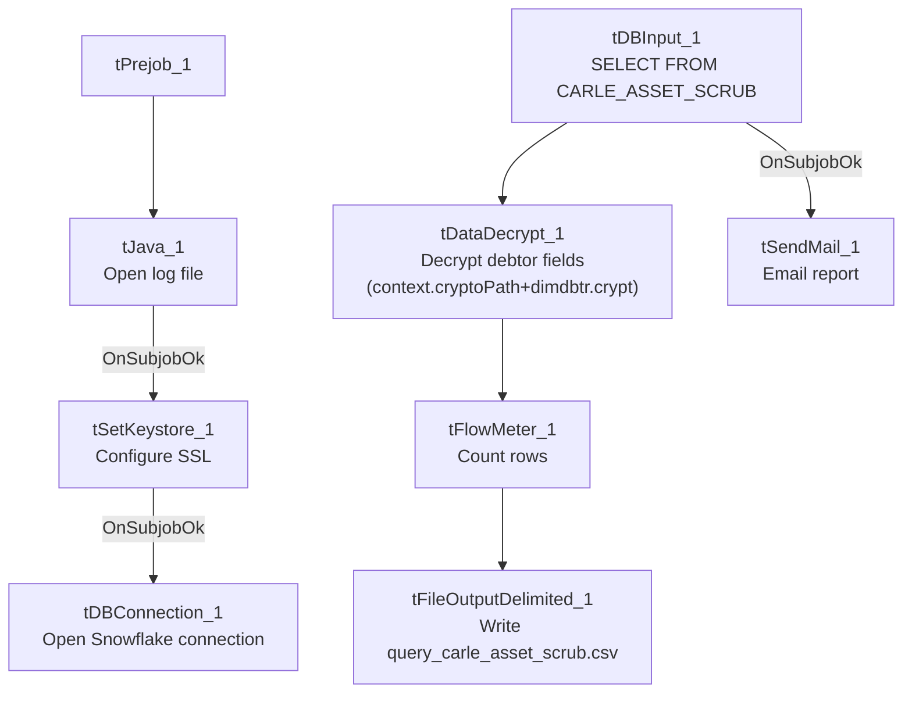

# Talend Job: LW_Carle_Asset_Scrub

## Overview

This job produces a monthly "Carle" asset scrub report for a health-system client: it queries a curated Snowflake view (`EDWPRODHH.PUB_LWASHINGTON.CARLE_ASSET_SCRUB`) for debtor/account/employment details, decrypts protected debtor fields, writes the result to a CSV file, and emails it to a distribution list. It follows the same query→decrypt→write→mail template as `LW_ProMedica_Scrub`, differing in the source table, target client, and specific column list (it includes employment address/phone and last-payment-date fields that `LW_ProMedica_Scrub` does not).

## Detail table

| Field | Value |
|---|---|
| Job name | LW_Carle_Asset_Scrub |
| Version | 0.1 |
| Project | EDW2SF |
| Author | jmach@harriscollect.com |
| Created | 2024-06-10T13:33:05.059-0700 |
| Last Modified | 2025-11-16T19:53:27.177-0800 |

## Step-by-step data flow

**Setup subjob:** `tPrejob_1` → `tJava_1` opens a per-run log file → on subjob-ok, `tSetKeystore_1` configures SSL from `context.keystorePath` → on subjob-ok, `tDBConnection_1` opens the Snowflake connection.

**Main flow:** `tDBInput_1` runs the query below → `tDataDecrypt_1` decrypts protected debtor fields using `context.cryptoPath+"dimdbtr.crypt"` → `tFlowMeter_1` counts rows → `tFileOutputDelimited_1` writes the full result (with header, file recreated each run) to `context.outputDir+"query_carle_asset_scrub.csv"`. Separately, on subjob-ok from `tDBInput_1`, `tSendMail_1` emails the finished report.

## Settings tables

### Source: `tDBInput_1` (`tSnowflakeInput`)

| Setting | Value | What it means |
|---|---|---|
| Query | `SELECT DEBTORNUMBER, CLIENT, NAME1, ADD1, CITY, ST, ZIP, PACKET, PHONE, DOB, DESK, "C.D.#" AS CD_NO, LST_PAY_DT, DT_ASSIGNED, SSN, STATUS, ASGN_AMT, ASGN_COLL, TOTAL_BAL, BALANCE_DIMDEBTOR_PACKET, ADMIT_DATE, DISCHARGE_DATE, EMP1_NAME, EMP1_ADDR, EMP1_CSZ, EMP1_PHN, "MISC. 4" AS MISC_4 FROM EDWPRODHH.PUB_LWASHINGTON.CARLE_ASSET_SCRUB;` | 26-column pull including SSN, employment address/phone, and last-payment/discharge dates — a richer column set than `LW_ProMedica_Scrub`'s equivalent query. |

### Transform: `tDataDecrypt_1`

| Setting | Value | What it means |
|---|---|---|
| CRYPTO_FILE_PATH | `context.cryptoPath+"dimdbtr.crypt"` | Context-driven key path (unlike `Insurance_Report_Extract`'s hardcoded equivalent). |
| DIE_ON_ERROR | `true` | Decryption failure fails the job. |
| SECRET_TYPE / SECRET_KEY / PASSWORD_M1 | `***REDACTED***` | Preserved as redacted. |

### Target: `tFileOutputDelimited_1`

| Setting | Value | What it means |
|---|---|---|
| FILENAME | `context.outputDir+"query_carle_asset_scrub.csv"` | |
| APPEND / INCLUDEHEADER | `false` / `true` | File recreated fresh each run with a header — differs from `LW_COC_Water_Scrub`'s append-without-header pattern. |

### Mail: `tSendMail_1`

| Setting | Value | What it means |
|---|---|---|
| SUBJECT / MESSAGE | `"Carle Asset Scrub Report"` / `"The monthly Carle asset scrub report is attached."` | |
| DIE_ON_ERROR | `true` | |

## Dependencies & configuration

- **Triggers/depends on other jobs:** none.
- **Context variables used:** `cryptoPath`, `keystorePath`, `logDir`, `mailRecipients`, `outputDir`.
- **Hardcoded paths:** `tSetKeystore_1.SSL_TRUSTSERVER_TRUSTSTORE` = `"C:/clientTrustStore.trustStore"` (same as other jobs in this batch).
- Per `05_operational_runbook.md`, this is one of the jobs that sends email on completion, consistent with its role as a partner-facing monthly report.

## Glossary

| Component type | Plain-English meaning |
|---|---|
| `tSnowflakeConnection` / `tSnowflakeInput` | Open a Snowflake connection and run a query against it. |
| `tDataDecrypt` | Decrypts protected debtor fields (SSN, etc.) using a local key file before the data is written out. |
| `tFlowMeter` | Counts rows passing a point in the flow. |
| `tFileOutputDelimited` | Writes rows to a CSV file. |
| `tSendMail` | Emails the finished report to a distribution list. |
| `tSetKeystore` | Configures SSL trust store/keystore for the Snowflake JDBC connection. |

## Issues observed

- No job-specific issues beyond the project-wide hardcoded truststore path already covered in `05_operational_runbook.md`. Unlike `LW_COC_Water_Scrub`/`LW_Property_Scrub`, this job has no file-exist/delete/sleep pre-flight steps and no truncated inline Java header-building code — its structure is simpler and more straightforwardly wired (single query → decrypt → write → mail).
- **No reject-row handling or row-count logging tied to a warning/failure path** — `tFlowMeter_1` counts rows but nothing branches on that count; a zero-row result (e.g., an empty upstream view) would still produce and email a header-only CSV with no indication in the job's own logic that something may be wrong. Unable to determine from metadata whether this is by design; consistent with the general pattern noted in `05_operational_runbook.md` that most jobs lack this kind of business-outcome check.
