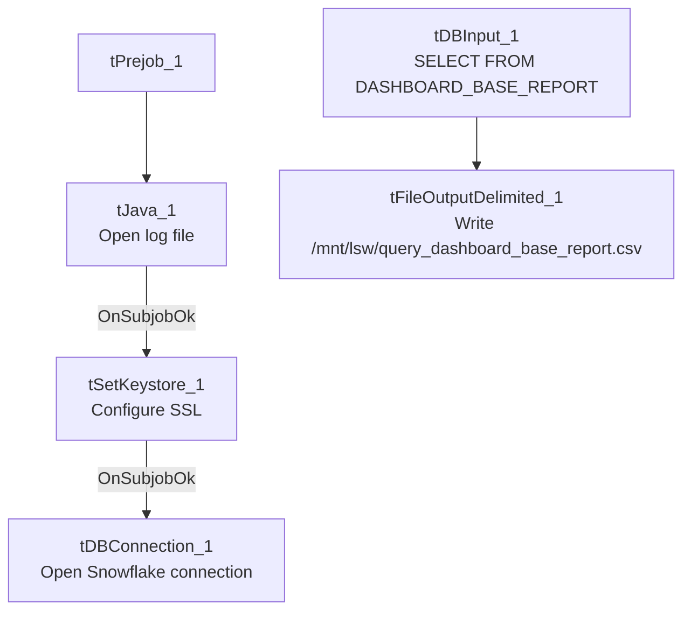

# Talend Job: LW_Dashboard_Base_Report

## Overview

This job extracts raw agent/call metric records from a Snowflake publish-schema view (`EDWPRODHH.PUB_LWASHINGTON.DASHBOARD_BASE_REPORT`) — one row per agent/call-date/metric combination — and writes them to a fixed local-mount CSV file (`/mnt/lsw/query_dashboard_base_report.csv`). It appears to be the raw/granular data feed underlying the two summarized dashboard jobs in this batch (`LW_Dashboard_By_Agent`, `LW_Dashboard_By_Metric`), which likely aggregate this same base data by agent or by metric for a BI dashboard tool.

## Detail table

| Field | Value |
|---|---|
| Job name | LW_Dashboard_Base_Report |
| Version | 0.1 |
| Project | EDW2SF |
| Author | jmach@harriscollect.com |
| Created | 2025-10-08T13:14:16.455-0700 |
| Last Modified | 2025-11-04T11:08:09.248-0800 |

## Step-by-step data flow

**Setup subjob:** `tPrejob_1` → `tJava_1` opens a per-run log file → on subjob-ok, `tSetKeystore_1` configures SSL from `context.keystorePath` → on subjob-ok, `tDBConnection_1` opens the Snowflake connection.

**Main flow (single step, no explicit trigger link into it — see Issues observed):** `tDBInput_1` runs the query below, and its `MAIN` output connects directly to `tFileOutputDelimited_1`, which writes the full result (with header, file recreated each run) to `/mnt/lsw/query_dashboard_base_report.csv`.

## Settings tables

### Source: `tDBInput_1` (`tSnowflakeInput`)

| Setting | Value | What it means |
|---|---|---|
| Query | `SELECT FILE, CALL_DATE, AGENT_NAME, EMPLOYEE_TYPE, SUPERVISOR, CAMPAIGN, LINE_OF_BUSINESS, SUBGROUP, ACCOUNT_NUMBER, METRIC_NAME, METRIC_VALUE FROM EDWPRODHH.PUB_LWASHINGTON.DASHBOARD_BASE_REPORT;` | 11-column raw/granular agent-metric feed — one row per metric per agent per call date, not pre-aggregated. |

### Target: `tFileOutputDelimited_1`

| Setting | Value | What it means |
|---|---|---|
| FILENAME | `"/mnt/lsw/query_dashboard_base_report.csv"` | Hardcoded Linux mount path — unlike the client-scrub jobs in this batch, this one is **not** driven by `context.outputDir`. `/mnt/lsw` is presumably a mounted share for this dashboard/BI process, distinct from the Windows-path conventions (`context.outputDir`, `C:/...`) seen elsewhere. |
| APPEND / INCLUDEHEADER | `false` / `true` | File recreated fresh each run with a header row. |

## Dependencies & configuration

- **Triggers/depends on other jobs:** none — no `tRunJob` links found. Not called by `LW_Dashboard_By_Agent`/`LW_Dashboard_By_Metric` either, per `runjob_targets`/`06_dependency_matrix.md` — despite the apparent data relationship (base feed vs. summarized views), these three jobs are not orchestrated together in this metadata; they appear to be run independently, likely on the same or a coordinated external schedule.
- **Context variables used:** `keystorePath`, `logDir`. Notably, `outputDir` is **not** referenced — the output path is fully hardcoded.
- **Hardcoded paths:** `tSetKeystore_1.SSL_TRUSTSERVER_TRUSTSTORE` = `"C:/clientTrustStore.trustStore"`, plus the `/mnt/lsw/...` output path (not flagged in `hardcoded_path_findings`, which only captures the truststore path, but visible directly in `tFileOutputDelimited_1.FILENAME`).

## Glossary

| Component type | Plain-English meaning |
|---|---|
| `tSnowflakeConnection` / `tSnowflakeInput` | Open a Snowflake connection and run a query against it. |
| `tFileOutputDelimited` | Writes rows to a CSV file. |
| `tSetKeystore` | Configures SSL trust store/keystore for the Snowflake JDBC connection. |

## Issues observed

- **No explicit trigger link connects the connection-setup subjob to the query/write subjob** — the `connections` array shows `tPrejob_1 → tJava_1 → tSetKeystore_1 → tDBConnection_1` as one chain and `tDBInput_1 → tFileOutputDelimited_1` as a separate, unconnected chain. As with `Insurance_Report_Extract`, this means the ordering guarantee (Snowflake connection open before the query runs) isn't explicit in this job's own wiring; verify directly in Talend Studio.
- **Output path is a hardcoded Linux mount (`/mnt/lsw/...`) rather than `context.outputDir`**, unlike most other jobs in this batch. If this job is meant to run on the same host/environment as the `context.outputDir`-based jobs, the inconsistent pathing convention could make it harder to relocate this job's output alongside the others during an environment migration.
- **No email, no row-count check, no `tWarn`/`tDie` logic** — a query failure or empty result set here would only surface as a generic Talend execution error, and nothing downstream (e.g., a BI refresh trigger) is visibly notified of success or failure in this job's own metadata.
