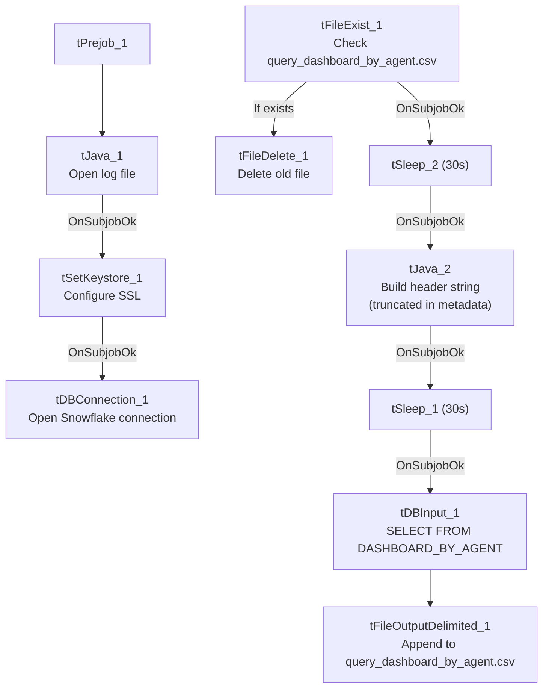

# Talend Job: LW_Dashboard_By_Agent

## Overview

This job extracts a per-agent rollup of dashboard metrics (current/previous week values, month-to-date compliance percentage, year-to-date value, and week-over-week/month-over-month variance) from a Snowflake publish-schema view (`EDWPRODHH.PUB_LWASHINGTON.DASHBOARD_BY_AGENT`) and writes them to a fixed local-mount CSV file. It's a sibling of `LW_Dashboard_By_Metric` — same column shape and same file-reset/header-writing template — but grouped by agent (adding `AGENT_NAME`, `EMPLOYEE_TYPE`, `SUPERVISOR` columns) rather than purely by metric.

## Detail table

| Field | Value |
|---|---|
| Job name | LW_Dashboard_By_Agent |
| Version | 0.1 |
| Project | EDW2SF |
| Author | jmach@harriscollect.com |
| Created | 2025-10-08T14:09:47.857-0700 |
| Last Modified | 2025-11-04T11:08:13.141-0800 |

## Step-by-step data flow

**Setup subjob:** `tPrejob_1` → `tJava_1` opens a per-run log file → on subjob-ok, `tSetKeystore_1` configures SSL → on subjob-ok, `tDBConnection_1` opens the Snowflake connection.

**File-reset subjob** (separate chain): `tFileExist_1` checks whether `/mnt/lsw/query_dashboard_by_agent.csv` exists → if so (`RUN_IF`), `tFileDelete_1` deletes it → on subjob-ok, `tSleep_2` (30s) → `tJava_2` builds a header-record string (again truncated in the captured metadata — see Issues observed) → on subjob-ok, `tSleep_1` (30s) → `tDBInput_1` runs the query below.

**Query and output:** `tDBInput_1` → `tFileOutputDelimited_1` appends the rows (no header written by this component; `APPEND=true`, `INCLUDEHEADER=false`) to `/mnt/lsw/query_dashboard_by_agent.csv`.

## Settings tables

### Source: `tDBInput_1` (`tSnowflakeInput`)

| Setting | Value | What it means |
|---|---|---|
| Query | `SELECT CAMPAIGN, METRIC_NAME, AGENT_NAME, EMPLOYEE_TYPE, SUPERVISOR, "Current Week", "Previous Week", "Current Week-2", "Current Week-3", "Compliance % MTD", "Last Month", "YTD Metric Value", "Variance (MoM)", "Variance(Current Week vs Latest Week)" FROM EDWPRODHH.PUB_LWASHINGTON.DASHBOARD_BY_AGENT;` | Per-agent rollup: 4 weeks of trailing values, MTD compliance %, prior-month value, YTD value, and two variance metrics. |

### Target: `tFileOutputDelimited_1`

| Setting | Value | What it means |
|---|---|---|
| FILENAME | `"/mnt/lsw/query_dashboard_by_agent.csv"` | Hardcoded Linux mount path, same convention as `LW_Dashboard_Base_Report`. |
| APPEND / INCLUDEHEADER | `true` / `false` | Header expected from the (truncated) `tJava_2` step, same pattern as `LW_COC_Water_Scrub`. |

## Dependencies & configuration

- **Triggers/depends on other jobs:** none — no `tRunJob` links.
- **Context variables used:** `keystorePath`, `logDir` only — `outputDir` is not referenced; the output path and delete-folder path are fully hardcoded.
- **Hardcoded paths:** `tSetKeystore_1.SSL_TRUSTSERVER_TRUSTSTORE` (`"C:/clientTrustStore.trustStore"`), plus `tFileDelete_1.DIRECTORY`/`PATH` (the generic Talend-Studio-workspace placeholder path).

## Glossary

| Component type | Plain-English meaning |
|---|---|
| `tFileExist` / `tFileDelete` | Check for and conditionally delete the prior run's output file before rebuilding it. |
| `tSleep` | Pauses the job for a fixed duration — used here around the delete/header-build steps. |
| `tSnowflakeConnection` / `tSnowflakeInput` | Open a Snowflake connection and run a query against it. |
| `tFileOutputDelimited` | Writes rows to a CSV file. |
| `tSetKeystore` | Configures SSL trust store/keystore for the Snowflake JDBC connection. |

## Issues observed

- **Same truncated-header-write pattern as `LW_COC_Water_Scrub` and `LW_Dashboard_By_Metric`.** `tJava_2`'s CODE parameter defines `filePath` and a `headerRecord` string that cuts off mid-literal ("...Variance...") with no visible statement that writes it to the file. Since `tFileOutputDelimited_1` has `INCLUDEHEADER=false`, this is the only place a header could be written — if the code genuinely stops short of a file-write call, the output CSV may end up headerless. This same pattern recurs across at least three jobs in this batch (`LW_COC_Water_Scrub`, `LW_Dashboard_By_Agent`, `LW_Dashboard_By_Metric`), suggesting either a shared copy-paste template with a real gap, or a metadata-extraction limit on how much inline Java code is captured — worth checking one job directly in Talend Studio to determine which.
- **Output path and delete-folder path are both hardcoded** rather than context-driven — same portability observation as `LW_Dashboard_Base_Report`.
- **No relationship in the metadata to `LW_Dashboard_Base_Report`**, despite the apparent data lineage (aggregated-by-agent view likely built from the base report's underlying table) — these are not chained via `tRunJob`; any dependency between them is presumably enforced at the Snowflake view/materialization layer, not visible here.
