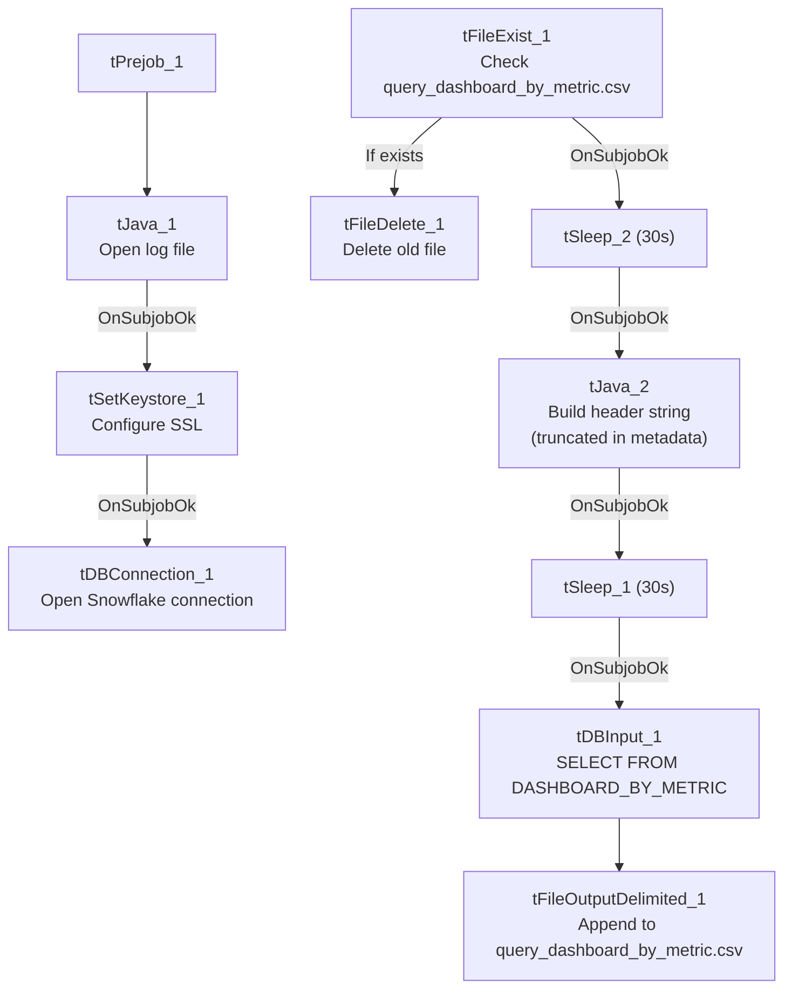

# Talend Job: LW_Dashboard_By_Metric

## Overview

This job extracts a per-metric (not per-agent) rollup of dashboard values — current/previous week, month-to-date compliance percentage, year-to-date value, and variance figures — from a Snowflake publish-schema view (`EDWPRODHH.PUB_LWASHINGTON.DASHBOARD_BY_METRIC`) and writes them to a fixed local-mount CSV file. It is structurally identical to `LW_Dashboard_By_Agent` (same file-reset/header/query/append template) but its query omits the agent-level columns (`AGENT_NAME`, `EMPLOYEE_TYPE`, `SUPERVISOR`), aggregating only by `CAMPAIGN` and `METRIC_NAME`.

## Detail table

| Field | Value |
|---|---|
| Job name | LW_Dashboard_By_Metric |
| Version | 0.1 |
| Project | EDW2SF |
| Author | jmach@harriscollect.com |
| Created | 2025-10-08T13:41:00.128-0700 |
| Last Modified | 2025-11-04T11:08:04.027-0800 |

## Step-by-step data flow

**Setup subjob:** `tPrejob_1` → `tJava_1` opens a per-run log file → on subjob-ok, `tSetKeystore_1` configures SSL → on subjob-ok, `tDBConnection_1` opens the Snowflake connection.

**File-reset subjob** (separate chain): `tFileExist_1` checks whether `/mnt/lsw/query_dashboard_by_metric.csv` exists → if so (`RUN_IF`), `tFileDelete_1` deletes it → on subjob-ok, `tSleep_2` (30s) → `tJava_2` builds a header-record string (truncated in metadata — see Issues observed) → on subjob-ok, `tSleep_1` (30s) → `tDBInput_1` runs the query below.

**Query and output:** `tDBInput_1` → `tFileOutputDelimited_1` appends the rows (`APPEND=true`, `INCLUDEHEADER=false`) to `/mnt/lsw/query_dashboard_by_metric.csv`.

## Settings tables

### Source: `tDBInput_1` (`tSnowflakeInput`)

| Setting | Value | What it means |
|---|---|---|
| Query | `SELECT CAMPAIGN, METRIC_NAME, "Current Week", "Previous Week", "Current Week-2", "Current Week-3", "Compliance % MTD", "Last Month", "YTD Metric Value", "Variance (MoM)", "Variance(Current Week vs Latest Week)" FROM EDWPRODHH.PUB_LWASHINGTON.DASHBOARD_BY_METRIC;` | Same trailing-weeks/MTD/YTD/variance shape as `LW_Dashboard_By_Agent`, but grouped by campaign+metric only — no agent/employee/supervisor breakdown. |

### Target: `tFileOutputDelimited_1`

| Setting | Value | What it means |
|---|---|---|
| FILENAME | `"/mnt/lsw/query_dashboard_by_metric.csv"` | Hardcoded Linux mount path. |
| APPEND / INCLUDEHEADER | `true` / `false` | Same append-without-header pattern as its siblings. |

## Dependencies & configuration

- **Triggers/depends on other jobs:** none.
- **Context variables used:** `keystorePath`, `logDir` only — `outputDir` not referenced.
- **Hardcoded paths:** `tSetKeystore_1.SSL_TRUSTSERVER_TRUSTSTORE`, plus `tFileDelete_1.DIRECTORY`/`PATH` (generic Talend-Studio-workspace placeholder).

## Glossary

| Component type | Plain-English meaning |
|---|---|
| `tFileExist` / `tFileDelete` | Check for and conditionally delete the prior run's output file. |
| `tSleep` | Pauses the job for a fixed duration. |
| `tSnowflakeConnection` / `tSnowflakeInput` | Open a Snowflake connection and run a query against it. |
| `tFileOutputDelimited` | Writes rows to a CSV file. |
| `tSetKeystore` | Configures SSL trust store/keystore for the Snowflake JDBC connection. |

## Issues observed

- **Same truncated header-write pattern as `LW_Dashboard_By_Agent`/`LW_COC_Water_Scrub`** — `tJava_2`'s `headerRecord` string is cut off mid-literal with no visible file-write statement, and `tFileOutputDelimited_1` relies on `INCLUDEHEADER=false`, so a header row may not actually get written if the code truly stops there. See `LW_Dashboard_By_Agent`'s doc for the same finding in more detail — this is a recurring pattern across the `LW_Dashboard_*` and `LW_COC_Water_Scrub` jobs, not unique to this one.
- **Only difference from `LW_Dashboard_By_Agent` is the query's column list** (no agent-level breakdown) and the target table/filename — every other component, connector type, and setting is identical between the two jobs, confirming they share a copy-paste template rather than independent development.
- **Output path hardcoded, not context-driven** — same observation as its `LW_Dashboard_*` siblings.
