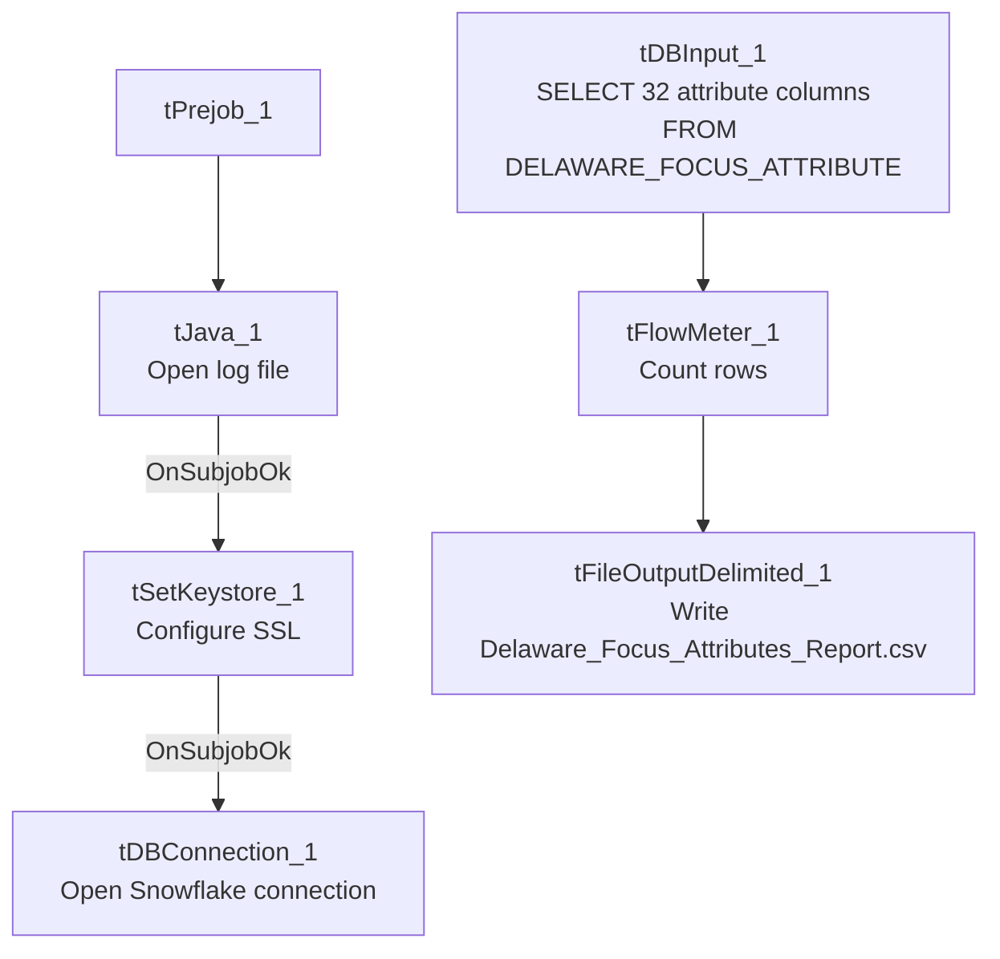

# Talend Job: LW_Delaware_Focus_Attributes

## Overview

This job extracts a fixed set of 32 call-audit compliance attribute scores (second-identifier, compliance statement, negotiation-flow steps, closing steps, documentation steps, etc.) for the Delaware client relationship from a Snowflake view (`PUB_LWASHINGTON.DELAWARE_FOCUS_ATTRIBUTE`) and writes the full result to a CSV report. It is one of three near-identical "Focus Attributes" jobs in this batch (Delaware, HPS, Lurie), each pointed at a client-specific source view and output filename but sharing the exact same 32-column attribute schema — see `LW_HPS_Focus_Attributes` and `LW_Lurie_Focus_Attributes` for the sibling variants.

## Detail table

| Field | Value |
|---|---|
| Job name | LW_Delaware_Focus_Attributes |
| Version | 0.1 |
| Project | EDW2SF |
| Author | jmach@harriscollect.com |
| Created | 2024-07-10T09:30:46.716-0700 |
| Last Modified | 2025-11-16T19:56:44.840-0800 |

## Step-by-step data flow

**Setup subjob:** `tPrejob_1` → `tJava_1` opens a per-run log file → on subjob-ok, `tSetKeystore_1` configures SSL from `context.keystorePath` → on subjob-ok, `tDBConnection_1` opens the Snowflake connection.

**Main flow (no explicit trigger link into it — see Issues observed):** `tDBInput_1` runs the 32-column query below → `tFlowMeter_1` counts rows → `tFileOutputDelimited_1` writes the full result (with header, file recreated each run) to `context.outputDir+"Delaware_Focus_Attributes_Report.csv"`.

## Settings tables

### Source: `tDBInput_1` (`tSnowflakeInput`)

| Setting | Value | What it means |
|---|---|---|
| Query | `SELECT SECOND_IDENTIFIER, IDENTIFY_SELF, COMPLIANCE_STATEMENT, IDENTIFY_CLIENT, STRATEGIC_PAUSES, ACKNOWLEDGE_THE_STAT, TRANSITION_BACK, LISTEN_TO_CONSUMER, REMOVE_ISOLATION, OFFER_TO_HELP, STATE_THE_BALANCE, MAKE_DEMAND_FOR_BALANCE, IF_NOT_BIF_TODAY, WHEN_CAN_REMAINING_BAL, IF_NOT_SOMETHING_TODAY, GATHER_F_AND_C_INFORMATION, WIIFM, F_C_INFORMATION, SELL_THE_URGENCY, EMPHASIZE_TEMPORARY, NEGOTIATE_MAD, EMPATHY_AND_RESPECT, DISPLAYED_COURTESY, SPEED_TONE_AND_VOLUME, MAD, SET_FOLLOW_UP, REGRET, RECAP_AGREEMENT, COMMUNICATE_CONSEQUENCES, CONTACT_INFORMATION, END_WITH_A_PLEASANTRY, ACTION_CODE, ACC_DOCUMENTATION FROM PUB_LWASHINGTON.DELAWARE_FOCUS_ATTRIBUTE;` | 32 numeric (`BigDecimal`, precision 28) attribute-score columns, no client/debtor identifying columns at all — this appears to be an already-aggregated scorecard-attribute summary, not a row-per-call extract. Table name is unqualified (`PUB_LWASHINGTON....`, no `EDWPRODHH.` database prefix) unlike the Dashboard jobs' queries. |

### Target: `tFileOutputDelimited_1`

| Setting | Value | What it means |
|---|---|---|
| FILENAME | `context.outputDir+"Delaware_Focus_Attributes_Report.csv"` | |
| APPEND / INCLUDEHEADER | `false` / `true` | File recreated fresh each run with a header row. |

## Dependencies & configuration

- **Triggers/depends on other jobs:** none.
- **Context variables used:** `keystorePath`, `logDir`, `outputDir`.
- **Hardcoded paths:** `tSetKeystore_1.SSL_TRUSTSERVER_TRUSTSTORE` = `"C:/clientTrustStore.trustStore"`.
- **Sibling comparison:** `LW_HPS_Focus_Attributes` and `LW_Lurie_Focus_Attributes` use the exact same 32-column query and schema, differing only in source view name (`HPS_FOCUS_ATTRIBUTE`, `LURIE_FOCUS_ATTRIBUTES_REPORT`) and output filename. `LW_Delaware_Focus_Attributes_Granular` is a related but structurally different job (2-column name/value pairs rather than 32 wide columns) pointed at a `_GRANULAR` view — see that job's own doc.

## Glossary

| Component type | Plain-English meaning |
|---|---|
| `tSnowflakeConnection` / `tSnowflakeInput` | Open a Snowflake connection and run a query against it. |
| `tFlowMeter` | Counts rows passing a point in the flow. |
| `tFileOutputDelimited` | Writes rows to a CSV file. |
| `tSetKeystore` | Configures SSL trust store/keystore for the Snowflake JDBC connection. |

## Issues observed

- **No explicit trigger link connects the connection-setup subjob to the query subjob** — same gap as `LW_Dashboard_Base_Report`: the `connections` array shows `tPrejob_1 → tJava_1 → tSetKeystore_1 → tDBConnection_1` and `tDBInput_1 → tFlowMeter_1 → tFileOutputDelimited_1` as two unconnected chains. Verify ordering directly in Talend Studio rather than assuming from this metadata.
- **No email or downstream notification** — unlike the `LW_*_Scrub` jobs in this batch, this job has no `tSendMail` component, so its output presumably feeds a BI tool or is picked up by a separate process rather than being emailed directly.
- **Query has no client/debtor identifying columns** — the output is pure attribute scores with no row-level key visible in this metadata (e.g., no debtor number, call ID, or date). Unable to determine from metadata whether the source view itself represents one row per audited call (with a key column simply not selected) or is already a single aggregated summary row; verify with the team before assuming how to join this output back to individual calls.
