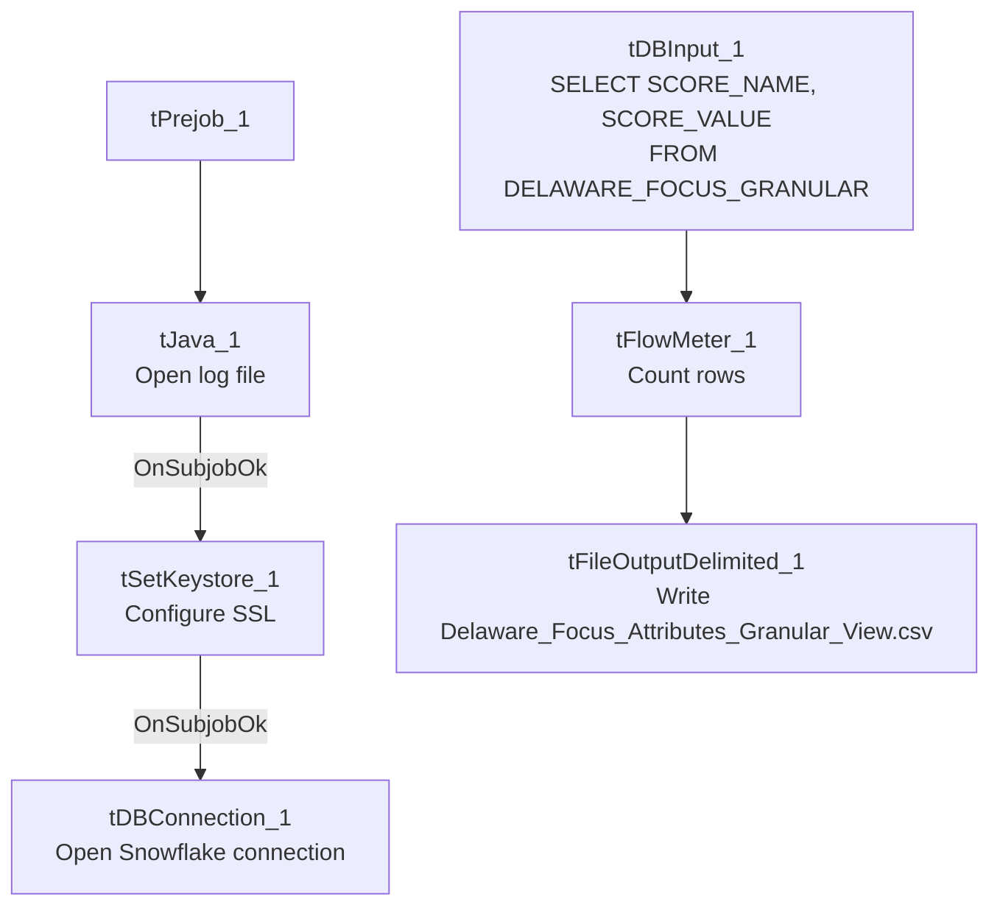

# Talend Job: LW_Delaware_Focus_Attributes_Granular

## Overview

This job extracts a narrow, long-format (name/value pair) view of Delaware focus-attribute scores from a Snowflake view (`PUB_LWASHINGTON.DELAWARE_FOCUS_GRANULAR`) and writes them to `Delaware_Focus_Attributes_Granular_View.csv`. Unlike `LW_Delaware_Focus_Attributes` (32 wide numeric columns, one row presumably per audit period), this job's source appears to already be pivoted into a two-column `SCORE_NAME`/`SCORE_VALUE` shape — likely a per-attribute breakdown feeding a chart or table that needs one row per named score rather than one row with 32 columns.

## Detail table

| Field | Value |
|---|---|
| Job name | LW_Delaware_Focus_Attributes_Granular |
| Version | 0.1 |
| Project | EDW2SF |
| Author | jmach@harriscollect.com |
| Created | 2024-07-10T09:38:23.454-0700 |
| Last Modified | 2025-11-16T19:56:03.248-0800 |

## Step-by-step data flow

**Setup subjob:** `tPrejob_1` → `tJava_1` opens a per-run log file → on subjob-ok, `tSetKeystore_1` configures SSL → on subjob-ok, `tDBConnection_1` opens the Snowflake connection.

**Main flow (no explicit trigger link into it):** `tDBInput_1` runs `SELECT SCORE_NAME, SCORE_VALUE FROM PUB_LWASHINGTON.DELAWARE_FOCUS_GRANULAR;` → `tFlowMeter_1` counts rows → `tFileOutputDelimited_1` writes the result (with header, file recreated each run) to `context.outputDir+"Delaware_Focus_Attributes_Granular_View.csv"`.

## Settings tables

### Source: `tDBInput_1` (`tSnowflakeInput`)

| Setting | Value | What it means |
|---|---|---|
| Query | `SELECT SCORE_NAME, SCORE_VALUE FROM PUB_LWASHINGTON.DELAWARE_FOCUS_GRANULAR;` | Two-column long-format extract: `SCORE_NAME` (string) and `SCORE_VALUE` (BigDecimal, precision 28) — the pivot/unpivot logic that turns the 32-attribute wide table into this long format lives entirely in the Snowflake view, not in this Talend job. |

### Target: `tFileOutputDelimited_1`

| Setting | Value | What it means |
|---|---|---|
| FILENAME | `context.outputDir+"Delaware_Focus_Attributes_Granular_View.csv"` | |
| APPEND / INCLUDEHEADER | `false` / `true` | |

## Dependencies & configuration

- **Triggers/depends on other jobs:** none.
- **Context variables used:** `keystorePath`, `logDir`, `outputDir`.
- **Hardcoded paths:** `tSetKeystore_1.SSL_TRUSTSERVER_TRUSTSTORE`.
- **Sibling comparison:** `LW_HPS_Focus_Attributes_Granular` and `LW_Lurie_Focus_Attributes_Granular` are structurally identical (same 2-column query shape), differing only in source view name and output filename. This job is the granular counterpart to `LW_Delaware_Focus_Attributes` (32-wide columns) and `LW_Delaware_Scorecard_Report`/`LW_Deleware_Audit_Scorecard` (per-call scorecards) — together these represent three different shapes of the same underlying Delaware compliance-scoring data.

## Glossary

| Component type | Plain-English meaning |
|---|---|
| `tSnowflakeConnection` / `tSnowflakeInput` | Open a Snowflake connection and run a query against it. |
| `tFlowMeter` | Counts rows passing a point in the flow. |
| `tFileOutputDelimited` | Writes rows to a CSV file. |
| `tSetKeystore` | Configures SSL trust store/keystore for the Snowflake JDBC connection. |

## Issues observed

- **Same missing explicit trigger link** between the connection-setup subjob and the query subjob as the other Focus Attributes jobs in this batch.
- **No client/debtor/audit identifying columns** — with only `SCORE_NAME`/`SCORE_VALUE`, there's no way from this job's own metadata to tell which audit period, call, or agent a given score row belongs to; that context must live either in the view's own row grouping (not visible here) or be joined downstream by whatever consumes this CSV. Unable to determine from metadata; verify with the team.
- No email/notification, consistent with the rest of this "Focus Attributes" family.
